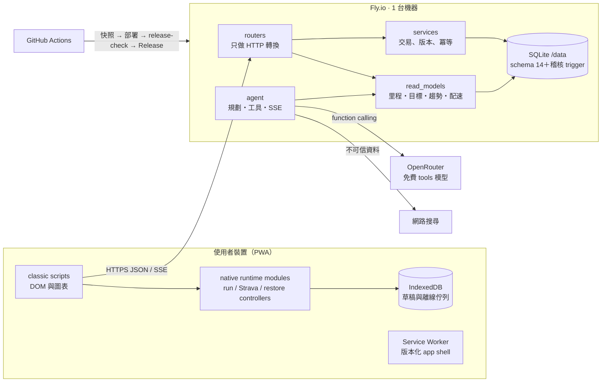

# Running Shoes

**給跑者用的跑鞋與訓練紀錄 App**：記錄每一次跑步的距離、時間和穿哪雙鞋，自動算出每雙鞋的里程、成本與退役時間，並把長期資料整理成訓練趨勢、配速分析與 AI 教練的對話和月報。可以加到手機主畫面當 App 用，離線時也能先記錄、恢復連線後自動同步。

Python 3.11 · FastAPI · SQLAlchemy · SQLite · 原生 JavaScript（不需要打包）· Chart.js · PWA · OpenRouter（function calling）· Docker · Fly.io · GitHub Actions · Playwright

- 線上網址：https://running-shoes.fly.dev （邀請制註冊：向管理員索取邀請碼；每個帳號的資料完全隔離）
- 版本紀錄：[`CHANGELOG.md`](CHANGELOG.md)、相容性與回滾細節 [`docs/release-notes.md`](docs/release-notes.md)
- 授權：[MIT](LICENSE)；內建的 Chart.js 與 marked 也是 MIT，授權全文在 `frontend/vendor/`
- 設計文件：[`docs/architecture.md`](docs/architecture.md)（SDD）、[`docs/testing-strategy.md`](docs/testing-strategy.md)、[`docs/specs/`](docs/specs/)（每個功能一份規格）、[`docs/adr/`](docs/adr/)

---

## 目錄

**作品介紹**

- [專案簡介](#專案簡介)
- [四個分頁，四種用途](#四個分頁四種用途)
- [技術選型](#技術選型)
- [系統架構](#系統架構)
- [核心流程](#核心流程)
- [安全與資料隔離](#安全與資料隔離)
- [設計決策與取捨](#設計決策與取捨)
- [品質：測試與規格](#品質測試與規格)
- [CI/CD 與維運](#cicd-與維運)
- [開發歷程](#開發歷程)

**使用與維運手冊**

- [使用方式](#使用方式)、[目錄結構](#目錄結構)、[快速開始（本機開發）](#快速開始本機開發)
- [功能細節](#功能細節)、[跑步日誌](#跑步日誌)、[AI 教練：對話](#ai-教練對話)、[AI 教練：月度報告](#ai-教練月度報告)
- [開發與測試](#開發與測試)、[統計與操作規則](#統計與操作規則)
- [Docker 部署](#docker-部署)、[Fly.io 部署流程](#flyio-部署流程)、[API 一覽](#api-一覽)

---

## 專案簡介

### 為什麼做這個

跑鞋大約 600～800 km 就該換，但實際穿了多少、哪雙快到了、這個月跑了多少，通常散落在手錶、Strava 和記憶裡。市面上的工具不是只管訓練、就是只管裝備。這個專案把兩者接起來：**每一次跑步都綁定一雙鞋**，鞋的里程、成本、退役預估和訓練分析都從同一份逐筆紀錄算出來。

它從一個單機的 HTML 頁面開始，一路演進成有帳號、有雲端部署、有自動化測試與發版流程、每天實際在用的服務。

### 設計目標

- **數字只算一次、到處一致**：里程、成本、壽命門檻、配速、目標進度都在後端算好；首頁、圖表、月報和 AI 讀的是同一個 read model，AI 只負責把數字寫成文字。
- **不會弄丟或算錯資料**：每筆異動有版本檢查、冪等鍵與同交易的稽核紀錄；里程增減和跑步紀錄在同一個交易完成；刪除可以從異動歷史復原。
- **手機優先、離線可用**：PWA 安裝到主畫面；離線時新增的跑步先存在 IndexedDB 佇列，恢復連線後自動送出且不重複。
- **長期可維護**：每個功能先寫規格（91 份 spec）、每個驗收條件都對應到具名測試；`main` 受保護，只能透過 CI 全綠的 PR 合併。

### 規模

| 項目 | 數量 |
| --- | --- |
| 正式版本 | 125 個 tag，2026-06 開始，目前 v4.26 |
| 自動化測試 | Python 811 項、前端 Node 回歸 255 項、40 組版面設定（WebKit／Chromium × 亮暗 × 10 種尺寸）、真實 CRUD E2E 與 PWA 升級／離線測試 |
| 功能規格 | 91 份 SPEC，每份含 Goals、帳號隔離、migration／rollback 與 AC 追蹤 |
| API | 66 個端點，與 `unit_tests/api_contract.json` 及下方 API 表自動比對 |
| 資料庫 | SQLite schema 14，每一版都有守衛的回滾腳本 |
| 部署 | Fly.io 1 台 256MB 機器＋加密 volume，閒置自動休眠 |

---

## 四個分頁，四種用途

| 分頁 | 用途 | 重點功能 |
| --- | --- | --- |
| **跑步日誌** | 記錄與快速查看當月 | 新增距離、跑步時間（自動算配速）、鞋款與運動類型（路跑／越野跑／健行／步行）；當月月曆、總里程、平均配速、上月同期比較、月底預測；「今天穿哪雙」選鞋建議；Strava 歷史匯入 |
| **跑鞋** | 裝備管理 | 跑步里程（和 Strava 跑步總計一致）與跑鞋里程（含步行、健行）、現役／退役鞋款、里程與壽命進度、每 km 成本、依近 90 天實際使用預估退役日、用途類別覆蓋（Daily／Speed／Tempo／Race）、支出明細、輪替時間軸、距離分布、單鞋分析 |
| **訓練分析** | 長期資料 | 年度目標與每月達標、年度回顧（與前一年同期比較）、熱力圖與連續天數、每週跑量與暴增提醒、每週最長一次、星期幾跑量與配速、年度月跑量對比；**比賽準備**：設定目標賽事後顯示倒數、目標配速、依參考成績預估完賽、長距離是否足夠、近 8 週強度分布，以及依強度上色的配速趨勢；**訓練課表**：依自訂的課表週數（4～24 週，留白從本週排到比賽）與自己近 4 週跑量排出每週建議跑量與最長一次，並建議每週各強度跑幾次（每週 1 次比賽配速，累積期再加 1 次更快或穩定的跑步），標示每週實際跑量、各強度區間的實際／建議次數與完成狀況；最長一次排不到比賽距離 75% 時，說明課表要拉長幾週或平常週跑量要提高多少；前兩週不到建議跑量 6 成時，之後的週改從實際跑量重新累積 |
| **AI 教練** | 對話與月報 | 依你的實際資料回答問題、解說備賽課表與推薦跑鞋（13 個工具、可上網搜尋並附來源）；一鍵產生並保存月度跑步報告 |

另外，側欄的「資料與同步」管理離線佇列、草稿、JSON 帳號備份與合併還原、異動歷史與復原；亮色／暗色主題會套用到整個介面和所有圖表。

---

## 技術選型

| 層 | 選擇 | 理由 |
| --- | --- | --- |
| 後端 | FastAPI＋Pydantic v2＋SQLAlchemy 2 | 型別化的請求／回應契約，輸入驗證寫在 schema；同步 session 配合 SQLite 簡單可靠 |
| 資料庫 | SQLite（WAL、外鍵、busy timeout） | 單機部署、備份就是一份檔案；版本化 migration 與回滾腳本 |
| 前端 | 原生 JavaScript classic scripts＋native ES modules，`build_frontend.py` 產生 HTML／CSS／Service Worker | 沒有打包工具鏈；建置只做樣板組合、資產版號與 CSP 雜湊，可重現且可檢查 |
| 圖表 | Chart.js（固定版本、包含在離線 shell） | 所有圖表讀同一組主題 token，亮暗模式自動對應 |
| AI | OpenRouter，原生 function calling、SSE 串流 | 只用當日熱門、免費且支援 tools 的模型；後端驗證模型清單 |
| 部署 | Docker＋Fly.io（新加坡、256MB、volume） | 最小規格即可運作，閒置休眠降低成本 |
| CI/CD | GitHub Actions＋Playwright（Chromium／WebKit） | 每次 push 跑完整測試；`main` 合併後快照、部署、上線檢查、發版 |

---

## 系統架構



- **依賴方向固定**：routers → services／read_models → models；routers 不建查詢、services 不碰 FastAPI，由 `architecture-check` 在 CI 擋下違規；前端 script 之間的共用名稱與後端過於複雜的函式只准變少（`scripts/architecture_ratchet.json`）。
- **讀寫分離**：`services/` 擁有交易與寫入（版本檢查、冪等回執、里程增減、稽核），`read_models/` 是只讀的使用者範圍統計，HTTP、月報與 AI 工具共用。
- **AI 只讀 read model**：13 個資料庫工具都是既有 read model 的薄 adapter，不自己重算數字；網路搜尋結果一律當成不可信資料。
- **前端狀態有主人**：跑步、Strava、還原等流程的狀態與操作 ID 由 native module 管理，DOM 留在 bridge；登入換帳號時舊請求失效，不會覆蓋新畫面。

完整的模組地圖、圖表與演進順序在 [`docs/architecture.md`](docs/architecture.md)。

---

## 核心流程

### 1. 記錄一次跑步：冪等、版本與同交易的里程

1. 表單送出 `POST /api/runs`，帶 `Idempotency-Key`；離線時先存進 IndexedDB 佇列，恢復後依序重送。
2. 後端取得 SQLite 寫入保留後才檢查配額與版本，在**同一個交易**新增跑步、累加跑鞋總里程與該月跑量，並由 trigger 寫入稽核紀錄。
3. 同一個 key、同一份內容重送會重播原本的回應，不會多記一次里程；內容不同則回 409。

### 2. Strava 匯入：去重、時區與手動紀錄配對

1. 預覽只解析、不寫入：讀繁中／英文欄位，把 UTC 時間（含「晚上」「凌晨」等時段）換成台灣日期，讀移動時間。
2. 以 Strava 活動 ID 去重；刪過的活動有墓碑，不會被再次匯入。
3. 同一天只有一筆距離接近的手動紀錄時，視為同一次跑步，只連結並補上時間，不重複計算里程；無法確定時逐筆列出，由使用者選擇略過、連結或匯入。
4. 匯入在一個交易內完成新增、補時間、日期修正與里程同步。
5. 里程與 Strava 用同一套規則：距離讀公尺欄位，鞋子里程＝跑步＋記在鞋上的步行與暖身，畫面無條件捨去到小數點第一位，和 Strava 裝備清單的數字一致。

### 3. 比賽準備：從目標到建議

1. 跑步時間存成秒數，配速不存、一律由 `run_metrics.py` 推導；平均配速以總時間 ÷ 有時間的距離計算。
2. 使用者設定目標賽事（日期、距離、目標時間）與一筆參考成績。`read_models/race_readiness.py` 用 Riegel 公式預估完賽時間，並以目標配速為基準把每次跑步分成輕鬆、穩定、比賽配速、更快四個強度。
3. 長距離以比賽距離的 75% 為門檻，統計近 8 週的次數、最長一次與每週最長一次；不足時提示在賽前 14 天前補一次，進入賽前兩週改為減量。
4. 前端只畫後端給的數字。以示範資料的 12/13 半馬破二為例：10 km 52:00（28°C）預估 1:54:44，比目標快約 5 分 16 秒；但近 8 週達 15.8 km 的長距離只有 1 次、輕鬆跑只佔 9% 的時間，畫面直接點出「長距離偏少」與「輕鬆跑太少」。
5. `read_models/race_plan.py` 依使用者在比賽設定選的週數（4～24 週；留白時由後端存成距離比賽剩下的週數，最多到距離預設的 8／10／12／16 週，網頁與 API 結果相同）排出課表：起點是課表開始前 4 週的平均週跑量（不到 15 km 以 15 km 起算），每週最多加 10%、最多比起點多 50%、每 4 週一次恢復週、高峰後減量進入比賽週；最長一次每週同樣慢慢加，最多是當週的一半，起點的長跑已超過距離預設高峰時維持不砍。累積期某週的前兩週實際跑量不到建議的 6 成時，這週起改從實際跑量重新累積並標示「已調降」。每週建議 1 次比賽配速跑，累積期週跑量 25 km 以上再加 1 次更快（5K、10K）或穩定（半馬、全馬）的跑步，比賽週只有比賽。最長一次排不到比賽距離 75% 時，回傳要拉長到幾週或平常週跑量要多少才排得到。起點在課表開始後就固定，已開始的週次不會因為新紀錄而改變；每週對照實際跑量與最長一次，達到 9 成算達成。AI 教練用 `race_training_plan` 讀同一份課表來解說，不自己排數字。
6. 早期版本的月份、累積跑量、距離區間與配速分布圖只是描述資料、無法指導訓練，v4.18.0 移除，改成以目標為基準的分析。

### 4. AI 教練：工具呼叫與防止捏造

1. 後端先依問題規劃：私人資料問題先查資料庫工具，市售鞋款問題先搜尋「官方規格」與「台灣價格／評價」。
2. 模型透過 function calling 取得具名 JSON，里程、百分比、成本都是後端算好的；搜尋失敗時禁止模型憑記憶補資料。
3. 回答以 SSE 串流，下方標示資料來源與實際搜尋關鍵字；中斷時保留已顯示內容、不把半截答案放進歷史。
4. 月報把當月統計交給模型寫成固定章節，成功才存入資料庫，之後回看不用再呼叫模型。

### 5. 部署：從 merge 到上線

1. PR 的 5 個測試 job 全部通過才能合併到 `main`。
2. 合併後喚醒正式機器，在 volume 上先做資料庫快照，再部署新映像。
3. `release-check` 匿名、唯讀地確認 schema、API contract、58 個資產的雜湊與 MIME、未登入一律被拒、手機啟動與離線 shell。
4. `package.json` 版號是新的就自動打 tag、用 CHANGELOG 發 GitHub Release；開著的 App 在安全時機自動換成新版。

---

## 安全與資料隔離

| 威脅 | 做法 |
| --- | --- |
| 看到別人的資料 | 每個查詢與異動都帶 `user_id` 條件；跨帳號的鞋款關聯由外鍵與擁有權檢查擋下；測試以兩個帳號驗證每個統計 |
| XSS、點擊劫持 | 嚴格 CSP：只允許同源 script 與建置時算好雜湊的啟動 script，禁止 inline 事件與 `eval`；禁止被 iframe 嵌入、`nosniff`；不可信 Markdown 安全渲染 |
| 暴力登入、濫用 AI | 每帳號／每 IP／全站的限流，以 SQLite 共享計數讓多 worker 共用上限；同一 IP 對同一帳號 15 分鐘內失敗 10 次、或該帳號從各處失敗 100 次就暫時鎖定；AI 另有每帳號／全站每日額度；註冊總數、每人資料量都有上限 |
| 陌生人註冊、帳號被接管 | 預設邀請制註冊，伺服器只存邀請碼雜湊，沒有有效邀請碼時試不出哪些名稱已被使用；邀請碼不能註冊管理員名稱，管理員帳號也不能刪除（權限跟著名稱走）；帳號名稱不分大小寫；改密碼、email 重設或管理員臨時密碼都讓所有舊 token 失效，綁定 email 的帳號會收到通知信；token 綁定帳號本身，帳號刪除後同名重新註冊，舊 token 也進不去；可以一鍵登出所有裝置 |
| 忘記密碼流程被濫用 | 驗證碼 6 位數、10 分鐘、每組最多試 5 次（比對前就計入），每個帳號每天最多試 10 次，只存 HMAC；不論帳號是否存在都回同樣結果；每 IP／帳號／全站都有寄送上限；寄信的 STARTTLS 驗證 Gmail 憑證 |
| 大量請求灌爆服務 | 每個來源位址每分鐘 600 次 API 上限（記憶體計數，不寫資料庫），Fly 另設同時請求上限 |
| 資料遺失 | 每次部署前在 volume 快照；每天把正式資料庫加密（AES-256）後存到 GitHub artifact，保留 30 天 |
| 偷換模型、燒付費額度 | 後端只接受當日免費 tools 模型清單內的模型 ID，前端傳任意 ID 也不會使用伺服器金鑰 |
| 提示注入 | 搜尋結果以不可信的 tool 結果傳入、限制長度並過濾網址；私人資料只來自資料庫工具 |
| 憑證外流 | JSON 備份不含密碼雜湊或 token；改密碼後舊 token 立即失效；log 只記 metadata，不記內容或密碼 |
| 上傳攻擊 | Strava CSV 與備份上傳在 multipart 解析前就限制大小，CSV 逐列解析並限制列數 |
| CI 被植入惡意程式 | 外部 GitHub Actions 全部釘選到 commit SHA，Dependabot 每月更新；Fly 金鑰與備份通行碼只給部署與異地備份的 job，測試 job 拿不到任何 secret |

---

## 設計決策與取捨

| 決策 | 得到 | 代價 |
| --- | --- | --- |
| **單機 SQLite**，不用 Postgres | 沒有額外服務；備份、還原、回滾腳本都是檔案層級；免費方案就能跑 | 只能一台機器；用寫入保留、WAL 與 busy timeout 處理並行 |
| **前端不用框架、不打包** | 沒有建置工具鏈；部署就是靜態檔；CSP 雜湊由建置腳本計算 | classic scripts 共用全域範圍，所以有測試禁止重複的頂層宣告 |
| **計算全在後端、AI 只寫文字** | 首頁、圖表、月報、AI 的數字永遠一致；模型換了也不會算錯 | 每個新問題都要先有 read model 與工具，不能直接丟給模型 |
| **配速不存、由時間推導** | 改距離或時間後配速自動正確；平均一律時間加權 | 每次讀取都要計算（資料量小，成本可忽略） |
| **規格先行、AC 對應具名測試** | 文件與程式不會分歧；`docs-check` 會擋下缺測試的規格 | 每個功能多一份文件的成本 |
| **`main` 只能透過綠燈 PR 合併** | 部署到正式站的版本一定測過；歷史不會被改寫 | 單人維護也要開 PR 等 CI（repo 公開後 Actions 不計分鐘） |

---

## 品質：測試與規格

- **Python 811 項**：API、交易與並行、migration 與回滾、備份往返、帳號隔離、Agent 規劃與工具（外部 LLM 與搜尋一律 mock），一律使用暫存或記憶體資料庫，不碰正式 `shoes.db`。
- **前端 Node 回歸 255 項**：以 `vm` 載入實際前端程式，驗證狀態、競態、草稿、串流與圖表資料。
- **瀏覽器**：Playwright 在 WebKit 與 Chromium 跑 40 組版面設定（含幾何對齊與無溢出）、真實 FastAPI＋暫存 SQLite 的 CRUD E2E、Service Worker 升級與離線；失敗時保存截圖與 trace。
- **修 bug 先寫重現測試**：例如 v4.17.0 的 CI 抓到新圖表檔案重複宣告全域常數，修正時同時加上掃描所有 script 的測試。
- **文件也被測**：`docs-check` 比對 README 的測試數、工具數、API 表、目錄樹與規格的 AC 追蹤，數字對不上 CI 就失敗。

---

## CI/CD 與維運

```text
push 任何分支 ─▶ verify（Ruff、mypy、架構邊界、secret 掃描、依賴弱點、pytest、前端回歸、文件一致性）
               ├▶ frontend-layout ─┐
               ├▶ frontend-e2e    ─┼─ 5 個 job 全綠才能合併到 main
               ├▶ frontend-pwa    ─┤
               └▶ diagnostics-roundtrip
merge 到 main ─▶ 喚醒機器 → volume 上快照資料庫 → 部署 → release-check → 打 tag、發 Release
每週一        ─▶ 在 main 排程跑一次，抓新公布的 CVE
```

- 只有部署 job 拿得到 `FLY_API_TOKEN`；測試 job 沒有任何 secret，fork 的 PR 也拿不到。
- 資料庫：每次部署前在 volume 上快照；另有異地備份、checksum 驗證與隔離還原演練工具（見下方維運手冊）。
- 每次 schema 升級都有守衛的回滾腳本，回到舊映像時舊程式仍能讀資料。

---

## 開發歷程

| 時間 | 版本 | 里程碑 |
| --- | --- | --- |
| 2026-06 | — | 單機 HTML 改成前後端分離（FastAPI＋SQLite），容器化並部署到 Fly.io；多使用者帳號與資料隔離 |
| 2026-07 | v1.x | 第一個正式版；AI 跑鞋推薦助手（function calling、串流） |
| 2026-08 | — | Agent 搜尋規劃與來源卡片；Strava 歷史匯入 |
| 2026-09 | v2.x | 工程 harness（規格範本、`task.py` 單一指令來源、AGENTS.md）；AI 月報；PWA |
| 2026-10 | v2.5–v3.x | 離線佇列與帳號備份還原；側欄工作區改版、運動科技風主題；session 隔離與 SQLite 還原強化 |
| 2026-10～11 | v4.0–4.14 | 安全標頭與 CSP、自動更新、訓練趨勢與年度回顧、AI 讀取統計工具 |
| 2026-11-17 | v4.15–4.17 | repo 公開、每次 push 跑 CI、`main` 保護；跑步時間與配速；Strava 與手動紀錄配對；配速分析 |
| 2026-11-17 | v4.18 | 比賽準備：目標賽事、預估完賽、強度分布與長距離檢查，取代只描述資料的配速圖 |
| 2026-11-18 | v4.19–4.20 | 公開服務防護：AI 每日額度、全站 API 限流、HSTS；邀請制註冊、管理員邀請碼與臨時密碼、刪除帳號；每日加密異地備份 |
| 2026-11-18～19 | v4.21–4.23 | Email 驗證碼找回密碼與密碼變更通知；淺色／深色／跟隨系統；公開 repo 的個人資料清理；新帳號引導 |
| 2026-11-20～21 | v4.23.1–4.26.1 | 資安強化（寄信驗證憑證、管理員名稱保護、驗證碼次數、token 綁定帳號、Actions 釘選 SHA、註冊不洩漏帳號名稱）；AI 即時顯示思考過程；登出所有裝置；MIT 授權；內建函式庫納入稽核；模組解耦；Strava 衝突可自選 |
| 2026-11-21～22 | v4.27–4.29.1 | 時區與帳號名稱修正、管理員與 token 強化；前端核心資料改由唯讀 store 提供；運動類型（路跑、越野跑、健行、步行），Strava 預設不匯入健行與步行 |
| 2026-11-24～25 | v4.29.2–4.29.14 | 解耦與只准變少的架構基準：殼層不再以名稱呼叫功能、沒有互相引用的 script、前端函式不超過 80 行；排程 workflow 續命；免費 AI 模型備援 |
| 2026-11-25 | v5.0 | 比賽訓練課表：自選週數、依自己跑量逐週累積、恢復週與減量、長跑不足時說明怎麼調、落後時往下調、每週各強度建議次數；AI 教練讀同一份課表 |

---

# 使用與維運手冊

以下是目前功能的完整說明、本機開發、部署、備份與 API 參考。

## 使用方式

完整操作說明見 [使用指南：日常記錄、資料與同步、備份及清理本機資料](docs/user-guide.md)。

要把雲端資料帶到本機版：在雲端「資料與同步」按「下載目前帳號資料 JSON」，再於電腦執行的本機版登入、選檔、預覽並確認匯入。「只新增」保留既有內容；「新增並更新同來源資料（v2 以後的備份）」可更新先前匯入的鞋款與跑步、檔案內月份調整、目標和月報，並保留額外資料及已刪除跑步。預覽會顯示接收網站／帳號與新增／更新筆數；不會覆寫整個資料庫，也不會刪除檔案未包含的資料。

一般連線時，跑步新增成功就直接存到雲端，不用按同步。「資料與同步」會依狀態顯示「同步待送跑步」或「更新雲端資料」；草稿、備份、歷史等低頻操作可按標題展開。JSON 不含草稿與待同步紀錄，請先確認沒有待送跑步再下載。「清除此帳號的本機資料」清理的是瀏覽器暫存，不是本機版資料庫；不刪除伺服器資料，但會丟失此裝置尚未同步的紀錄。

### 直接使用線上服務

開啟 [running-shoes.fly.dev](https://running-shoes.fly.dev/)，用管理員給的邀請碼註冊帳號即可開始使用，每個人的跑鞋資料完全隔離。沒有邀請碼時請聯絡管理員。

#### 安裝到 iPhone 主畫面

1. 使用 Safari 開啟線上服務。
2. 點選 Safari 的「分享」按鈕。
3. 選擇「加入主畫面」，再按「新增」。

之後可從主畫面以獨立 App 視窗開啟，並使用「速度線＋箭頭」標誌搭配磨耗進度環的專屬圖示。PWA 本身免費，不需要 TestFlight 或 Apple Developer 帳號。圖表與 Markdown 套件使用專案內固定版本並包含在離線 app shell；application CSS／JavaScript 會以同一版號快取，避免更新後混用新舊介面資產。登入、資料同步與 AI 功能仍需要網路連線。離線時會保留登入狀態，待重新連線後繼續使用。

如果主畫面仍顯示舊圖示，請先刪除原本的主畫面捷徑，再從 Safari 重新執行「加入主畫面」，讓 iOS 重新取得圖示。

> 所有使用者共用同一個 Fly.io 免費容器（256MB RAM），人數或資料量過多可能影響效能。

### 自己部署

開源專案，可依照下方「快速開始」在本機執行，也可以部署到自己的
Fly.io 帳號或其他支援 Docker 的平台。註冊預設需要邀請碼，而邀請碼只有管理員能產生，所以全新部署要先照下方「[第一次建立管理員帳號](#第一次建立管理員帳號)」建立第一個帳號。

## 目錄結構

```
running-shoes/
├── .github/
│   ├── actions/browser-setup/ # 三個 browser jobs 共用的鎖版環境
│   ├── dependabot.yml    # GitHub Actions 每月更新、Python 只收安全性更新
│   ├── pull_request_template.md # PR 需連結 spec／ADR 與驗證結果
│   └── workflows/
│       ├── offsite-backup.yml # 每天下載正式資料庫、還原演練、加密後存成 30 天的 artifact
│       └── verify.yml    # Push／PR 完整 harness 驗證；push 到 main 再自動快照、部署、檢查與發版
├── .claude/
│   └── settings.json     # Claude Code 完成回覆前執行確定性驗證的 Stop hook
├── backend/              # FastAPI 後端
│   ├── main.py           # 最小 ASGI 入口
│   ├── app_factory.py    # 可注入的 FastAPI 組裝、lifecycle 與 SPA fallback
│   ├── settings.py       # Immutable typed runtime configuration
│   ├── clock.py          # 唯一的應用時區、local_now()／local_today()
│   ├── dependencies.py   # Request-scoped app settings 與 DB session（get_db）
│   ├── seeding.py        # 使用注入 session factory 的可選預設資料
│   ├── mailer.py         # Gmail SMTP 寄送驗證碼（未設定時關閉，log 不含收件人與驗證碼）
│   ├── middleware.py     # 安全標頭（CSP frame-ancestors、nosniff 等）、每位址 API 請求上限與 Strava／備份上傳大小限制
│   ├── routers/
│   │   ├── auth.py       # 註冊、登入、密碼管理與刪除帳號 routes
│   │   ├── admin.py      # 管理員的邀請碼與臨時密碼 routes
│   │   ├── goals.py      # 跑量目標 routes
│   │   ├── race_goal.py  # 目標賽事 routes
│   │   ├── monthly.py    # 月跑量 routes
│   │   ├── agent.py      # AI provider 與對話 routes
│   │   ├── reports.py    # AI 月報 routes
│   │   ├── health.py     # Liveness／readiness probes
│   │   ├── analytics.py  # Dashboard 與單鞋分析 routes
│   │   ├── exports.py    # 帳號備份與跑鞋匯出 routes
│   │   ├── spending.py   # 支出統計 routes
│   │   ├── strava.py     # Strava upload／import routes
│   │   ├── workspace.py  # 操作回執、歷史與帳號還原 adapters
│   │   ├── runs.py       # 跑步日誌 CRUD routes
│   │   ├── shoes.py      # 跑鞋 CRUD HTTP routes
│   │   ├── password_notices.py # 改密碼通知信（auth 與 admin 共用，不定義 router）
│   │   └── errors.py     # Service domain error 對應 HTTP 狀態碼
│   ├── services/
│   │   ├── errors.py      # Transport 無關的 application errors
│   │   ├── account_restore.py # 預覽、來源 mapping 與原子合併還原
│   │   ├── account_import_plan.py # User-scoped 來源比對，預覽與執行共用匯入計畫
│   │   ├── account_import_changes.py # 預覽與執行共用的欄位 patch 與預估里程
│   │   ├── account_import.py # 在呼叫端交易內執行匯入計畫（不自行 commit）
│   │   ├── run_identity.py # 刪除墓碑與復原後的來源別名（呼叫端持有交易）
│   │   ├── operations.py  # 操作身分、版本及回執的統一寫入入口
│   │   ├── history.py     # User-scoped 歷史與防衝突誤刪復原
│   │   ├── identifiers.py # 單調遞增 run／month 主鍵配置
│   │   ├── accounts.py    # 註冊容量、密碼 CAS、token revocation、刪除帳號與臨時密碼
│   │   ├── invites.py     # 邀請碼產生、停用與註冊時扣用（只存雜湊）
│   │   ├── email_codes.py # Email 綁定與忘記密碼的一次性驗證碼（只存 HMAC）
│   │   ├── goals.py       # 個人目標 upsert、版本與 rollback
│   │   ├── race_goals.py  # 目標賽事 upsert、刪除與版本
│   │   ├── reports.py     # 月報生成身分、事件及成功保存流程
│   │   ├── report_storage.py # 月報最新生成回執與條件寫入交易
│   │   ├── fingerprints.py # 回執、備份與匯入計畫共用的 payload 指紋
│   │   ├── retention.py  # 每帳號稽核、回執與刪除墓碑的保留上限
│   │   ├── transactions.py # SQLite writer reservation 與交易生命週期
│   │   ├── runs.py       # 日誌寫入、重送、版本與里程交易
│   │   ├── shoes.py      # 鞋款配額、編輯與刪除交易
│   │   ├── monthly.py    # 月跑量與歷史調整交易
│   │   ├── exports.py    # Framework-independent 匯出內容生成
│   │   ├── strava_imports.py # Strava 匯入 transaction 與配對驗證
│   │   └── mileage.py    # 跑步、鞋款、月份彙總的交易式里程同步
│   ├── audit_schema.py   # 同交易異動事件及資料 revision triggers
│   ├── backup_contract.py # 有界 v1～v5 備份格式與參照驗證
│   ├── migrations.py     # 有版本的 SQLite schema upgrade
│   ├── observability.py  # Request ID 與不含敏感內容的結構化 HTTP log
│   ├── rate_limits.py    # Auth／AI／備份預覽／Strava 上傳 SQLite 固定視窗限流（獨立交易、注入設定）
│   ├── auth.py           # HTTP JWT 認證 adapter
│   ├── credentials.py    # 不依賴 HTTP 的 bcrypt／JWT primitives
│   ├── database.py       # ORM base、SQLite pragma 與 engine 工廠（import 無 I/O）
│   ├── models.py         # 資料表定義
│   ├── schemas.py        # Pydantic request／response schema 與輸入驗證
│   ├── agent.py          # AI 助手 runner 與公開 orchestration entry point
│   ├── agent_planner.py  # Deterministic intent 與最小查詢計畫
│   ├── agent_tools.py    # 受信任工具 dispatch
│   ├── agent_protocol.py # SSE 與搜尋來源摘要 contract
│   ├── report_llm.py     # One-shot LLM adapter
│   ├── report_protocol.py # 月報 domain events 的 SSE 序列化
│   ├── forecasting.py    # 共用退役預估與 user-scoped 批次查詢
│   ├── shoe_metrics.py   # 共用折數、成本與壽命算術
│   ├── run_metrics.py    # 跑步時間合理範圍與配速推導
│   ├── read_models/      # API／月報／AI 共用的 user-scoped native statistics 與清單查詢
│   │   ├── shoes.py      # 鞋櫃、生命週期與名稱身分查詢
│   │   ├── shoe_statistics.py # SQL 聚合與每雙鞋 12 筆 recent window
│   │   ├── shoe_matching.py # 名稱消歧義；有歧義時絕不自動選一筆
│   │   ├── runs.py       # 跑步清單、月曆摘要與匯入紀錄
│   │   ├── run_statistics.py # 目標／首頁／月報共用的日曆範圍與距離彙總
│   │   ├── mileage.py    # 月跑量歷史統計（月報與 AI 工具共用）
│   │   ├── spending.py   # 依日曆計算的支出統計
│   │   ├── trends.py     # 熱力圖、連續天數、每週跑量、目標線與輪替時間軸
│   │   ├── pace.py       # 配速趨勢與依目標配速的強度標記
│   │   ├── race_readiness.py # 目標配速、預估完賽、強度分布與長距離準備
│   │   ├── race_plan.py  # 依自己跑量排出的每週備賽課表與實際完成狀況
│   │   ├── highlights.py # 今天穿哪雙、年度回顧與距離分布
│   │   ├── saved_reports.py # 已保存月報的摘要與內容
│   │   ├── strava_preview.py # Strava CSV 配對預覽
│   │   ├── insights.py   # 首頁洞察與單鞋使用分析
│   │   ├── goal_progress.py # 個人月／年跑量目標與達成率計算
│   │   ├── report_snapshot.py # 月報唯讀統計快照與提示詞
│   │   └── rounding.py   # 共用彙總四捨五入 round_metric
│   ├── strava_import.py  # 純 Strava CSV 解析、篩選與領域錯誤
│   ├── exporting.py      # CSV／XLSX 安全匯出列與檔名
│   ├── llm.py            # LLM 抽象層（OpenRouter）
│   ├── tools/            # AI 助手工具
│   │   ├── db_tools.py   # JSON adapters 與受信任工具 registry
│   │   ├── tool_definitions.py # 工具 schema，與查詢／派發分離
│   │   ├── legacy_calls.py # 舊模型文字 tool calls 相容解析
│   │   └── search_tool.py # 上網搜尋市售鞋款（DuckDuckGo）
│   └── run.py            # 本機開發啟動入口
├── frontend/
│   ├── index.html        # 由 templates/ 產生的完整 Dashboard HTML
│   ├── assets.json       # Script 順序、CSS 來源與 PWA revision 的單一清單
│   ├── templates/        # Shell、六個彈窗片段與 worker 的可編輯來源
│   ├── css/              # 依責任拆分的樣式來源，產生單一 styles.css
│   ├── runtime/
│   │   ├── feature-lifecycle.mjs # 功能生命週期
│   │   ├── form-operations.mjs # 操作身分、草稿快照與成功回應合併
│   │   ├── resource-store.mjs # 請求合併、ownership、錯誤與快取失效策略
│   │   ├── workspace-controller.mjs # 注入帳號 storage／session 的草稿與同步佇列
│   │   ├── run-controller.mjs # 注入 transport/session 的跑步 state
│   │   ├── strava-controller.mjs # 預覽、匯入與視窗操作所有權
│   │   ├── account-restore-controller.mjs # 還原預覽的操作、session 與清理所有權
│   │   └── core-data.mjs # 核心資料（鞋款、月跑量、目標、匯入紀錄、支出）的 store、載入規則與唯讀 view
│   ├── app-lifecycle.js  # Legacy handler 與原生 runtime 的過渡橋接
│   ├── app-inline-editors.js # 表格輸入 DOM、列快照與 session 清理
│   ├── app-dates.js      # 日曆日期與跨日限制／恢復
│   ├── app-dialogs.js    # 共用焦點、Tab、Escape 與彈窗語義
│   ├── app-updates.js    # 版本資訊、新部署偵測與確認後才重載的更新提示
│   ├── app-actions.js    # data-* 介面動作的事件委派（不寫 inline handler）
│   ├── app.js            # Dashboard 初始化與全域 dialog wiring
│   ├── app-boot.js       # 啟動 loading、逾時與 stylesheet readiness
│   ├── app-state.js      # 共用記憶體 state 與 presentation constants
│   ├── app-session.js    # 登入 session 身分（token、使用者、世代）與過期通知
│   ├── app-api.js        # HTTP／upload helpers
│   ├── app-auth.js       # 登入、註冊、登出與帳號切換
│   ├── app-streams.js    # 共用 SSE 解碼、取消與完成狀態
│   ├── app-resources.js  # 原生資源模組、session 與功能快取的過渡橋接
│   ├── app-local-store.js # IndexedDB 原子交易 adapter
│   ├── app-workspace.js  # 草稿、資源快照及同步 DOM adapter
│   ├── app-account.js    # 邀請碼註冊、管理員邀請碼／臨時密碼與刪除帳號
│   ├── app-account-restore.js # 還原預覽與視窗操作身分
│   ├── app-history.js    # 異動分頁與誤刪復原 UI
│   ├── app-core.js       # Shell、主題、分頁與聚合資料載入
│   ├── app-dashboard.js  # 首頁卡片、提醒與跑鞋表格
│   ├── app-onboarding.js # 新帳號的三步驟引導卡
│   ├── app-exports.js    # 跑鞋匯出與帳號備份下載
│   ├── app-goals.js      # 年度目標總覽、每月達標與目標設定
│   ├── app-charts.js     # 共用圖表 registry 與 label utilities
│   ├── app-shoe-charts.js # 跑鞋生命週期、成本、時間軸與分配
│   ├── app-monthly-charts.js # 月份／年度選擇、跑量圖表、歷年比較與年度回顧
│   ├── app-trend-charts.js # 訓練趨勢：熱力圖、每週跑量與長距離、星期分布、年度累計
│   ├── app-pace-charts.js # 比賽準備：摘要卡、長距離、強度分布與配速趨勢
│   ├── app-race-goal.js  # 目標賽事表單：新增、修改與刪除
│   ├── app-spending.js   # 支出摘要、圖表與表格
│   ├── app-agent.js      # AI 助手對話與串流呈現
│   ├── app-models.js     # AI／月報共用模型選單
│   ├── app-markdown.js   # 不可信 Markdown 的安全呈現
│   ├── app-reports.js    # 月報讀取、產生與串流顯示
│   ├── app-runs.js       # 跑步 CRUD、分頁與鞋款選擇
│   ├── app-strava.js     # Strava 預覽、配對與匯入 UI
│   ├── app-run-insights.js # 跑步月曆、洞察與單鞋分析 UI
│   ├── app-shoes.js      # 跑鞋編輯與 modal 互動
│   ├── styles.css        # 自動產生的單一樣式資產，請修改 css/ 來源
│   ├── manifest.webmanifest # PWA 名稱、顏色與圖示設定
│   ├── service-worker.js # App shell 快取與離線 fallback
│   ├── offline.html      # 無快取頁面可用時的離線提示（無 script，嚴格 CSP）
│   ├── icons/            # PWA、iOS 主畫面圖示與向量來源 app-icon.svg（node scripts/render_icons.cjs 產生 PNG）
│   ├── vendor/           # 固定版本的 Chart.js 與 marked.js 離線資源
│   └── favicon.svg
├── docs/
│   ├── architecture.md   # SDD：現況架構圖、模組邊界與演進順序
│   ├── testing-strategy.md # TDD：測試層級、追蹤矩陣與完成條件
│   ├── release-notes.md  # 各版本的行為變更、相容性與回滾說明（新到舊）
│   ├── user-guide.md     # 給使用者的操作說明
│   ├── specs/            # Feature spec 範本與 acceptance criteria
│   └── adr/              # 重要架構決策與取捨紀錄
├── scripts/
│   ├── build_frontend.py # 產生／驗證 HTML、CSS、PWA 清單，無 Node build 依賴
│   ├── claude_stop_hook.py # Claude Code 本機驗證與失敗回饋
│   ├── claude_stop_hook_launcher.cjs # 跨 Windows／Unix 尋找專案 Python
│   ├── check_architecture.py # 阻止反向依賴與重複 API route
│   ├── check_secrets.py  # 掃描 tracked files 的明確 credential 特徵
│   ├── check_docs.py     # 核對 README 數字、命令與文件契約
│   ├── document_contracts.py # 本地連結、spec 結構、AC 狀態與測試路徑
│   ├── database_backup.py # SQLite backup／checksum／retention／restore
│   ├── offsite_backup.py # Fly 外部下載、private staging 與隔離還原演練
│   ├── browser_runner.py # Browser 程序 deadline、錯誤落檔與子程序收尾
│   ├── browser_artifacts.cjs # 先存 error、限時 screenshot／trace／close
│   ├── smoke_test.py     # 部署後 health 與 OpenAPI smoke check
│   ├── release_check.py  # 部署後匿名唯讀檢查：schema、API、資產 hash／MIME
│   ├── release_browser.cjs # release-check 的匿名瀏覽器 boot、離線 shell 與 CSP 檢查
│   ├── browser_probe.cjs # 確認 Playwright Chromium／WebKit 在本機真的能啟動
│   ├── worker_update.cjs # Service worker 更新觀察器（瀏覽器與 Node 測試共用）
│   ├── diagnostics_drill.cjs # 產生合成瀏覽器失敗，演練診斷落檔
│   ├── verify_diagnostics.py # 只用標準函式庫驗證下載的合成診斷
│   ├── render_icons.cjs  # 本機由 icons/app-icon.svg 產生 PNG 圖示（不在 CI 執行）
│   ├── rollback_schema_fourteen.sql # Schema 14 → 13 的文件化回滾（保留比賽目標與課表週數欄位）
│   ├── rollback_schema_thirteen.sql # Schema 13 → 12 的文件化回滾（健行里程加回月跑量）
│   ├── rollback_schema_twelve.sql # Schema 12 → 11 的文件化回滾
│   ├── rollback_schema_eleven.sql # Schema 11 → 10 的文件化回滾
│   ├── rollback_schema_ten.sql # Schema 10 → 9 的文件化回滾
│   ├── rollback_schema_nine.sql # Schema 9 → 8 的文件化回滾
│   ├── rollback_schema_eight.sql # Schema 8 → 7 的文件化回滾
│   ├── rollback_schema_seven.sql # Schema 7 → 6 的文件化回滾
│   ├── rollback_preview_schema.sql # 只捨棄暫存還原預覽的回滾
│   └── task.py           # 跨平台 setup、測試、eval 與完整驗證入口
├── unit_tests/           # Pytest、Agent eval、前端邏輯與版面回歸測試
│   ├── agent_eval_cases.json # Agent 工具選擇與安全行為案例
│   ├── frontend_regressions.cjs # Node 回歸測試單一入口
│   ├── frontend/         # 依責任拆分的 Node suite 與共享 helpers
│   ├── frontend_layout.cjs # Playwright 跨瀏覽器版面測試
│   ├── frontend_e2e.cjs  # 真實 FastAPI + 暫存 SQLite 的瀏覽器 CRUD（含 CSP 違規檢查）
│   ├── frontend_pwa.cjs  # 真正 Service Worker 的升級、離線與恢復
│   ├── browser_waits.cjs # 需要 await 的頁面條件等待（waitForAsync）
│   └── token_helpers.py  # 測試專用 token 簽章（正式程式一律使用注入的密鑰）
├── AGENTS.md             # Coding Agent 專案規則與完成條件
├── CLAUDE.md             # 讓 Claude Code 匯入共用的 AGENTS.md
├── CHANGELOG.md          # 版本演進與 release 摘要
├── LICENSE               # MIT 授權
├── pyproject.toml        # pytest、Ruff 與 mypy 設定
├── requirements.in       # 正式環境直接依賴與核准版本
├── requirements.txt      # 含雜湊的完整正式環境鎖定檔
├── requirements-dev.in   # 測試、lint、型別與安全掃描直接依賴
├── requirements-dev.txt  # 含雜湊的完整開發／CI 鎖定檔
├── package.json          # 版號（發版依據）、Playwright 與內建前端函式庫的版本（供稽核）
├── package-lock.json     # 鎖定的 npm 依賴
├── Dockerfile            # Docker 部署用
├── .dockerignore         # 排除 SQLite、備份與 .env
├── fly.toml              # Fly.io 部署設定
└── .gitignore
```

## 快速開始（本機開發）

```bash
# 1. Clone
git clone https://github.com/<你的 GitHub 帳號>/running-shoes.git
cd running-shoes

# 2. 建立虛擬環境
python3 -m venv venv

# 3. 使用虛擬環境安裝開發依賴（包含正式執行、測試與程式碼檢查套件）
venv/bin/python -m pip install --require-hashes -r requirements-dev.txt

# 4. 使用虛擬環境啟動伺服器
venv/bin/python -m backend.run

# 5. 開啟瀏覽器
open http://localhost:8000
```

Windows 把 `python3` 換成 `py -3`、`venv/bin/python` 換成 `venv\Scripts\python`，例如
`py -3 -m venv venv`、`venv\Scripts\python -m backend.run`；本文件其他 `python3 scripts/task.py ...` 指令同理。
本機註冊同樣預設需要邀請碼，第一個帳號請照「[第一次建立管理員帳號](#第一次建立管理員帳號)」建立。

建議直接使用 `venv/bin/python`，因為指令本身就明確指定虛擬環境，不會因為換了
Terminal、忘記 activate，或 IDE 使用另一個 shell 而誤用系統 Python。

專案將直接依賴與可安裝鎖定檔分開：

- `requirements.in`／`requirements-dev.in`：人工維護的直接依賴與核准版本。
- `requirements.txt`／`requirements-dev.txt`：完整鎖定所有間接依賴並附下載雜湊；Docker、Fly.io 與 CI 都使用 `--require-hashes` 安裝，避免不同時間解析出不同套件。

如果只想執行服務、不需要跑測試或程式碼檢查，也可以只安裝
`requirements.txt`。更新 `.in` 後，使用 `uv pip compile` 以跨平台（universal）模式重新編譯兩份鎖定檔，不要直接手改鎖定內容：

```bash
uv pip compile --universal --generate-hashes --python-version 3.11 --no-header requirements.in -o requirements.txt
uv pip compile --universal --generate-hashes --python-version 3.11 --no-header requirements-dev.in -o requirements-dev.txt
```

跨平台模式會保留平台條件，例如 `uvloop` 只在非 Windows 安裝、`colorama` 只在 Windows 安裝；只在單一平台編譯會遺失這些條件，使其他作業系統的 `setup` 失敗。

若偏好先啟用虛擬環境，也可以使用以下等效方式：

```bash
source venv/bin/activate
python -m pip install --require-hashes -r requirements-dev.txt
python -m backend.run

# 使用完畢可離開虛擬環境
deactivate
```

`source venv/bin/activate` 不會另外「載入」套件；它會修改**目前這個 shell** 的
`PATH`，讓 `python` 和 `pip` 優先指向 `venv/bin/`。開啟新的 Terminal、從其他
IDE Task 啟動，或關閉目前 shell 後，都需要重新 activate。可用以下指令確認：

```bash
# 應顯示專案內的 venv/bin/python
which python

# 顯示實際執行器、虛擬環境位置，並確認搜尋套件可匯入
venv/bin/python -c "import sys; from ddgs import DDGS; print(sys.executable); print(sys.prefix); print(DDGS)"
```

第一次啟動會自動建立 `shoes.db`（資料表結構）。本機與 Fly.io 都預設建立空資料庫；只有明確設定 `SEED_DATA=true` 時才會寫入範例資料，且此時必須同時設定 `MIGRATION_PASSWORD`。

### 本機使用 AI 助手

在專案根目錄建立 `.env` 檔，填入 OpenRouter API Key：

```bash
OPENROUTER_API_KEY=<你的 OpenRouter API Key>   # 取得: https://openrouter.ai/keys
# 選填：偏好的模型 ID；只有在當天的免費、支援 tools 模型清單中才會排到第一個，不會啟用付費或已下架模型
# OR_MODEL=<model-id>
# 選填：每個帳號每分鐘最多 AI 請求數（預設 20）
AGENT_RATE_LIMIT_PER_MINUTE=20
# 選填：同一 IP／全站每分鐘 AI 請求上限（預設 30／120）
AGENT_IP_RATE_LIMIT_PER_MINUTE=30
AGENT_GLOBAL_RATE_LIMIT_PER_MINUTE=120
# 選填：每個帳號／全站每日 AI 請求上限（預設 20／200，對話與月報合計；SPEC-071、SPEC-075）
AGENT_DAILY_LIMIT_PER_USER=20
AGENT_GLOBAL_DAILY_LIMIT=200
# 選填：註冊方式 invite（預設，需要邀請碼）／open／closed；其他值一律視為 closed（SPEC-075）
REGISTRATION_MODE=invite
# 選填：管理員帳號（逗號分隔、不分大小寫），可以產生邀請碼和替別人產生臨時密碼；正式站請設為 Fly secret
ADMIN_USERNAMES=
# 選填：寄送驗證碼用的 Gmail 與應用程式密碼；兩個都有才開啟「忘記密碼」與綁定 email（SPEC-079），正式站請設為 Fly secret
SMTP_USERNAME=
SMTP_PASSWORD=
# 選填：SMTP 主機與連接埠（預設 Gmail：smtp.gmail.com／587，STARTTLS）
SMTP_HOST=smtp.gmail.com
SMTP_PORT=587
# 選填：每個來源位址每分鐘最多 API 請求數（預設 600，記憶體計數、不寫資料庫；SPEC-073）
API_RATE_LIMIT_PER_MINUTE=600
# 選填：同一 IP／全站每分鐘登入、註冊、改密碼請求上限（預設 20／60；每次都要做 bcrypt，SPEC-074）
AUTH_RATE_LIMIT_PER_MINUTE=20
AUTH_GLOBAL_RATE_LIMIT_PER_MINUTE=60
# 選填：每個帳號每分鐘最多 Strava 預覽／匯入次數（預設 10；同一時間只處理一個上傳）
STRAVA_UPLOAD_RATE_LIMIT_PER_MINUTE=10
# 選填：帳號總數、每人跑鞋／跑步紀錄筆數及模型列表刷新冷卻秒數（冷卻最多 3600）
MAX_REGISTERED_USERS=100
MAX_SHOES_PER_USER=500
MAX_RUNS_PER_USER=5000
MODEL_REFRESH_COOLDOWN_SECONDS=60
# 選填：全站每分鐘最多強制刷新模型清單次數（預設 10）
MODEL_REFRESH_GLOBAL_PER_MINUTE=10
# 選填：每個帳號／全站每分鐘最多備份還原預覽次數（預設 20／60）
RESTORE_PREVIEW_RATE_LIMIT_PER_MINUTE=20
RESTORE_PREVIEW_GLOBAL_RATE_LIMIT_PER_MINUTE=60
# 選填：每次 LLM 回覆最多輸出 token 數（預設 4096，最低 256）
LLM_MAX_OUTPUT_TOKENS=4096
```

`.env` 會被自動載入，不需要手動 `export`。沒設定也不影響 Dashboard 的其他功能，只是 AI 助手無法使用。
`OPENROUTER_API_KEY`、`OR_MODEL` 與 `LLM_MAX_OUTPUT_TOKENS` 在伺服器啟動時讀入，改了要重新啟動伺服器才生效。

### 執行環境與部署設定

以下變數控制執行環境，本機開發通常都不用設定：

| 變數 | 預設 | 用途 |
| --- | --- | --- |
| `ENVIRONMENT` | `development` | 不是 `development` 就視為正式環境：缺少 `SECRET_KEY` 或少於 32 bytes 時拒絕啟動。Docker 與 Fly.io 設為 `production`。 |
| `SECRET_KEY` | 開發用固定值（啟動時警告） | JWT 簽章密鑰；更換後所有人都要重新登入。 |
| `DB_DIR` | 專案根目錄 | SQLite `shoes.db` 所在目錄；Fly.io 為掛載的 `/data`。 |
| `DATABASE_URL` | `sqlite:///<DB_DIR>/shoes.db` | 完整資料庫連線字串；設定後優先於 `DB_DIR`。 |
| `FRONTEND_DIR` | `frontend/` | 提供靜態前端的目錄。 |
| `SEED_DATA` | 未設定 | 設為 `true` 時寫入範例資料，必須同時設定 `MIGRATION_PASSWORD`。 |
| `FLY_APP_NAME` | Fly.io 自動設定 | 有值時才信任 Fly 代理的 `Fly-Client-IP` 做每 IP 限流。 |

## 功能細節

- **側欄工作區**：桌面版以固定左側導覽切換四個功能（跑步日誌、跑鞋含支出、訓練分析、AI 教練；AI 教練的對話與月報在同一分頁切換），右側完整呈現目前工作內容；手機版以固定底部分頁列切換，標題列「帳號」按鈕點開後可同步資料、切換主題或登出
- **跑鞋分頁摘要卡**：現役跑鞋、跑步里程、跑鞋里程、總花費、平均每 km 成本、換鞋提醒六張卡。跑步里程是所有跑步紀錄的合計與筆數（含已刪除鞋款上的跑步），和 Strava 個人頁的跑步總計同一口徑；跑鞋里程是所有跑鞋的里程合計，包含記在鞋上的步行與健行，兩者都無條件捨去到小數點第一位（SPEC-070）
- **跑鞋全生命週期追蹤**：記錄品牌、鞋款、用途類別 (Daily / Speed / Tempo / Race，可多選)、購買日期、尺寸、價格、里程、預期壽命、月跑量
- **購鞋資訊集中管理**：現役／退役跑鞋清單聚焦使用狀態；尺寸、買價、原價、折數統一在「跑鞋 → 支出明細」查看。新增／編輯跑鞋仍保留原有尺寸與價格欄位，不刪除既有資料
- **鞋櫃類別覆蓋分析**：判斷某雙鞋退役後其所有用途是否仍有其他現役鞋覆蓋，避免不必要地補鞋 (支援多用途鞋款)
- **智慧試算**：自動計算每 km／每次穿著成本、折數、生命進度，並依近 90 天實際使用預估退役日期；還沒穿過的新鞋才用計畫月跑量，穿過但近 90 天沒穿的鞋（比賽鞋、健行鞋）不預估、顯示「—」，已退役的鞋也不再預估，退役表格的「預估退役」欄顯示「已退役」，與現役表格欄位對齊（SPEC-069、SPEC-117）
- **一致的換鞋提醒**：所有頁面、提醒與 AI 工具共用同一套門檻：達預期壽命 80% 開始注意、90% 可以準備換鞋（標紅）
- **一致的退役預估**：跑鞋清單、時間軸及單鞋分析共用後端預估；有近 90 天紀錄時使用實際月均，否則回退計畫月跑量。清單日期提示及分析卡片會標示依據；無法預估或已達壽命時不虛構日期
- **圖表視覺化**：生命進度條、每 km 成本比較、退役時間軸、近 90 天月均里程佔比（各現役鞋近 90 天實際月均，圓餅圖直接標示公里數與百分比，中間為合計，Chart.js）
- **訓練趨勢**：訓練分析分頁的年度跑步熱力圖與連續天數、每週跑量（預設最近 16 週，可用「‹ 較早／較晚 ›」在選定年份內一次切換 16 週，過去的年份也能看到 1 月起的每週資料；4 週平均線、週目標虛線，比前 4 週平均多 30% 以上的週次標橘色）、每週最長一次的趨勢（和每週跑量一起切換；準備長距離比賽用，近期平均只算已結束的週）、這一年星期幾的跑量分布、平均每次距離與平均配速、年度累計跑量對照目標線；週目標＝年度目標 × 7 ÷ 全年天數，和年度目標線同一斜率（SPEC-056）；跑鞋分頁的輪替時間軸只列現役鞋，並標出超過 30 天沒穿的鞋；提示框顯示和跑鞋清單一致的鞋子里程，並拆成跑步與「步行與暖身」（記在鞋上但不在跑步日誌的里程，例如 Strava 的步行活動），跑鞋里程的顯示規則與 Strava 相同（見「Strava 歷史資料匯入」的里程對帳，SPEC-067、SPEC-068）
- **運動科技風介面**：碳黑底配細格線，螢光黃綠（volt）代表距離與主要操作，青色代表金額與「目前」，數字使用 DIN 風格字體（iOS／macOS 的 DIN Alternate、Windows 的 Bahnschrift，沒有時回退系統字體），分頁與品牌使用線條 SVG 圖示
- **淺色／深色／跟隨系統**：側欄（手機在「帳號」選單）與登入頁都可以三選一，預設跟隨裝置設定，裝置切換時即時更新；偏好只存在這台裝置（SPEC-082），全域 UI 元素與所有 Chart.js 圖表（網格線、刻度文字、數據標籤、跑鞋磨耗色階）都讀同一組 CSS 主題 token 自動對應色調，偏好透過 `localStorage` 自動記憶
- **安全的里程統計**：跑鞋與月跑量都明確區分「逐筆跑步日誌」與「歷史／手動調整」（月跑量的手動調整自 v4.1.2 起不再提供網頁編輯，資料保留），手動總數不能低於日誌合計；所有新輸入的里程與金額統一保存至小數點後兩位
- **跑步日誌**：預設首頁，可記錄日期、公里數與鞋款並同步里程；完成日期不得晚於今天。「今天」一律以台灣時間計算，人在國外時預設日期也照台灣日曆（SPEC-093）
- **今天穿哪雙**：跑步表單下方依休息天數建議現役鞋（快到退役里程的鞋排最後），可一鍵選入
- **比賽準備**：訓練分析分頁可設定一個目標賽事（日期、距離、目標時間，選填參考成績與當天氣溫）。目標時間與參考成績時間同樣可以只打數字（`15959` → `1:59:59`）；目標存在帳號裡，換裝置也在，直到修改或刪除。依參考成績以 Riegel 公式預估完賽時間（參考成績在 25°C 以上會標示偏保守）；以目標配速為基準把每次跑步分成輕鬆（慢 45 秒以上）、穩定、比賽配速（快 10 秒到慢 15 秒）與更快，顯示近 8 週的時間占比；以比賽距離 75% 為長距離門檻，檢查近 8 週次數（建議至少 2 次）、最長一次與近 12 週每週最長一次，並提示最後一次長距離的期限（賽前 14 天）。配速趨勢依強度上色並畫出目標配速，配速軸越上面越快（SPEC-065）
- **年度回顧與對比**：訓練分析分頁頂端唯一的年份選單切換年度回顧、訓練趨勢與所有年度圖表；年度月跑量對比把每年畫成一條線，已經開始但沒有跑步的月份畫成 0，線不會斷開，還沒到的月份才留白（SPEC-072）。進行中的年份與前一年**同期**（1/1 到同一天）比較，已結束的年份才比全年（SPEC-055）
- **一致的鞋款顏色**：同一雙鞋在所有圖表與表格使用相同顏色；跑鞋分頁另有每雙現役鞋的跑步距離分布（<5 紅、5–10 黃、10–15 綠、15–20 藍、≥20 km 紫；只算路跑與越野跑）
- **跑步洞察首頁**：當月會以相同天數比較上月同期，並顯示近 7 天趨勢、月目標、月底里程預測及鞋款壽命提醒
- **手機跑步摘要**：六張摘要卡片統一以兩欄三列排列，同列等高；分析載入／失敗訊息與鞋款提醒維持全寬
- **單鞋分析**：可檢視穿著次數、30／90 天里程、最後使用日期、壽命進度、預估退役、近 12 月趨勢與最近使用紀錄（含健行與步行並標示類型；平均配速只算路跑）
- **跑步時間與配速**：新增或編輯跑步時可選填跑步時間（`32:15`、`1:05:30` 或整數分鐘；手機數字鍵盤沒有冒號，直接打 `3215`、`10530` 會自動補成 `32:15`、`1:05:30`），後端自動算配速（只改距離而與原本的時間換算出不合理的配速時，會請你一併修改或清除時間）；列表、月份卡片與單雙鞋分析顯示配速與時間加權的平均配速
- **Strava 歷史匯入**：從 Strava 匯出的 `activities.csv` 預覽並批次匯入跑步活動與移動時間，依活動 ID 去重，支援匯入前逐鞋款配對；重新匯入可替既有紀錄補上跑步時間；CSV 與資料庫工作在 worker thread 順序執行，HTTP 仍等待交易完成，不是背景佇列
- **帳號與註冊**：註冊預設需要邀請碼（`REGISTRATION_MODE=invite`，也可設為 open 或 closed）。管理員（`ADMIN_USERNAMES`）在側邊欄的「邀請碼管理」（只有管理員看得到）產生邀請碼：可自訂好記的邀請碼（4～20 個英文字母或數字，不分大小寫；留空自動產生 8 碼），並設備註、使用次數（最多 20）與有效天數（最多 90），邀請碼只在產生時顯示一次，伺服器只存雜湊；也可以替忘記密碼的人產生一次性的臨時密碼，對方的登入會全部失效。帳號名稱不分英文字母大小寫。任何人都可以在「資料與同步」更改密碼（知道目前密碼時；忘記密碼請用登入頁的「忘記密碼？」），或輸入密碼後永久刪除自己的帳號與所有資料（管理員帳號不能刪除，要先從 `ADMIN_USERNAMES` 移除；尚未註冊的管理員名稱只有全新部署的第一個帳號能註冊，SPEC-085、SPEC-093）；手機遺失或懷疑別人登入過時，可以在「資料與同步」按「登出所有裝置」（SPEC-088）；登入與註冊頁有隱私說明（SPEC-075）
- **新帳號引導**：新帳號的跑步頁最上方有「開始使用：三個步驟」：新增第一雙鞋、記錄跑步或匯入 Strava、設定月目標，每步都有直接開啟表單的按鈕，完成會打勾；三步都完成或按「略過引導」（只記在這台裝置）後不再顯示（SPEC-084）
- **密碼變更通知**：綁定 email 的帳號在更改密碼、用 email 驗證碼重設或管理員產生臨時密碼後，會收到通知信（帳號、台灣時間、方式；不是本人操作時用「忘記密碼？」重設）（SPEC-083）
- **Email 找回密碼**：在「資料與同步」綁定 email（輸入寄到信箱的 6 位數驗證碼才會綁定），忘記密碼時在登入頁「忘記密碼？」用帳號或 email 收驗證碼並設定新密碼，舊的登入全部失效。驗證碼 10 分鐘內有效、每組最多試 5 次，每個帳號每天最多試 10 次（重寄不重算，SPEC-085），只存 HMAC；不論帳號是否存在都顯示同樣訊息，寄送次數有限制。需要 `SMTP_USERNAME`／`SMTP_PASSWORD`（專用 Gmail 與應用程式密碼）；沒設定時 Email 區塊隱藏，「忘記密碼」會提示找管理員產生臨時密碼（SPEC-079）
- **資料匯出與備份**：跑鞋可匯出 **XLSX / CSV**，並可下載不含密碼或 token 的完整 JSON 帳號備份（跑鞋、日誌、月跑量、目標、月報與 Strava 匯入摘要）
- **AI 跑鞋推薦助手**：依你的實際資料給換鞋與選鞋建議（需設定 OpenRouter API Key），可從本日熱門、免費且支援工具呼叫的模型中選擇
- **AI 月度跑步報告**：可自行選擇本日免費模型，一鍵產生指定月份的跑步報告（跑量趨勢、鞋款狀態、退役提醒與下月建議），報告自動保存、可隨時回看，不需重打 LLM；更新時間以帶 offset UTC 傳輸，生成與重新讀取皆顯示裝置本地時間
- **安全的編輯與串流**：跑步／月跑量／跑鞋視窗保存開啟時的 ID、版本與 session；重新載入後仍由後端檢查衝突。跑鞋儲存、刪除與移動防止重送，晚到回應不關閉新草稿。AI／月報共用串流處理，AI 中斷會保留可見內容、提示重試，不把半截答案放進歷史
- **按需圖表**：只建立或更新目前分頁的圖表；未變更的分頁可重用，資料或主題更新後在切入時重繪，年度跑步資料只在訓練分析分頁需要時載入
- **個人跑量目標**：預設自 2026 年起每月 125 km，年度目標自動以月目標 × 12 計算；目標、首頁與 AI 月報統一以逐筆跑步日誌計算。訓練分析分頁的年度目標卡依上方年份一次列出 12 個月是否達標、年度累計與今天應有的進度、年底前每週需求及本月進度；「調整目標」展開後才能修改每月目標與開始計算的年份
- **瀏覽器安全防護**：頁面有嚴格的 Content-Security-Policy，只允許同源 script 與建置時算好雜湊的三段啟動 script，inline 事件屬性、`eval` 與外部 script 都會被瀏覽器擋下；所有回應帶 `nosniff`、禁止被嵌入 iframe 等安全標頭；API 只接受同源呼叫（不開放 CORS）
- **多使用者隔離**：每人資料完全獨立，支援邀請制註冊、登入、登入後改密碼與 email 找回密碼；認證表單防重送，切換表單／session 使舊操作失效。切換帳號會清除洞察快取並取消 AI 串流，過期回應不覆蓋新登入或 UI 狀態

## 跑步日誌

登入後切換到「跑步日誌」頁籤，即可為每次跑步選擇日期、公里數與穿著的鞋款。日誌支援新增、編輯與刪除，現役與已退役鞋款都可使用。

「跑步日誌」位於第一個分頁，也是固定首頁。每次登入、重新整理、重新開啟網站／PWA，或由瀏覽器 back-forward cache 還原文件時，都會回到此頁，不再記憶上次停留的分頁；登入狀態與主題偏好照常保留。單純切換 App／瀏覽器分頁後回到原畫面不會強制切頁。從此處新增的距離會同步累加到所選跑鞋的總里程，以及該年月的月跑量；如果該月份尚無紀錄，系統會自動建立。編輯距離、日期或鞋款時只套用前後差額，刪除時則同步扣回。既有歷史資料不會在升級時重新計算。

每筆紀錄可以選擇運動類型：路跑（預設）、越野跑、健行或步行（SPEC-096、SPEC-097）。所有類型都計入鞋子里程、壽命提醒與退役預估；越野跑另外計入月跑量、目標、熱力圖、連續天數與每週跑量，但不進入配速分析；健行與步行只計入鞋子里程。配速趨勢、平均配速與比賽準備度只看路跑，避免爬升與健行拉慢配速。新增紀錄時，類型預設為所選鞋款在目前載入紀錄中最近一次的類型；表單會提示這個類型計入哪些統計。把紀錄改成健行／步行或改回跑步時，月跑量會跟著移動，鞋子里程不變。

跑步日誌會即時計算（月曆、卡片與鞋款分布只算路跑與越野跑，健行與步行不會出現，SPEC-098）：

- 總里程（路跑＋越野跑）、跑步次數與跑步天數，以及有填時間的路跑的平均配速
- 平均每個跑步日的里程
- 當月跑步里程最高的主力鞋
- 1 日到月底的完整互動月曆；顯示每日跑步里程與鞋款名稱，不顯示次數。空白日期可帶入新增表單，鞋款活動可篩選當日明細再編輯
- 跑步明細每頁 200 筆，月曆、總里程、跑步次數與鞋款分布不受目前明細頁影響
- 依鞋款匯總的跑步里程分布圓環圖，以及各鞋實際里程與使用比例明細
- 紀錄列表仍會列出健行與步行（標示類型），方便編輯或刪除；按月曆某天篩選時，同一天的健行與步行也會列出
- 每筆紀錄的跑步時間、配速、運動類型（越野跑、健行、步行會標示）與來源標籤（手動或 Strava）
- 當月截至今天與上月同期、前 7 天的趨勢比較，以及月目標與鞋款壽命提醒；已結束月份維持整月比較，未來月份不會混入前一月資料
- 依目前節奏預測月底總里程，並顯示達標所需的每日里程
- 每雙鞋在所選月份的里程、穿著次數及占比

跑步紀錄儲存在 SQLite `runs` 資料表，每筆資料都會綁定帳號與該帳號擁有的鞋款。後端會驗證鞋款擁有權，並啟用 SQLite 外鍵約束，避免無效或跨帳號的鞋款關聯。編輯時會檢查紀錄版本；同一筆紀錄若已在其他分頁被修改，較舊的畫面會收到衝突提示，避免重複套用里程差額。刪除已有跑步紀錄的鞋款時，鞋款會從鞋櫃與未來選項中移除，但歷史跑步紀錄與月跑量仍會保留。每個帳號預設最多儲存 5,000 筆跑步紀錄，可用 `MAX_RUNS_PER_USER` 調整。前端只分頁載入目前查看月份；鞋款年度堆疊圖切換年份時才按需載入該年的後端彙總矩陣，避免每次操作都下載完整歷史。

| API | 用途 |
| --- | --- |
| `GET /api/runs` | 取得目前帳號的跑步紀錄；可用 `year`、`month`、`limit`（最多 500）與 `offset` 篩選／分頁，不帶參數時維持完整列表相容性 |
| `GET /api/runs/summary` | 指定 `year`、`month` 的完整月曆、鞋款彙總與總數（只算路跑與越野跑，健行與步行不在其中），以及路跑平均配速，不受明細分頁影響 |
| `GET /api/runs/totals` | 帳號所有跑步（路跑與越野跑，不含健行與步行）的筆數與總距離（和 Strava 的跑步總計相同口徑） |
| `GET /api/runs/year-summary` | 指定 `year` 的完整年度每月／每鞋里程矩陣；一次聚合查詢，不下載逐筆日誌 |
| `GET /api/running-goal/progress` | 指定 `year`、`month` 的日誌目標進度，與首頁／月報共用後端規則 |
| `GET /api/running-goal/year?year=` | 年度目標總覽：12 個月日誌里程與達標狀態、年度進度、今天應達里程與每週需求 |
| `GET /api/spending/summary` | 後端計算的總支出、折數、平均月支出與月份明細 |
| `POST /api/runs` | 新增日期、公里數、鞋款與選填的 `duration_seconds`（跑步時間，秒）、`activity_type`（`road`／`trail`／`hike`／`walk`，預設 `road`） |
| `PUT /api/runs/{run_id}` | 編輯指定跑步紀錄（含 `activity_type`）；`duration_seconds: null` 會清除時間 |
| `DELETE /api/runs/{run_id}` | 刪除指定跑步紀錄 |
| `GET /api/runs/import/strava/history` | 取得最近 10 次 Strava 匯入摘要 |
| `POST /api/runs/import/strava/preview` | 預覽 Strava CSV 中的跑步活動與鞋款配對；`include_walks_hikes=true` 時納入健行與步行，回應的 `walk_hike_count`／`walk_hike_km` 是這段期間的健行與步行 |
| `POST /api/runs/import/strava` | 依鞋款配對批次匯入 Strava 跑步活動；選填 `conflicts` 決定每筆當天已有手動紀錄的活動要略過、連結或匯入；`include_walks_hikes=true` 才匯入健行與步行（`skipped_walk_hike` 回報略過筆數） |
| `GET /api/analytics/dashboard` | 取得指定月份的趨勢、目標、月底預測與壽命洞察 |
| `GET /api/shoes/{shoe_id}/analytics` | 取得單雙鞋的使用、成本與退役預測 |
| `GET /api/analytics/pace` | 取得全部紀錄的配速趨勢；有目標賽事時每筆帶強度 |
| `GET /api/analytics/race` | 取得目標賽事的倒數、目標配速、預估完賽、強度分布、長距離準備與每週訓練課表 |
| `GET /api/analytics/trends?year=&weeks_end=` | 取得年度每日跑量、連續天數、16 週跑量（`weeks_end` 選填，切換到這一年較早的 16 週）與年度累計目標線 |
| `GET /api/analytics/shoe-timeline` | 取得每雙鞋首次／最後跑步期間、鞋子里程與跑步以外的里程、閒置提醒 |
| `GET /api/analytics/home` | 取得「今天穿哪雙」選鞋建議 |
| `GET /api/analytics/year-review?year=` | 取得指定年份的年度回顧 |
| `GET /api/analytics/shoe-distance-mix` | 取得每雙現役鞋的跑步距離分布（不含健行與步行） |
| `GET /api/export/account` | 下載不含驗證秘密的完整 JSON 帳號備份 |

### Strava 歷史資料匯入

在「跑步日誌」右上角按「匯入 Strava」，選擇 Strava 匯出資料夾中的 `activities.csv`（Strava 官方匯出方式請參考[說明](https://support.strava.com/hc/en-us/articles/216918437-Exporting-your-Data-and-Bulk-Export)）。系統支援繁體中文與英文 Strava 匯出欄位及日期格式，只會保留活動類型為跑步（`Run`、`VirtualRun`→路跑；`TrailRun`→越野跑）且落在所選起訖日期內的資料（包含開始與結束當天），騎車等其他活動略過。健行（`Hike`）與步行（`Walk`）預設不匯入，預覽會顯示這段期間有幾筆、幾公里；勾選「也匯入健行與步行」後才會納入，並只計入鞋子里程（SPEC-097）。以前的版本不匯入這兩種活動，如果你已經把它們的里程手動加在鞋子上，請不要勾選，否則會重複計算，將 Strava 的公尺距離轉換為公里，並先顯示真正待匯入的鞋款筆數與里程；已存在或同檔重複的活動會另外計數，不會混入鞋款配對合計。日期預設為前 13 個完整月份、不包含本月，調整後會依登入帳號保存在目前瀏覽器。

匯入前可逐組選擇現有鞋款；名稱只有一個相符候選時會自動配對，也可以把多個 Strava 裝備配到同一雙 Dashboard 跑鞋。如果同品牌型號有多雙，系統不會猜測，請依購買日期手動選擇。沒有鞋款或無法辨識的裝備可以選擇略過。

Strava 匯出的活動時間是 UTC，系統會換算成台灣日期：清晨 6:30 的跑步（UTC 前一天 22:30）記在當天，不會跑到前一天或上個月。繁中匯出的「凌晨、清晨、上午、中午、下午、晚上」等時段都會換算（SPEC-063）。v4.7.0 以前匯入的紀錄只取了 UTC 日期；用涵蓋那段時間的匯出檔重新預覽時，會顯示「另有 N 筆既有紀錄的日期會依台灣時間修正」，匯入時一併修正並把里程移到正確月份。只修正仍停在舊 UTC 日期的紀錄，自己改過日期的不會被覆蓋。

匯入時會讀取「移動時間」（`Moving Time`，沒有時用「經過時間」）作為跑步時間，配速與 Strava 顯示的一致。時間缺漏或換算配速不合理（每公里快於 1:00 或慢於 60:00）時，活動照常匯入，只是沒有配速。先前匯入、還沒有時間的紀錄，用同一份 CSV 重新預覽會顯示「另有 N 筆既有紀錄會補上跑步時間」，匯入時只補上缺少的時間，已有的時間（包括手動填的）不會被覆蓋；只需要補時間、沒有新活動時也可以按匯入（SPEC-060）。

手動輸入過的跑步不會被重複匯入（SPEC-062）。同一天只有一筆手動紀錄、距離也接近（差距在 0.3 km 或 5% 以內）時，系統把它視為同一次跑步：不新增，而是連結到那筆紀錄，並在它沒有時間時補上移動時間；手動填的距離、日期、鞋款與時間都不會改，里程也不變。當天有手動紀錄但距離差太多，或同一天有多筆而無法一對一時，預覽會在鞋款配對下方逐筆列出，每筆可以選擇略過（預設，不匯入）、連結到當天某一筆手動紀錄（距離、鞋款照手動輸入，距離接近時才補上時間），或匯入為新紀錄（SPEC-091）。連結後的紀錄之後會被當成已匯入，刪除後也不會再被匯回來。

Strava 匯入後會自動同步跑鞋總里程與對應月份的月跑量，只有本次真正新增的活動會計入。每筆匯入資料會保留 Strava 活動 ID，因此重複選擇同一份 CSV 不會重複建立紀錄或再次增加里程。刪除過的 Strava 跑步也不會因為再次匯入而回來：預覽會顯示「另有 N 筆先前刪除過的活動不會重新匯入」，真的要找回可以到異動歷史復原（SPEC-055）。匯入仍受 `MAX_RUNS_PER_USER` 上限限制，CSV 最大為 10 MB、最多 50,000 筆資料列；後端會逐列解析，並在 multipart 解析前限制整體上傳請求為 11 MB。切換檔案或日期時，舊的預覽請求會被取消且結果不會覆蓋最新選擇。

#### 里程如何與 Strava 對帳（SPEC-067、SPEC-068）

App 的主要資料來源是 Strava 匯入，所以鞋子里程刻意採用和 Strava 完全相同的計算與顯示方式：

| 項目 | Strava | Running Shoes |
| --- | --- | --- |
| 每筆距離 | 以公尺記錄（到 0.1 m） | 讀匯出檔的公尺欄位，換算公里後四捨五入到 0.01 km |
| 鞋子里程 | 掛在這雙鞋的所有活動合計（跑步、步行、健行…） | 紀錄合計（路跑、越野跑與健行）＋「步行與暖身」（記在鞋上、但不在紀錄裡的里程） |
| 畫面顯示 | 無條件捨去到小數點第一位（512.352 → 512.3） | 同樣無條件捨去到小數點第一位；儲存值與行內編輯保留完整數字 |

- `activities.csv` 有兩個「距離」欄位：第一個是公里，Strava 已**無條件捨去**到小數點第二位（7285.7 m 寫成 7.28）；第二個是公尺。匯入只讀公尺欄位，避免每筆少算幾公尺、累積下來每雙鞋差到 0.2～0.5 km。
- 匯入只收跑步類型，步行、健行不會變成跑步紀錄，所以週跑量、長距離、配速與比賽準備只看跑步。步行仍然會磨鞋，所以鞋子里程應該和 Strava 一樣包含它：在跑鞋清單雙擊里程，填入 Strava「我的鞋履」上的數字，差額就記為「步行與暖身」，輪替時間軸會分開顯示。
- 鞋子里程不能低於這雙鞋的跑步合計。如果 Strava 的數字比 App 的跑步合計還小，通常是匯入時把別的裝備配到這雙鞋，請先把那些跑步移回正確的鞋。

系統另保存成功匯入的摘要（不保存 CSV 內容），每個帳號保留最近 50 次並提供最近 10 次結果，包含時間、日期區間、新增里程與新增／重複／未配對／格式略過筆數。跑步日誌會顯示最近一次結果，下次開啟匯入視窗時則以最近匯入結束日的隔天作為起始日、今天作為結束日；若紀錄已到今天或未來，起始日會安全地停在今天。

## AI 教練：對話

「AI 教練」分頁的對話會依你的**實際資料**回答訓練問題、給換鞋與選鞋建議：

- 讀取你的跑鞋清單、剩餘壽命、每月跑量趨勢、目標進度、訓練趨勢、年度回顧與買鞋支出（只看你自己的資料）
- 找出接近預期壽命、該準備替換的鞋
- 上網搜尋市售鞋款、規格、評價、價格；網址由後端驗證後顯示為安全來源卡片
- 以繁體中文對話，過程逐步顯示推理與工具呼叫（SSE 串流）；推理模型回答前的思考內容會即時顯示在答案上方，開始回答後收合成「💭 已思考 N 秒」，點開可再看；還沒有任何內容時，泡泡顯示「思考中… N 秒」。思考內容不保存，也不送回下一輪（SPEC-086）
- 使用 OpenRouter / OpenAI 原生 function calling；模型清單只顯示本日總使用量前 50 名中，免費且宣告支援 `tools` 的模型；前 50 名沒有時，改列整份本日排行榜中用量最高的 5 個（SPEC-118）
- 資料庫工具回傳具名 JSON；里程、剩餘壽命、百分比、成本與跑量統計由後端計算，LLM 只負責文字分析
- 詢問市價、最新評價、上市資訊或具體市售鞋款規格時，後端會先用「官方規格」與「台灣價格／評價」查詢；搜尋失敗時禁止模型憑記憶補造資料
- 詢問「某雙鞋適合我嗎」時，後端會在同一輪先取得外部資料、鞋櫃與跑量，再交給模型綜合判斷，不必先問一次再等使用者確認
- 搜尋結果會過濾不安全網址、去除重複項目，並優先排列官方與可信評測來源；成功結果快取 15 分鐘，價格類查詢快取 5 分鐘
- 搜尋標題與摘要會限制長度，並以不可信的原生 tool 結果傳給模型，避免網頁文字偽裝成使用者或系統指令
- 「我最新的月跑量／跑鞋里程」等私人資料問題會優先查後端資料庫；「最新市售跑鞋」才會查網路
- 「今年目標達成多少」「最近每週跑量有沒有暴增」「回顧我今年」「買鞋花了多少」會先取得對應的後端統計（SPEC-057），回答直接引用首頁與訓練分析分頁相同的數字
- 每則回答下方會由後端標示「即時搜尋」、「近期搜尋快取」、「不需要搜尋」或「搜尋失敗」，並列出可點擊的來源卡片與實際搜尋關鍵字

目前提供 13 個 Agent 工具：

| Tool | 用途 |
| --- | --- |
| `list_my_shoes` | 列出所有跑鞋，明確區分累積里程、預期壽命、剩餘里程、已使用百分比與分配月跑量 |
| `shoe_summary` | 統計鞋款數量、總里程、現役鞋花費及各鞋生命週期 |
| `monthly_mileage_stats` | 由後端計算總跑量、月均、近期趨勢及最近六個有跑量月份明細 |
| `nearing_end_of_life` | 找出達提醒門檻的現役鞋，並判斷同類別是否已有替代鞋 |
| `compare_shoes` | 比較兩雙鞋的用途、里程、壽命與每公里成本 |
| `shoe_category_status` | 分析 Daily / Speed / Tempo / Race 覆蓋及補鞋需求 |
| `shoe_usage_analytics` | 分析穿著次數、近期里程與實際退役預測（已退役的鞋不預估） |
| `running_goal_progress` | 年度目標進度：每月是否達標、年度累計、今天應有進度與每週需求 |
| `training_trends` | 近 16 週每週跑量、跑量暴增週、每週最長一次、週目標、連續天數與星期幾分布 |
| `year_review` | 年度回顧：總跑量與前一年同期比較、最長一次、最多的一週與月份、最常穿的鞋、買鞋花費 |
| `spending_summary` | 買鞋總花費、原價、省下金額、平均折數、平均每月花費與最近月份明細 |
| `race_training_plan` | 目標賽事的倒數、目標配速、預估完賽、長距離準備與每週訓練課表（建議跑量、最長一次、實際完成狀況） |
| `web_search` | 搜尋市售鞋款、規格、評價與價格來源 |

需要設定 `OPENROUTER_API_KEY`（見上方）。前端預設選取 OpenRouter 本日總使用量前 50 名中，
符合免費且支援工具呼叫條件的最高排名模型。免費模型的速率限制、延遲與可用性可能波動，因此較適合
個人使用、展示與低流量情境，不保證每次請求都成功。

登入後，前端下拉選單會先依當日 token 使用量排列所有模型、取前 50 名，再顯示其中免費且
支援工具呼叫的模型；點擊 🔄 可強制刷新。只有前 50 名完全沒有這類模型時，才改從整份當日排行榜
依用量取前 5 個（SPEC-118）；不在當日排行榜上的免費模型不會列入，也不使用固定
過期名單；更新失敗時最多短暫沿用一小時內曾驗證過的免費清單，超過後會停止 AI 呼叫，避免舊模型轉為付費仍被使用。所有模型都必須支援
OpenRouter 的 `tools` 參數。

後端會再次驗證請求模型必須位於目前的免費工具模型清單，前端傳入任意模型 ID
不會直接使用伺服器的 OpenRouter API Key 呼叫。Agent API 同時限制單則訊息長度、
history 筆數與整段對話總字數，並套用每帳號、每 IP 與全站請求上限。公開驗證端點、註冊帳號總數、
每人跑鞋筆數、跑步紀錄筆數，以及模型列表的每帳號冷卻與全站刷新頻率，也都有可透過環境變數調整的防濫用限制。驗證與 AI 請求的限流同時使用程序內滑動視窗和 SQLite 共享計數，因此多個伺服器 worker 會共用上限。LLM 請求另有連線與整體逾時，外部服務卡住時不會無限等待。

## AI 教練：月度報告

「AI 教練」分頁切到「月報」，可為指定月份一鍵產生 AI 訓練報告，固定包含一句話摘要、關鍵指標表格，以及「本月總覽、趨勢解讀、鞋款壽命與退役提醒、下月建議」四個章節。產生期間會逐步套用 Markdown 文件排版，不必等串流結束才看到格式化結果。

- 統計數字全部由後端計算：當月里程、跑步次數與跑步天數、逐鞋里程與主力鞋、上月差額、年度累計、整體月跑量趨勢及接近壽命的鞋款；不產生輪替或購鞋建議
- 本月報告比較上月同期，已結束月份比較完整月份；目標達成率與首頁統一以逐筆跑步日誌為準
- 產生過程以 SSE 串流顯示；模型只負責把後端算好的數字寫成文字，不得自行計算或杜撰
- 報告成功產生後存入資料庫（一人一月一版），同月重新產生會覆蓋舊版；之後從「歷史報告」或月份選擇器讀取，不會重打 LLM
- 月報提供獨立的「本日免費模型」選單，選項與 AI 助手共用同一份後端核准清單，但不會偷偷沿用 AI 助手分頁目前選取的模型
- 套用與 AI 助手相同的每帳號／每 IP／全站請求上限，未來月份不可產生
- 需設定 `OPENROUTER_API_KEY`（見上方），免費模型的可用性可能波動；產生失敗時不會寫入任何資料

| API | 用途 |
| --- | --- |
| `POST /api/reports/generate` | 串流產生指定月份的跑步報告，成功後自動保存 |
| `GET /api/reports` | 列出目前帳號所有已儲存的報告（不含內文） |
| `GET /api/reports/{year}/{month}` | 取得指定月份的完整報告內容 |

## 開發與測試

### 前端來源與產物

編輯 `frontend/templates/`、`frontend/css/` 或 `frontend/assets.json` 後執行：

```bash
python3 scripts/build_frontend.py --write
python3 scripts/build_frontend.py --check
```

產物是 `index.html`、`styles.css` 與 `service-worker.js`，一併納入 Git；不是手動維護的第二份來源。
`verify` 與 `docs-check` 都會檢查來源／產物一致。CSS 保留原始 cascade 順序，瀏覽器仍只下載單一樣式檔。
原生 `.mjs` runtime 也包含在 PWA 原子 shell，並檢查 JavaScript MIME。
公開同源 shell cache 的查詢忽略 `Vary`（v4.11.0 以前的 CORS middleware 會回 `Vary: Origin`），避免預快取與原生模組的
Origin 差異讓離線啟動失敗；URL／版本仍須完整匹配，`/api/` 一律不快取（SPEC-018）。
產生 `index.html` 時會計算每段 inline `<script>` 的 SHA-256，寫進頁面最前面的 CSP `<meta>`；改了模板裡的
script 卻沒有重新 `--write`，瀏覽器就會擋下它，`--check` 也會失敗（SPEC-054）。

### 測試與驗證指令

專案提供跨平台工程 harness，會自動選用 Windows `venv/Scripts/python.exe`、
Unix `venv/bin/python` 或目前的 Python。Windows、macOS、Linux、Coding Agent 與 CI
都使用相同的 `scripts/task.py`，不依賴特定 shell。以下使用 Unix 的 `python3`；Windows
把 launcher 換成 `py -3` 即可，後面的 script 與 task 名稱完全相同：

```bash
# 安裝開發依賴
python3 scripts/task.py setup

# 完整檢查：Ruff、mypy、架構邊界、依賴漏洞、pytest、前端 Node 回歸測試
python3 scripts/task.py verify

# 一次跑完 verify、frontend-layout、frontend-e2e 與 frontend-pwa（缺 Playwright 時警告並跳過瀏覽器檢查）
python3 scripts/task.py verify-all

# 日常後端檢查，或只執行 Agent 行為 eval
python3 scripts/task.py test-fast
python3 scripts/task.py eval-agent

# 只掃描鎖定的 Python 正式環境依賴與 npm 鎖定檔（含內建的 Chart.js、marked）是否有已知漏洞
python3 scripts/task.py audit-deps

# 檢查 router 依賴方向與重複 API route
python3 scripts/task.py architecture-check

# 掃描 tracked files 是否出現 private key 或常見平台 token
python3 scripts/task.py security-check

# 核對 README 與實際測試數、工具數、版面矩陣及 harness 路徑
python3 scripts/task.py docs-check

# 部署後唯讀檢查（也可指定本機 fixture origin；缺瀏覽器會失敗，不跳過）
python3 scripts/task.py release-check --base-url https://running-shoes.fly.dev
```

Agent eval 案例位於 `unit_tests/agent_eval_cases.json`，用來固定私人資料、即時搜尋、
工具選擇和一般對話等行為。後端測試涵蓋 API、帳號隔離、資料庫升級與邊界案例。
`test-fast` 與 `verify` 會量測 branch coverage，低於 92% 直接失敗。若只想單獨查看：

```bash
python3 -m pytest -q --cov=backend --cov-branch --cov-report=term-missing
```

前端流程回歸測試使用 Node.js 內建測試工具，不需要安裝 npm 套件：

```bash
python3 scripts/task.py frontend-test
```

手機版面回歸檢查另外使用 Playwright（WebKit 與 Chromium），包含亮暗模式、長鞋名、多筆資料、空資料、表單欄位重疊、分頁完整顯示、圖表繪圖區及彈出視窗：

```bash
npm ci
npx playwright install chromium webkit
# Linux／WSL 第一次另需系統函式庫（需要 sudo）；瀏覽器啟動不了時，verify-all 與 Stop hook 會跳過瀏覽器檢查
sudo npx playwright install-deps chromium webkit
python3 scripts/task.py frontend-layout

# Chromium 真實 CRUD（暫存 SQLite）＋ Chromium/WebKit mock 帳號切換與串流競態
python3 scripts/task.py frontend-e2e

# 真正 Service Worker：舊版升級、資產 HTTP/MIME 失敗、離線與恢復
python3 scripts/task.py frontend-pwa
```

可設定 `LAYOUT_SCREENSHOT_DIR` 保存手機版截圖供人工檢查；Windows 若使用已安裝的 Edge，可設定 `PLAYWRIGHT_CHROMIUM_CHANNEL=msedge`。WebKit 模擬檢查不等同於 iPhone 實機驗證。

Playwright 版本由 `package.json`／`package-lock.json` 鎖定，使用 `npm ci` 重現本機與 CI 的套件版本，
瀏覽器 harness 使用 Node.js 22+（CI 固定 Node 22），
本機由該版 Playwright 安裝匹配的 Chromium／WebKit；CI 使用同版本官方 noble container，已包含瀏覽器與系統依賴，避免每次下載 apt 套件。映像版本必須和 lockfile 同步（[官方容器說明](https://playwright.dev/docs/docker)）。瀏覽器失敗時在 `.artifacts/browser/` 保存截圖、trace 與錯誤輸出，
CI 明確允許上傳這個隱藏目錄並保留 7 天，範圍只限 browser diagnostics；可用 `npx playwright show-trace /path/to/trace.zip` 開啟。Artifacts 可能包含測試畫面，只記錄合成帳號或匿名 smoke，不對真實登入工作階段錄製。

Layout／CRUD／PWA 在 CI 分成 `frontend-layout`、`frontend-e2e`、`frontend-pwa`，共用鎖版初始化，不互相依賴。
引擎／操作階段使用明確 deadline；trace 啟動最多 10 秒，失敗時先保存原始錯誤文字，再讓 screenshot／trace 各最多 5 秒，context／browser close 也分別限時 5 秒。
外層 `browser_runner.py` 為 layout／E2E／PWA 設定 660／420／300 秒程序期限；超時先寫 watchdog 診斷，再終止該 runner 的子程序，回傳 124。
CI 失敗／取消時嘗試上傳已有產物；引擎完全卡死時可能只有錯誤文字，不能保證產生 trace。這些期限不改變產品的 API timeout 或重試策略。

診斷演練使用 `python3 scripts/task.py diagnostics-generate` 產生刻意失敗的合成 browser screenshot／trace／error，並驗證 checksum 與內容；
`python3 scripts/task.py diagnostics-verify` 可在只有 Python 標準函式庫的環境驗證 `.artifacts/browser/roundtrip/`。
CI 的 `frontend-pwa` job 上傳獨立 `browser-diagnostics-roundtrip` artifact，另一個 job 下載並驗證 PNG、trace ZIP 與合成錯誤標記，缺檔／損毀會讓 pipeline 失敗。

`frontend-e2e` 會對真實 FastAPI 與暫存 SQLite 執行同一個 `release-check`：檢查 readiness／schema、
完整 API contract、manifest 對應的 58 個 shell／worker 資產雜湊與 MIME、四個統計 API 的匿名拒絕存取，
再驗證 Chromium／WebKit 匿名手機啟動與 native runtime cache，以及 Chromium 離線重開。
WebKit 離線 shell 由 `frontend-pwa` 的 fixture transport 中斷驗證；API probe 在 HTTP headers 後截斷 response body，完整讀取 JSON 並檢查 server 請求計數，避免 headers 前 TCP 中斷讓裸 fetch 一直 pending。這些不取代引擎之外的實機驗證。
這個 task 不登入、不送出資料、不發布或回滾；正式 origin 必須是 HTTPS，HTTP 只允許 loopback。

### AI 開發規範與自動驗證

`AGENTS.md` 是 Codex 等 Coding Agent 共用的專案規範；`CLAUDE.md` 會把同一份規範匯入
Claude Code，避免兩份規則日後分歧。Claude Code 的專案 Stop hook 只要發現工作樹有變更，
就會在完成回覆前執行 Ruff、mypy、架構／secret／文件一致性、Python coverage 與前端回歸測試；版面檔案有變更且
Playwright／Chromium／WebKit 齊全時，也會執行版面測試。

驗證失敗會把指令輸出送回 Claude 繼續修正。同一個 session 的同一份 diff 會重用本機快取，
避免每次停止都重跑。Hook 不會呼叫其他模型、外部 API，或傳送提示、diff、原始碼與測試輸出。
GitHub Actions 仍會在 push／pull request 執行 `verify`，並以三個可獨立重跑的 browser jobs 執行完整版面矩陣、真實 CRUD E2E 與 PWA 升級／離線測試；push 到 main 時再依序快照、部署、檢查並發版（見「日常開發流程、自動部署與發版」）；Dependabot 每月以單一 PR 合併 GitHub Actions 更新；Python 只接收安全性更新 PR，例行升級依下方 `uv pip compile --universal` 步驟手動重編鎖定檔（Dependabot 產生的鎖定檔會遺失 Windows 條件）。

本次驗證基線為 Python **811 passed**、前端回歸測試 **255 passed**；測試數量會隨功能與修正持續增加，實際結果以 `python3 scripts/task.py verify` 與 CI 當次輸出為準。
版面檢查涵蓋 WebKit／Chromium、亮／暗模式與 10 組直橫向尺寸，共 40 組設定，檢查四個功能分頁與月報、三個認證表單、圖表、全部彈窗、行內編輯、停用／錯誤及空資料狀態。

主要表單、工具列與彈窗操作統一為 44px 控制項；桌面表格內的緊湊操作為 36px，手機至少 44px。
日期／月份欄位與一般輸入框等高，模型工具列及彈窗按鈕依可用空間換行；表格數字與表頭統一右對齊。
`frontend-layout` 同時驗證幾何對齊、同列邊界、圖表起點與無溢出，設定 `LAYOUT_SCREENSHOT_DIR` 可保存桌面／手機、認證及彈窗截圖人工覆核。

`docs-check` 會從 pytest collection、前端測試檔、Agent tool registry、Playwright 測試矩陣與實際檔案系統核對上述數字及 harness 路徑；release-check 的 shell／worker 資產數量也由同一 manifest 推導。新增測試、工具、版面設定或 native module 卻忘記同步 README 時，`verify` 和 GitHub Actions 會直接失敗。另檢查 Markdown 本地連結／標題 anchor、spec 必要章節／Owner／狀態、Implemented 規格的 AC 勾選及 traceability 測試檔路徑；SPEC-020 起每個 AC 都要連結明確測試路徑或 repository command。SPEC-023 起每個 AC 必須引用實際存在的 `unit_tests/file.py::test_name` 或 `unit_tests/frontend/feature.test.cjs::test title`；Python 支援 class 與參數化節點，Node 使用具名 literal test title。這些是靜態檢查，行為正確性仍由回歸測試與 review 確認。

專案的規格不是只存在對話裡：[`docs/architecture.md`](docs/architecture.md) 是目前的
Software Design Description（含 Mermaid 架構圖與拆分順序），
[`docs/testing-strategy.md`](docs/testing-strategy.md) 是 Test Design Document（含需求追蹤矩陣），
重大取捨則記錄在 [`docs/adr/`](docs/adr/)。`architecture-check` 會把其中最重要的依賴規則
變成 CI 可執行的限制，避免文件和程式逐漸分歧。

新功能、資料模型、部署流程或架構變更先從 [`docs/specs/template.md`](docs/specs/template.md)
建立 feature spec，寫清楚 goals、non-goals、帳號隔離、migration、rollback、acceptance criteria
與測試追蹤；PR template 會要求連結 spec／ADR 與實際驗證結果。

鞋款、跑步日誌、月跑量與跑量目標的更新都會使用版本檢查，舊畫面遇到衝突時請重新載入後再操作。跑步日誌造成的鞋款與月跑量增減會在同一交易中處理；同月份彙總與首次建立目標使用 SQLite 原子 upsert，搭配交易與版本條件處理並行寫入。月報另以 user／月份的最新生成身分，在同一寫交易中驗證並保存，舊生成不會覆蓋新內容或統計快照。SQLite 連線啟用 foreign keys、30 秒 busy timeout 與 WAL，降低讀取分析和一般寫入互相鎖住的機率。已有逐筆日誌的月份不能直接改年月，必須先調整日誌日期；純手動月份仍可移動。改密碼後既有登入會失效，需重新登入。

並行改密碼使用原密碼與登入版本的條件更新；過期請求回 409，請重新登入後再試，避免覆寫較新的密碼或保留應撤銷憑證。註冊在資料庫寫入保留後才檢查同名與容量，空資料庫與多 worker 皆適用；同名維持回 400、容量不足回 403（SPEC-021）。
啟動時會自動為既有資料庫補上鞋款、跑步日誌、月跑量、跑量目標與登入版本欄位，並依當前顯示總里程建立歷史調整基準；升級前後的顯示總里程不會改變。

現役與退役鞋皆只使用 Daily、Speed、Tempo、Race 四種用途分類。啟動時會移除既有資料中的 Trail、Walk 與舊 Other 標記，保留其他類別、里程及退役狀態；清理後沒有用途的鞋會顯示「未分類」，不會自動改成 Daily。清理會更新受影響鞋款的版本，重複啟動不會再次修改已清理資料。
新增跑鞋預設勾選 Daily，也可以取消所有類別；編輯未分類鞋款會保留空分類。換鞋提醒會檢查每個用途是否都有現役替代鞋，未分類鞋款則提示先分類。

## 統計與操作規則

### 資料與畫面規則（SPEC-017）

- 月跑量 API 空白或無效不會寫入；清零必須明確輸入 `0`。歷史／手動調整與日誌里程分開保留（網頁編輯介面已於 SPEC-039 移除）。
- 月跑量頁、首頁、月報目標皆只計逐筆日誌；鞋款成本／壽命指標由 `shoe_metrics.py` 統一計算。
- 新增／編輯跑步或 Strava 配對時，日期早於該鞋購買日會提醒確認（仍可儲存），避免跑步記到錯的鞋。
- 刪鞋不移除日誌或年度堆疊里程；已刪除鞋款的里程合併為一個灰色「已刪除的鞋款」系列，不顯示內部編號。
- AI 遇到同名鞋回傳含購買日期及狀態的候選，必須詢問後以 ID 選定；批次使用分析不逐鞋查詢。
- 支出平均依後端日曆月份計算，不受瀏覽器時區影響；按需載入，失敗可在該區重試，不阻擋首頁。
- PWA 回到前景或跨日時更新日期上限，不改目前分頁／月份／草稿。登入換帳號則清除前帳號狀態與草稿。
- 彈窗支援 Tab、Shift+Tab、Escape 及返回原按鈕；關閉不等於撤回已送出的交易。
- 畫面顯示版本；新版完整安裝後，App 在背景、剛回到前景還沒操作，或閒置 5 分鐘時自動換成新版；AI 正在回答、月報產生中、視窗或行內編輯開著、有請求還沒完成或輸入框還有文字時會等到結束（SPEC-059）。

### 請求、重試與跨分頁（SPEC-019）

- 月份／分頁載入錯誤有自己的提示，重試成功不掩蓋其他區塊的載入錯誤。
- 同源其他分頁登入、登出或換帳號時，本頁立即清理舊資料及取消未完成普通請求，回登入畫面；不刪除其他分頁的新憑證。這只同步同一台裝置的分頁；要讓其他裝置也登出，請用「資料與同步」的「登出所有裝置」。
- JSON CRUD／登入讀取有 20 秒 deadline（涵蓋 headers 與 body）；CSV upload 為 90 秒。GET 在 timeout／network／502–504 最多重試一次；寫入不自動重試。SSE 維持原串流取消流程，不套用 JSON deadline。
- `POST /api/runs` 支援可選 `Idempotency-Key`（16–128 字元，英數及 `._:-`），同帳號、同 key／內容會重播原始回應，不重複寫入日誌及里程；內容不一致回 409。無 key 的舊客戶端維持相容。
- 前端保留失敗新增表單的 key；原表單人工重試沿用，修改內容、成功或換帳號即建立新操作。同日同距離的兩次真實跑步不會被誤判重複。刪除後重播舊 key 不會復活日誌。

## 版本紀錄

每個版本的摘要在 [CHANGELOG.md](CHANGELOG.md)；上線時的行為變更、資料相容性與回滾細節（v3.5.0 起）在
[docs/release-notes.md](docs/release-notes.md)。README 只描述目前的功能與操作方式。

## AI 開發萬用指示

在 Codex 或其他 Coding Agent 中開啟本專案後，可以複製以下內容，再把中間的需求換成這次要開發的功能或要修正的問題：

```text
請先閱讀 AGENTS.md，依照現有架構直接完成以下需求：

[在這裡描述新功能、Bug 的操作方式、目前結果與預期結果]

完成條件：
- 找出並處理根因，不要只隱藏表面症狀
- 保留既有行為、使用者資料隔離與安全限制
- 補上必要的回歸測試
- 不修改正式 shoes.db
- 執行 python3 scripts/task.py verify
- 如果有修改畫面版面，再執行 python3 scripts/task.py frontend-layout
- 最後列出修改內容、測試結果與仍存在的限制
```

如果目前只想討論方案、不希望 AI 修改檔案，請在開頭加上：

```text
先不要修改程式。請分析需求會影響哪些檔案、資料表和測試，並列出風險與建議方案。
```

## Docker 部署

Docker build context 排除 SQLite 主檔、WAL／SHM、DB 備份、backups 目錄與 `.env`；正式資料只保留在掛載 volume。

```bash
# 1. Build image
docker build -t running-shoes .

# 2. 啟動 container（資料持久化）
#    SECRET_KEY 必要，請產生一次後保存（例如 openssl rand -hex 32）：換新值會讓所有人重新登入、email 驗證碼失效
#    ADMIN_USERNAMES 是之後能產生邀請碼的帳號；要用 AI 功能再加 -e OPENROUTER_API_KEY=...
docker run -d -p 8000:8000 -v shoes-data:/data \
  -e SECRET_KEY="<保存好的 64 字元密鑰>" \
  -e ADMIN_USERNAMES="<你的帳號>" \
  --name running-shoes running-shoes

# 3. 在任何裝置瀏覽器開啟
open http://你的IP:8000
```

## Fly.io 部署流程

第一次部署至少需要設定 JWT 簽章密鑰；AI 功能另需 OpenRouter 金鑰：

正式環境的 `SECRET_KEY` 至少要 32 bytes，缺少或太短時服務會拒絕啟動；下方指令產生 64 個字元。

```bash
# 必要：自動產生 256-bit JWT 簽章密鑰
fly secrets set SECRET_KEY="$(openssl rand -hex 32)"

# 必要：AI 助手功能需要 OpenRouter API 金鑰
# 取得: https://openrouter.ai/keys
read -rsp 'OPENROUTER_API_KEY: ' OPENROUTER_KEY_VALUE && echo
fly secrets set OPENROUTER_API_KEY="$OPENROUTER_KEY_VALUE"
unset OPENROUTER_KEY_VALUE

# 建議：管理員帳號（產生邀請碼、替忘記密碼的人產生臨時密碼）；註冊預設需要邀請碼
fly secrets set ADMIN_USERNAMES="<你的帳號>"

# 選填：寄送驗證碼的 Gmail（先開兩步驟驗證，再到 https://myaccount.google.com/apppasswords 建立應用程式密碼）
# 也可以在 Fly 網頁的 Secrets 頁面設定，密碼就不會留在終端機紀錄
fly secrets set SMTP_USERNAME="<專用 Gmail>" SMTP_PASSWORD="<應用程式密碼>"
```

### 第一次建立管理員帳號

註冊預設是邀請制（`REGISTRATION_MODE=invite`），邀請碼只有 `ADMIN_USERNAMES` 裡的帳號能產生，但全新的資料庫一個帳號都沒有。尚未註冊的管理員名稱只有全新部署的**第一個帳號**能在開放註冊時取得（SPEC-093）。第一次請暫時開放註冊，自己註冊完再關掉：

```bash
# Fly.io：設定管理員名稱並暫時開放註冊（設定 secret 會自動重新部署）
fly secrets set ADMIN_USERNAMES="<你的帳號>" REGISTRATION_MODE=open
# 打開網站，用上面那個名稱註冊；側邊欄出現「邀請碼管理」就代表是管理員
# 註冊完立刻改回預設的邀請制
fly secrets unset REGISTRATION_MODE
```

本機或 Docker 一樣：在 `.env` 或 `-e` 加上 `REGISTRATION_MODE=open`，註冊完移除並重新啟動。開放期間任何知道網址的人都能註冊，第一個註冊的人可能搶先取得管理員名稱，所以請部署後立刻完成，並確認自己看得到「邀請碼管理」。之後其他人用你在「邀請碼管理」產生的邀請碼註冊；要增加管理員時，請對方先用一般名稱註冊，再把那個名稱加入 `ADMIN_USERNAMES`。

全新空資料庫不需要 `MIGRATION_PASSWORD`。只有升級尚未綁定使用者的舊版資料庫，或明確啟用 `SEED_DATA=true` 範例資料時才需要設定：

```bash
read -rsp 'MIGRATION_PASSWORD: ' MIGRATION_PASSWORD_VALUE && echo
fly secrets set MIGRATION_PASSWORD="$MIGRATION_PASSWORD_VALUE"
unset MIGRATION_PASSWORD_VALUE
```

### 日常開發流程、自動部署與發版（SPEC-048）

之後不必在本機執行 `fly deploy`：**PR 合併進 `main` 就會自動部署**。`main` 受 GitHub ruleset 保護（SPEC-061）：只能透過 PR 合併，PR 的 5 個測試 job 全部通過、分支也跟上最新 `main` 才能按 merge，不能直接 push 或 force push，管理員也一樣。`.github/workflows/verify.yml` 依序執行，前一步沒過，後面就不跑：

1. **測試**：`verify`（後端、前端、文件與安全檢查）、版面矩陣、CRUD E2E、PWA 與 diagnostics。三個 browser job 與部署後檢查遇到失敗會自動重跑一次，因為 CI 的 WebKit 偶爾回報內部錯誤；重跑通過仍會留下黃色警告，真正的錯誤兩次都會失敗。
2. **部署前快照**：在 Fly 主機上用 `scripts/database_backup.py create` 建立並驗證一份資料庫快照（`/data/backups/predeploy`，保留最新 10 份）。快照失敗就不部署。快照留在 Fly 的 volume 上，不會下載到 GitHub。
3. **部署**：`flyctl deploy --remote-only --ha=false`（SQLite 只能跑一台機器）。
4. **部署後檢查**：匿名、唯讀的 `release-check`，比對正式站與這個 commit 的資產、API 與離線 shell。
5. **發版**：讀 `package.json` 的 version（必須與 `frontend/assets.json` 相同）。還沒有 `v<版號>` 這個 tag 時，才打 tag 並以 `CHANGELOG.md` 對應版本的段落發 GitHub Release；版號沒改的 push 只部署、不發版。

部署後，開著 App 的裝置會在回到前景、取得焦點或 30 分鐘內偵測到新版，並在安全時自動換上（SPEC-059）；使用中的畫面會顯示「有新版本」提示，想馬上換可以按「立即更新」。

其他行為：

- 任何分支的 push 都跑完整測試，推上去就看得到結果；pull request 另外測試「分支合併進目前 `main`」後的結果。兩者都不部署。同一個分支或 PR 有更新的 push 時，舊的那次會被取消。
- 只改 Markdown 或 `docs/` 也照跑，`docs-check` 會檢查 README、規格與連結。repo 是公開的，GitHub 標準 runner 不計分鐘數。
- 每週一 09:00（台灣時間）在 `main` 排程跑一次，讓依賴弱點掃描抓到新公布的 CVE；排程不部署。
- commit 訊息含 `[skip ci]` 時整個 workflow 都不跑；PR 會因為缺少必要檢查而無法合併。
- main 的執行一次跑一個，正在部署的不會被取消；排隊時 GitHub 只保留最新的一個，中間那次會被跳過，最後部署的一定是最新的 main。
- 想手動重新部署：GitHub → Actions → Verify and deploy → Run workflow（選 `main`）。偶發失敗時用 **Re-run failed jobs**，後面被跳過的部署與發版會跟著重跑。
- 權限分開：只有部署 job 拿得到 `FLY_API_TOKEN`，而且不安裝、不執行專案套件；只有發版 job 能寫入 repo；測試與部署後檢查都沒有任何 secret。

發新版時：修 bug 加第三碼、加功能加第二碼，同時改 `package.json`、`package-lock.json`（根目錄兩處）與 `frontend/assets.json`（含 `cache_name`），然後執行 `python3 scripts/build_frontend.py --write`，並在 `CHANGELOG.md` 寫好 `## [版號] - 日期` 段落。

#### 一次性設定：FLY_API_TOKEN

1. 建立只能部署這個 app 的 deploy token：Fly 網頁 → `running-shoes` → **Tokens** → 建立 deploy token；或用 Fly CLI 執行 `fly tokens create deploy -a running-shoes -n github-actions -x 8760h`。完整複製輸出的整串文字（以 `FlyV1 ` 開頭）。
2. GitHub repo → **Settings → Secrets and variables → Actions → New repository secret**，名稱 `FLY_API_TOKEN`，值貼上剛才那串。
3. 記下到期日（上例 8760h 為一年）。到期後部署 job 會在快照步驟失敗；照同樣步驟重新產生並覆蓋這個 secret 即可。

目前的 token（名稱 `github-actions`）建立於 2026-11-11，**2027-11-11 到期**。

沒有設定這個 secret 時，部署 job 會在第一步明確失敗，測試照常執行。

#### 手動部署（備援）

GitHub Actions 無法使用時，仍可在裝好 Fly CLI 的電腦上手動部署：

```bash
# 先建立異地快照，驗證 checksum 與隔離還原；備份目錄必須位於 Git 外
python3 scripts/offsite_backup.py --app running-shoes \
  --output-dir ~/.local/share/running-shoes/backups

fly deploy

# 部署後匿名唯讀檢查 schema、API、資產 hash/MIME、boot 與離線 shell
python3 scripts/task.py release-check --base-url https://running-shoes.fly.dev
```

自動部署前的快照只存在 Fly 的 volume 上，不能防範 volume 本身遺失；異地備份由每天的 `offsite-backup.yml` 自動完成（見下方「每日加密異地備份」），也可以隨時用上面的 `offsite_backup.py` 手動下載到 Git 以外的私人位置。

Fly 與 Docker 會呼叫 `/health/ready`；只有 SQLite 可讀且 schema version 正確才會回 200。
所有 HTTP response 也會附上 `X-Request-ID`，server log 只記錄 method、path、status、耗時與
request ID，不會記錄 Authorization、request body 或使用者資料。

部署架構：

```
git push main ──→ GitHub Actions：測試 → 資料庫快照 → flyctl deploy
                                                    │
                                              Fly.io Builder
                                                    │
                                              Dockerfile 建置
                                                    │
                                         ┌──────────┴──────────┐
                                         │                     │
                         requirements.txt（鎖版+雜湊）     COPY backend/
                         pip --require-hashes             COPY frontend/
                                         │                     │
                                         └──────────┬──────────┘
                                                    │
                                            Python 3.11 容器
                                            uvicorn 啟動
                                                    │
                                        ┌───────────┴───────────┐
                                        │                       │
                              HTTP 請求 (port 8000)      SQLite 持久卷
                              HTTPS (自動)               /data/shoes.db
                                        │                       │
                                        └───────────┬───────────┘
                                                    │
                                              使用者瀏覽器
                                         https://你的app.fly.dev
```

### 資料庫備份、驗證與還原

本機或已下載的 SQLite 都使用同一個工具；它透過 SQLite backup API 取得交易一致快照、
建立 SHA-256 checksum、執行 `PRAGMA quick_check`，並確認必要資料表存在：

```bash
# 建立備份並只保留最近 14 份 managed snapshots
venv/bin/python scripts/database_backup.py create \
  --source shoes.db --output-dir backups --keep 14

# 下載或移動後再次驗證 checksum 與 SQLite integrity
venv/bin/python scripts/database_backup.py verify \
  --backup backups/shoes-YYYYMMDDTHHMMSSffffffZ.db
```

還原會覆蓋目標資料庫，因此必須先停止所有連線到該資料庫的 server／worker。工具要求明確輸入
`RESTORE`，取得 SQLite 獨占鎖，而且在覆蓋前會自動建立 `pre-restore` 安全快照；目標忙碌時會拒絕還原。
還原透過 SQLite backup API 處理，不直接替換主檔或手動刪除 WAL／SHM，避免殘留 WAL 蓋回舊資料；完成後再驗證目標：

```bash
venv/bin/python scripts/database_backup.py restore \
  --backup backups/shoes-YYYYMMDDTHHMMSSffffffZ.db \
  --destination shoes.db --confirm RESTORE
```

Fly volume 裡的 `/data/backups` 仍和正式資料位於同一個基礎設施，不能當成唯一備份；重要版本
應使用 `fly ssh sftp get` 下載到另一個裝置或受控儲存空間，下載後再執行 `verify`。未經停寫與
還原演練，不要直接替換運行中的 `/data/shoes.db`。

### Fly 外部備份與隔離還原演練

已有 Fly CLI 登入且 Machine 啟動時，可用同一支跨平台 Python 工具建立一致快照、下載 DB／checksum、
驗證並執行隔離還原演練；不覆蓋本機開發 DB，也不會對正式站進行還原：

```bash
python3 scripts/offsite_backup.py --app running-shoes \
  --output-dir ~/.local/share/running-shoes/backups

# 對既有快照重新演練，目的地只能是工具建立的 OS 暫存目錄
python3 scripts/database_backup.py drill --backup /absolute/path/to/snapshot.db
```

Windows 使用 `py -3` 與自己的專用儲存路徑即可。多台 Fly Machine 時可加 `--machine <id>`；
Machine 若已停止，先用 `fly machine start <id> -a running-shoes` 啟動。工具只使用既有的 Fly CLI
認證，不要求把 token 加入命令、程式或備份 manifest。

完成的備份目錄包含 `.db`、`.db.sha256` 與 `manifest.json`。只有 checksum、完整 SQLite integrity、
資料表筆數／內容摘要、schema（含 index/view/trigger）與 schema version 都通過隔離還原比較，才發布完成目錄；
下載或演練失敗只清理本次 private staging，既有本地備份不刪除。遠端 `/data/backups/offsite` 保留最近 14 份 managed snapshots。

完整 SQLite **包含所有帳號與密碼 hash**，不同於帳號匯出 JSON。不得提交 Git，也不得以明文上傳 artifacts（每日備份只上傳加密檔）；
工具拒絕 Git 目錄，備份目錄 0700、檔案 0600，Windows 另需管理 ACL。建議啟用磁碟加密。
本機副本可應付 Fly Volume 故障，但不能同時抵抗本機遺失。

### 每日加密異地備份（SPEC-078）

`.github/workflows/offsite-backup.yml` 每天 03:30（台北時間）自動執行，也可以在 Actions 頁手動觸發：

1. 用 `offsite_backup.py` 從 Fly 下載一致快照到 GitHub runner 的暫存目錄，驗證 checksum、完整性並做隔離還原演練。
2. 把 `.db`、`.sha256`、`manifest.json` 打包，以 `BACKUP_PASSPHRASE` 用 AES-256（PBKDF2 600,000 次）加密，刪除明文；上傳前先解密一次確認完整。
3. 只上傳 `.tar.gz.enc` 為 artifact，保留 30 天。

repo 是公開的，任何登入 GitHub 的人都看得到 artifact 和 log，所以只上傳加密檔，log 只印檔名與大小。公開 repo 的 Actions 與 artifact 不收費。

設定（只需一次）：repo 的 **Settings → Secrets and variables → Actions → New repository secret**，新增 `BACKUP_PASSPHRASE`（至少 20 字元，建議 32 字元以上的隨機字串），並另外存在密碼管理器；**遺失就無法解密備份**。沒有這個 secret 時 workflow 會在第一步失敗，不會產生任何備份。部署用的 `FLY_API_TOKEN` 共用。

排程續命（SPEC-116）：公開 repo 連續 60 天沒有 commit 時，GitHub 會悄悄停用所有排程 workflow。同一個 workflow 的 `keep-schedules-enabled` job 每天以 `GITHUB_TOKEN` 重新啟用 `offsite-backup.yml` 與 `verify.yml`，不產生 commit；只有這個 job 有 `actions: write`，失敗只發警告，不影響備份。GitHub 沒有文件保證這會重設 60 天計時；若仍收到排程停用的通知信，改用 repo 以外的 cron 呼叫 `workflow_dispatch`。

還原：從 Actions 執行頁下載 artifact（zip 解開後是 `.tar.gz.enc`），然後：

```bash
read -rsp 'BACKUP_PASSPHRASE: ' BACKUP_PASSPHRASE && echo && export BACKUP_PASSPHRASE
openssl enc -d -aes-256-cbc -pbkdf2 -iter 600000 -pass env:BACKUP_PASSPHRASE \
  -in running-shoes-<時間>.tar.gz.enc | tar -xzf - -C /path/to/private/restore
unset BACKUP_PASSPHRASE
python3 scripts/database_backup.py drill --backup /path/to/private/restore/shoes-<時間>.db
```

### PWA 升級與離線邊界

App 開著時會在回到前景、取得焦點、網路恢復與每 30 分鐘檢查一次新部署（SPEC-049）。新 shell 完整安裝並啟用後（SPEC-059）：

- App 在背景、回到前景後還沒有任何點擊或按鍵，或已閒置 5 分鐘時，自動重新載入成新版。
- AI 正在回答、月報產生中、有彈窗或行內編輯開著、有請求還沒完成、AI 輸入框或登入表單還有文字時先等待，每分鐘再檢查一次。
- 使用中的畫面顯示「有新版本」提示，可按「立即更新」馬上換。表單草稿本來就會保留；完成的 AI 對話存在這個分頁的 sessionStorage，重新載入後還在，關閉分頁、登出或換帳號就清除。
- 自動重新載入後若仍不是新版，同一個分頁不再自動重試，只保留提示，避免反覆重整。
- 第一次升到 v4.14.0 時，各裝置跑的仍是舊版程式，需要再手動更新最後一次。

每次發布須一併更新 HTML 的 `app-asset-version`、資產 query revision 與 SW cache 名稱。
安裝先檢查所有資源及 HTML revision，成功後才啟用；導覽不將新 HTML 塞入舊 cache。
新版資產下載失敗時保留完整舊 shell，恢復網路後重新更新；清理只限本 app 的 cache，不快取 API。
首次安裝必須連網；完成安裝且此帳號已載入鞋款後，可離線查看最近快照、恢復草稿與新增跑步至本機佇列；伺服器統計須連線同步。首次從舊 worker 遷移時亦應保持連線，
讓新 worker 完整安裝後再重新開啟。`frontend-pwa` 使用本機 fixture、不連正式站，也不等同 iPhone 實機驗證。

### 同步雲端資料到本地

雲端是 source of truth。本地開發想用最新資料時：

```bash
# 1. 停掉本地 server（避免 SQLite 檔案被鎖）
#    Ctrl+C 結束 venv/bin/python -m backend.run

# 2. 備份本地（建議，覆蓋前留個底）
cp shoes.db "shoes.db.local-$(date +%Y%m%d-%H%M%S).bak"

# 3. 查看 Fly Machine ID 與狀態
fly status -a running-shoes

# 4. 把下方 ID 換成上一步顯示的 Machine ID；若 STATE 是 stopped，再啟動它
FLY_MACHINE_ID=d8917edb352038
fly machine start "$FLY_MACHINE_ID" -a running-shoes

# 5. 使用 SQLite backup API 在雲端建立交易一致的暫存快照
fly ssh console --machine "$FLY_MACHINE_ID" -a running-shoes -C \
  "python -c \"import sqlite3; src=sqlite3.connect('/data/shoes.db'); dst=sqlite3.connect('/data/shoes.snapshot.db'); src.backup(dst); dst.close(); src.close()\""

# 6. 下載快照並覆蓋本機 shoes.db
fly ssh sftp get /data/shoes.snapshot.db ./shoes.db \
  --machine "$FLY_MACHINE_ID" \
  -a running-shoes

# 7. 刪除雲端暫存快照（不會刪到正式的 /data/shoes.db）
fly ssh console --machine "$FLY_MACHINE_ID" -a running-shoes -C \
  "rm -f /data/shoes.snapshot.db"

# 8. 重新啟動本地 server
venv/bin/python -m backend.run
```

**注意**：
- 本地 server 必須先停，否則 SQLite 鎖住會抓不下來
- 雲端是 source of truth — 本地被覆蓋後，本地的未同步更動會被洗掉
- `FLY_MACHINE_ID` 要換成當次 `fly status` 顯示的 ID；重新部署後 Machine ID 可能改變
- 專案設定了 `auto_stop_machines = "suspend"`（SPEC-099），閒置後自動暫停是正常行為；`fly machine start` 也能喚醒暫停中的機器；若 SFTP 顯示 `no started VMs`，重新執行步驟 3～5 即可
- 新版 Fly CLI 的啟動指令是 `fly machine start`，不是 `fly start` 或 `flyctl start`
- 不要在服務運行時直接複製 `/data/shoes.db`；先用 SQLite backup API 建立快照，才能避免下載途中遇到寫入交易而取得不一致的檔案

反向同步（local → 雲端）目前沒有自動化流程，直接對雲端 UI 操作即可。

## 多使用者

註冊方式由 `REGISTRATION_MODE` 決定：預設 `invite` 需要管理員產生的邀請碼，`open` 任何人都能註冊，`closed` 不開放註冊（其他值一律視為 `closed`）。每個使用者的跑鞋資料完全隔離，互看不到；管理員只能管理邀請碼和產生臨時密碼，看不到別人的跑步資料。

登入後的 token 存在這台裝置的瀏覽器，7 天後過期；瀏覽器封鎖網站資料時仍可使用，但登入只保存在這個頁面，重新整理後要再登入。「登出」只清除這台裝置；手機遺失或懷疑別人登入過時，在「資料與同步」按「登出所有裝置」，所有裝置（包括這一台）都要重新登入，密碼不變；懷疑密碼外流時請更改密碼，效果相同。

## API 一覽

除了 `/health/live`、`/health/ready`、`GET /api/auth/registration`、登入、註冊與忘記密碼（`/api/auth/password-reset/*`），所有端點都需要 `Authorization: Bearer <token>`，而且只讀寫目前帳號的資料。
本機（`ENVIRONMENT=development`）啟動後可以開啟 `http://localhost:8000/docs` 查看 Swagger 文件；正式環境關閉 `/docs` 與 `/redoc`，只保留 `/openapi.json` 給部署檢查使用（SPEC-071）。`docs-check` 會確認下表列出 `unit_tests/api_contract.json` 的每一個端點（SPEC-058）。

| 分類 | API | 用途 |
| --- | --- | --- |
| 帳號 | `GET /api/auth/registration` | 註冊方式（invite／open／closed）與是否開啟 email 功能，不需登入 |
| 帳號 | `POST /api/auth/register` | 註冊帳號；邀請制時需要 `invite_code`（受註冊總數與頻率限制） |
| 帳號 | `POST /api/auth/login` | 登入並取得 7 天有效的 Bearer token |
| 帳號 | `GET /api/auth/me` | 取得目前登入的帳號 |
| 帳號 | `POST /api/auth/change-password` | 以舊密碼更換密碼；舊 token 立即失效 |
| 帳號 | `POST /api/auth/logout-all` | 登出所有裝置（包括這一台），密碼不變 |
| 帳號 | `POST /api/auth/delete-account` | 輸入密碼後永久刪除帳號與所有資料（管理員帳號不能刪除） |
| 帳號 | `POST /api/auth/email/request` | 寄驗證碼到要綁定的 email |
| 帳號 | `POST /api/auth/email/confirm` | 輸入驗證碼完成綁定 |
| 帳號 | `POST /api/auth/email/remove` | 移除綁定的 email |
| 帳號 | `POST /api/auth/password-reset/request` | 用帳號或 email 申請重設密碼的驗證碼（不論帳號是否存在都回同樣結果） |
| 帳號 | `POST /api/auth/password-reset/confirm` | 以驗證碼與新密碼重設，舊 token 全部失效（每個帳號每天最多試 10 次） |
| 管理員 | `GET /api/admin/invites` | 邀請碼清單（不含邀請碼本身） |
| 管理員 | `POST /api/admin/invites` | 產生邀請碼（可自訂邀請碼、備註、可用次數、有效天數），邀請碼只回傳這一次 |
| 管理員 | `DELETE /api/admin/invites/{invite_id}` | 停用邀請碼 |
| 管理員 | `POST /api/admin/reset-password` | 替忘記密碼的帳號產生臨時密碼，對方的登入全部失效 |
| 跑鞋 | `GET /api/shoes/active` | 現役跑鞋，含成本、壽命與退役預估 |
| 跑鞋 | `GET /api/shoes/retired` | 退役跑鞋 |
| 跑鞋 | `POST /api/shoes` | 新增跑鞋 |
| 跑鞋 | `PUT /api/shoes/{shoe_id}` | 編輯跑鞋（可帶 `expected_version`） |
| 跑鞋 | `DELETE /api/shoes/{shoe_id}` | 刪除跑鞋，保留歷史跑步紀錄 |
| 跑鞋 | `GET /api/shoes/{shoe_id}/analytics` | 單鞋的使用、成本與退役預估 |
| 跑步日誌 | `GET /api/runs` | 跑步紀錄；可用 `year`、`month`、`day`、`limit`、`offset` 篩選 |
| 跑步日誌 | `GET /api/runs/summary` | 指定月份的月曆、鞋款彙總與平均配速 |
| 跑步日誌 | `GET /api/runs/totals` | 所有跑步的筆數與總距離 |
| 跑步日誌 | `GET /api/runs/year-summary` | 指定年份的每月／每鞋里程矩陣 |
| 跑步日誌 | `POST /api/runs` | 新增跑步，可帶跑步時間與運動類型（可帶 `Idempotency-Key`） |
| 跑步日誌 | `PUT /api/runs/{run_id}` | 編輯跑步、跑步時間或運動類型 |
| 跑步日誌 | `DELETE /api/runs/{run_id}` | 刪除跑步；Strava 活動會記住，重新匯入不會回來 |
| Strava | `POST /api/runs/import/strava/preview` | 預覽 CSV 的跑步活動、重複／已刪除／待補時間筆數與鞋款配對 |
| Strava | `POST /api/runs/import/strava` | 依鞋款配對匯入，並補上既有紀錄的跑步時間；`conflicts` 選擇重複活動的處理方式（過期回 409） |
| Strava | `GET /api/runs/import/strava/history` | 最近 10 次匯入摘要 |
| 月跑量 | `GET /api/monthly-mileage` | 每月跑量（日誌合計加歷史調整） |
| 月跑量 | `POST /api/monthly-mileage` | 新增月份的歷史跑量 |
| 月跑量 | `PUT /api/monthly-mileage/{entry_id}` | 修改月份跑量（不能低於日誌合計） |
| 月跑量 | `DELETE /api/monthly-mileage/{entry_id}` | 清除月份的歷史調整 |
| 目標 | `GET /api/running-goal` | 每月目標與開始年份 |
| 目標 | `PUT /api/running-goal` | 修改目標（年度目標＝每月 × 12） |
| 目標 | `GET /api/running-goal/progress` | 指定月份的目標進度 |
| 目標 | `GET /api/running-goal/year` | 年度目標總覽 |
| 目標 | `GET /api/race-goal` | 目標賽事（沒有時為 `null`） |
| 目標 | `PUT /api/race-goal` | 新增或修改目標賽事（可帶 `expected_version`） |
| 目標 | `DELETE /api/race-goal` | 刪除目標賽事（可帶 `expected_version`） |
| 分析 | `GET /api/analytics/dashboard` | 跑步日誌頁的趨勢、目標、月底預測與換鞋提醒 |
| 分析 | `GET /api/analytics/pace` | 配速趨勢；有目標賽事時每筆帶強度 |
| 分析 | `GET /api/analytics/race` | 比賽準備：預估完賽、強度分布、長距離與訓練課表 |
| 分析 | `GET /api/analytics/trends` | 熱力圖、連續天數、每週跑量與最長一次、週目標、星期幾分布、年度累計 |
| 分析 | `GET /api/analytics/shoe-timeline` | 現役鞋的輪替時間軸 |
| 分析 | `GET /api/analytics/home` | 「今天穿哪雙」建議 |
| 分析 | `GET /api/analytics/year-review` | 年度回顧（含前一年同期比較） |
| 分析 | `GET /api/analytics/shoe-distance-mix` | 每雙現役鞋的距離分布 |
| 支出 | `GET /api/spending/summary` | 總花費、折數與平均月支出 |
| 支出 | `GET /api/spending/monthly` | 每月買鞋花費 |
| AI | `GET /api/agent/providers` | 可用的免費工具模型 |
| AI | `POST /api/agent/models/refresh` | 重新整理模型清單（有冷卻時間） |
| AI | `POST /api/agent/chat/stream` | AI 對話（SSE 串流） |
| 月報 | `POST /api/reports/generate` | 產生月報（SSE 串流） |
| 月報 | `GET /api/reports` | 已保存的月報列表 |
| 月報 | `GET /api/reports/{year}/{month}` | 指定月份的完整月報 |
| 匯出與備份 | `GET /api/export` | 匯出跑鞋 CSV 或 XLSX（`format`）；`mode` 選全部、現役或退役 |
| 匯出與備份 | `GET /api/export/account` | 完整 JSON 帳號備份（`include_history` 可關閉異動歷史） |
| 匯出與備份 | `POST /api/account-restore/preview` | 驗證備份並產生合併預覽（`mode` 為 merge 或 update） |
| 匯出與備份 | `POST /api/account-restore/apply` | 套用預覽 token，一個交易合併 |
| 匯出與備份 | `DELETE /api/account-restore/preview/{token}` | 捨棄不用的預覽 |
| 工作區 | `POST /api/operations` | 帶操作 ID 與版本的統一異動，成功回執可重播 |
| 工作區 | `GET /api/history` | 異動歷史分頁（`before`、`limit`） |

---

## 授權

程式碼以 [MIT 授權](LICENSE) 釋出：可以自由使用、修改、商用與再散布，只要保留版權聲明與授權全文。內建在 `frontend/vendor/` 的 Chart.js 與 marked 也是 MIT 授權，各自的授權全文放在同一個資料夾。
