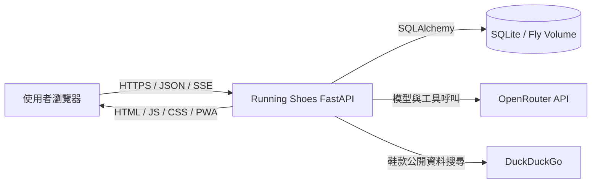
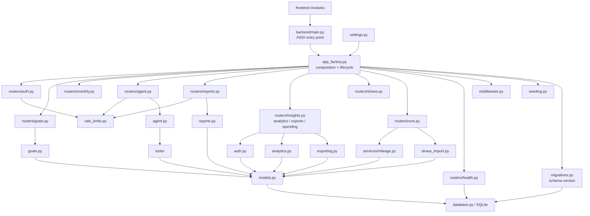
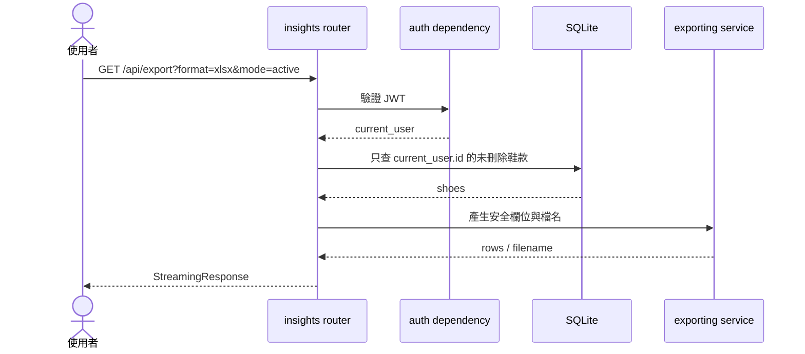

# Software Design Description（SDD）

本文件描述 Running Shoes 的目前架構、模組邊界與下一步拆分方向。它不是理想化的完成圖；
後端採模組化單體，`backend/main.py` 僅作為 ASGI 入口；composition 位於可注入的 app factory，
HTTP endpoint 全部位於 feature router。

## 1. 設計目標

- 維持單一 FastAPI／SQLite 部署，優先符合目前 Fly.io 資源與維運規模。
- 依功能邊界拆成模組化單體（modular monolith），避免為了「看起來有架構」提早引入微服務。
- HTTP router 只處理驗證、參數與 response；計算與資料轉換放在 domain/service 模組。
- 所有資料查詢與修改都必須帶入 `current_user.id`，不可跨帳號存取。
- 外部 LLM 與搜尋是可失敗的 adapter，不可成為跑鞋、跑量和支出計算的資料來源。
- 架構規則、測試與文件可由 CI 重複驗證。

## 2. 系統脈絡

## 3. 目前後端元件

`backend/main.py` 只輸出由 `create_app()` 建立的 ASGI app，不包含 route 或歷史相容 aliases。
`backend/app_factory.py` 建立 FastAPI、掛載 middleware／router，並從 `app.state` 取得 settings、engine、
session factory 與 frontend path，使測試可完整注入隔離環境。
auth、goals、monthly、agent、reports、insights、shoes、runs 與 health 都是獨立垂直切片；runs 把跨資料表的里程
同步委派給 framework-independent service。啟動 migration 位於 `backend/migrations.py` 並寫入
schema version。router 不能反向 import `backend.main`，service 也不能 import FastAPI 或 router。

## 4. 模組責任與依賴方向

| 模組 | 責任 | 可以依賴 | 不應依賴 |
| --- | --- | --- | --- |
| `backend/main.py` | 最小 ASGI entry point | `app_factory` | routers、database、業務邏輯 |
| `backend/app_factory.py` | app 組裝、lifecycle、router/middleware 與 SPA fallback | settings、routers、database | domain 計算 |
| `backend/settings.py` | typed environment configuration | Python stdlib | routers、database、FastAPI |
| `backend/seeding.py`、`middleware.py` | 可選 seed 與 request body guard | settings、models／ASGI | `backend.main` |
| `backend/rate_limits.py` | auth／AI 的 process 與 SQLite shared limits | models、database session | routers、`backend.main` |
| `backend/routers/` | HTTP 參數、認證 dependency、response | auth、domain/service、models | `backend.main` |
| `backend/services/` | 跨 route 的交易與 application use case | models、persistence | FastAPI、routers、`backend.main` |
| `backend/migrations.py` | ordered/idempotent schema upgrade 與版本 | models、database | routers、frontend |
| `backend/analytics.py`、`goals.py`、`reports.py` | 可重用的業務計算與 use case | models、LLM adapter（僅 AI use case） | FastAPI app、frontend |
| `backend/exporting.py`、`strava_import.py` | 輸入／輸出轉換 | models 或純資料 | FastAPI app |
| `backend/tools/` | Agent 可使用的受信任工具 | database、models | route 與 UI state |
| `backend/database.py`、`models.py` | persistence 與 schema | SQLAlchemy | router、frontend |

依賴方向由入口往內：`main → app factory → router → domain/service → persistence/adapters`。CI 的
`architecture-check` 會阻止 router 反向 import `backend.main`、service 穿透 HTTP layer，並檢查
API method/path 重複、OpenAPI path contract、`main.py` route 數與最小 entry-point imports。

## 5. 關鍵流程：跑鞋匯出

## 6. 不可破壞的品質屬性

- **帳號隔離**：任何 user-owned table 查詢都必須包含 `user_id`。
- **交易一致性**：跑步日誌與鞋款／月跑量的里程差額在同一交易內完成。
- **向後相容**：外部 API path、payload 與下載格式在純重構時不得改變。
- **資料安全**：帳號備份不得包含密碼 hash、JWT secret、API key 或其他帳號資料。
- **確定性測試**：測試使用暫存／記憶體資料庫，LLM 與搜尋必須 mock。
- **可部署性**：維持單一 container 與 SQLite volume；拆分模組不等於拆分服務。

## 7. 演進順序

1. **已完成**：前端拆出 AI、月報、跑步與跑鞋互動；後端建立 insights／shoes／runs／health routers。
2. **已完成**：共用里程交易整理成 service，startup migration 移到有版本的 migration 模組。
3. **已完成**：抽出 auth／rate-limit 與 agent／reports／goals／monthly routers，main route budget 降為 0。
4. **已完成**：前端再依 core、dashboard、monthly、charts、spending、bootstrap 拆分，加入真實瀏覽器 CRUD E2E。
5. **已完成**：導入 app factory 與 typed settings，注入 lifespan dependencies，移除 `backend.main` route aliases。

每一階段都先以既有 API regression tests 鎖住行為，再移動程式碼；不在同一個 commit 同時
改變 endpoint contract 與模組邊界。
