# Software Design Description（SDD）

本文件描述 Running Shoes 的目前架構、模組邊界與下一步拆分方向。它不是理想化的完成圖；
後端採模組化單體，`backend/main.py` 僅作為 ASGI 入口；composition 位於可注入的 app factory，
HTTP endpoint 全部位於 feature router。

## 1. 設計目標

- 維持單一 FastAPI／SQLite 部署，優先符合目前 Fly.io 資源與維運規模。
- 依功能邊界拆成模組化單體（modular monolith），避免為了「看起來有架構」提早引入微服務。
- HTTP router 只處理驗證、參數與 response；計算與資料轉換放在 domain/service 模組。
- 所有資料查詢與修改都必須帶入 `current_user.id`，不可跨帳號存取。
- 外部 LLM 與搜尋是可失敗的 adapter，不可成為跑鞋、跑量和支出計算的資料來源。
- 架構規則、測試與文件可由 CI 重複驗證。

### SPEC-019：請求、資料庫與發布的可靠性邊界

[ADR-0004](adr/0004-request-reliability-and-release-gates.md) 增加持久化回執，而不是靠前端的 disabled 按鈕推論是否寫入成功。
schema 2 只新增 receipt 表；舊 run／shoe／monthly 欄位與總量保持不變。相同 key、不同內容為 409，原始回應重播不代表復活已刪除資料。

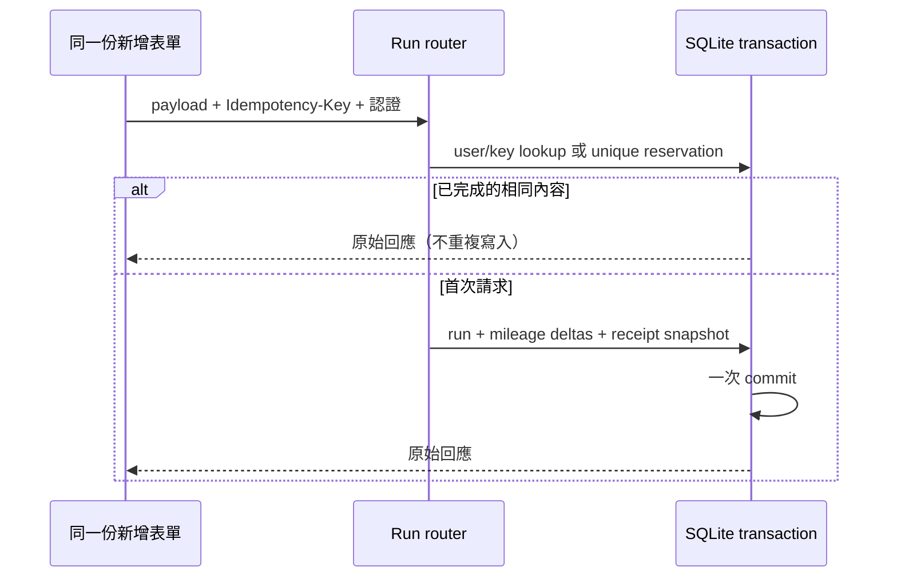

`withRequestDeadline` 涵蓋 JSON headers/body，GET 可一次有限重試；`authenticatedFetch` 保留 SSE adapter 語義，串流由 feature controller 管理。
`http-requests` lifecycle owner 在 session teardown 取消普通請求，storage 同步清理其他分頁但不刪除它們剛寫入的新憑證。
月份錯誤使用 `run-load-error`，不與 aggregate error 互相覆蓋。年度圖表使用 `/api/runs/year-summary` 的後端矩陣，不再取得逐筆年度日誌。

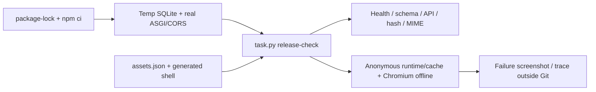

此 gate 不含部署權限；正式部署在檢查後依明確授權執行，部署後再次對正式 origin 執行。Rollback 的 schema marker 相容步驟見 README 與 SPEC-019，不能直接切回 schema 1 image。

### SPEC-020：交易、配置與功能 state 的 owner

[ADR-0005](adr/0005-transactional-services-and-run-controller.md) 定義 `services/runs.py`、`shoes.py`、`monthly.py` 為寫入 owner；
router 只處理輸入、認證與 domain error 的 HTTP mapping，不能 commit／rollback 或執行 mutation。
`services/transactions.py` 在任何業務讀取前，以 user-scoped no-op UPDATE 取得 SQLite writer reservation，
清除可能已載入的 ORM 快照，再驗證 quota／version、寫入與 commit；失敗一律 rollback。
這個 UPDATE 不改變 token_version，且適用不同 session／process，不依賴 process lock。
Strava 匯入使用同一交易邊界；SPEC-020 當時無 schema migration，維持 schema 2。SPEC-023 新增 nickname 的 schema 3，詳見第 10 節。

`dependencies.get_settings` 從 `app.state.settings` 提供 CRUD 與匯入配額；註冊容量與 middleware upload budget
也由 app instance 決定。外部 provider discovery／LLM 設定與既有 rate-limit module 保留 process runtime policy。
`read_models/run_statistics.py` 提供共用月／上月同期／YTD calendar bounds 與單一 conditional aggregate；
reports 將同一份 totals 傳給 goal progress，避免重複計算；歷史手動月跑量仍是另一種資料來源。

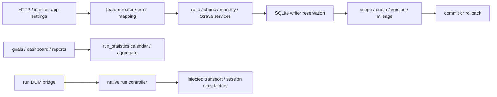

`runtime/run-controller.mjs` 擁有日誌明細、summary、分頁、年度 cache、request identity、editor、retry key。
`app-runs.js` 注入 JSON transport 與 auth session，負責表單／DOM；`app-core.js`、insights 與年度圖表透過
controller.state 整合，不再共享各自的 run state globals。Boot 等待 native modules 完成後才初始化登入。
成功回應清理前比對原始表單值，保留等待期間的新草稿與查看月份；reset 作廢舊帳號操作。

### SPEC-021：認證寫入與文件數量契約

註冊的 bcrypt hash 在 writer reservation 外計算，之後以 `write_transaction(db)` 的無 user 模式
執行 `UPDATE users ... WHERE id IS NULL`；即使沒有任何帳號，SQLite 仍在容量／同名查詢前保留 writer。
沒有符合資料，不更改使用者欄位；檢查與新增一起 commit／rollback，不依賴程序內 Lock。
改密碼以驗證時的 user id、hash 與 token_version 作條件 UPDATE，SQL 原子遞增版本；
過期請求回 409，不覆寫新密碼。昂貴 hash 工作不持有資料庫寫入保留。
`docs-check` 與 release-check 共用 `shell_asset_paths(manifest)` 推導 shell 加 worker 數量，阻擋 README 過期數字。
詳見 [SPEC-021](specs/021-auth-concurrency-and-release-asset-count.md)。

## 2. 系統脈絡

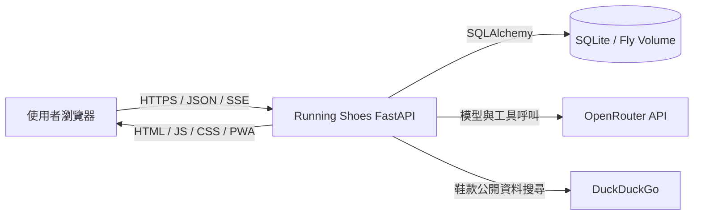

## 3. 目前後端元件

```mermaid
flowchart TB
    Browser[frontend modules] --> Main[backend/main.py<br/>ASGI entry point]
    Main --> Factory[app_factory.py<br/>composition + lifecycle]
    Settings[settings.py] --> Factory
    Factory --> AuthRoutes[routers/auth.py]
    Factory --> GoalRoutes[routers/goals.py]
    Factory --> MonthlyRoutes[routers/monthly.py]
    Factory --> AgentRoutes[routers/agent.py]
    Factory --> ReportRoutes[routers/reports.py]
    Factory --> AnalyticsRoutes[routers/analytics.py]
    Factory --> ExportRoutes[routers/exports.py]
    Factory --> SpendingRoutes[routers/spending.py]
    Factory --> Shoes[routers/shoes.py]
    Factory --> Runs[routers/runs.py]
    Factory --> StravaRoutes[routers/strava.py]
    Factory --> Health[routers/health.py]
    Factory --> Middleware[middleware.py]
    Factory --> Seed[seeding.py]
    Runs --> RunService[services/runs.py]
    Shoes --> ShoeService[services/shoes.py]
    MonthlyRoutes --> MonthlyService[services/monthly.py]
    RunService --> Mileage[services/mileage.py]
    RunService --> Transactions[services/transactions.py]
    ShoeService --> Transactions
    MonthlyService --> Transactions
    StravaService --> Transactions
    StravaService --> Mileage
    StravaRoutes --> Worker[worker thread<br/>parse / filter / service transaction]
    Worker --> StravaService[services/strava_imports.py]
    ExportRoutes --> ExportService[services/exports.py]
    AuthRoutes --> Limits[rate_limits.py]
    AgentRoutes --> Limits
    ReportRoutes --> Limits
    AgentRoutes --> AI[agent.py<br/>runner]
    AI --> Planner[agent_planner.py]
    AI --> AgentTools[agent_tools.py]
    AI --> Protocol[agent_protocol.py]
    ReportRoutes --> ReportService[services/reports.py<br/>generation ownership / events]
    ReportService --> ReportStorage[services/report_storage.py<br/>reservation / conditional upsert]
    ReportStorage --> Models
    ReportRoutes --> ReportLLM[report_llm.py]
    ReportRoutes --> ReportProtocol[report_protocol.py<br/>events to SSE]
    ReportLLM --> Reports[reports.py<br/>statistics / prompt]
    ReportRoutes --> Reports
    Reports --> ReadModels[read_models/<br/>shared user-scoped native statistics]
    Tools --> ReadModels
    ReadModels --> Models
    Shoes --> Metrics[shoe_metrics.py<br/>canonical cost / lifecycle arithmetic]
    Analytics --> Metrics
    Exporting --> Metrics
    ReadModels --> Metrics

    AnalyticsRoutes --> Auth[auth.py]
    AnalyticsRoutes --> Analytics[analytics.py]
    ExportService --> Exporting[exporting.py]
    GoalRoutes --> Goals[goals.py]
    StravaService --> Strava[strava_import.py]
    AI --> Tools[tools/]

    Auth --> Models[models.py]
    Analytics --> Models
    Shoes --> Forecast[forecasting.py<br/>shared retirement policy]
    Analytics --> Forecast
    Analytics --> ShoeStats[read_models/shoe_statistics.py<br/>SQL aggregates / bounded recent]
    ShoeStats --> Models
    Forecast --> Models
    Exporting --> Models
    Goals --> Models
    StravaService --> Preview[read_models/strava_preview.py]
    Preview --> Models
    Reports --> Models
    Tools --> Models
    Mileage --> Models
    Models --> Database[database.py / SQLite]
    Factory --> Migrations[migrations.py<br/>schema version]
    Health --> Database
    Migrations --> Database
```

`backend/main.py` 只輸出由 `create_app()` 建立的 ASGI app，不包含 route 或歷史相容 aliases。
`backend/app_factory.py` 建立 FastAPI、掛載 middleware／router，並從 `app.state` 取得 settings、engine、
session factory 與 frontend path，使測試可完整注入隔離環境。
auth、goals、monthly、agent、reports、analytics、exports、spending、shoes、runs、strava 與 health 都是獨立垂直切片；runs 與 strava 把跨資料表的里程
同步委派給 framework-independent service，exports router 只負責 HTTP response mapping。啟動 migration 位於 `backend/migrations.py` 並寫入
schema version。router 不能反向 import `backend.main`，service 也不能 import FastAPI 或 router。

## 4. 前端 module 與載入順序

前端保留無 bundler 的 classic DOM handlers，漸進引入原生 ES module runtime。`assets.json` 定義載入順序，
`scripts/build_frontend.py` 由 templates／CSS sources 產生完整 `index.html`、單一 `styles.css` 與 worker 清單，
並由產物一致性、前端 regression 與 Service Worker 升級測試鎖定。

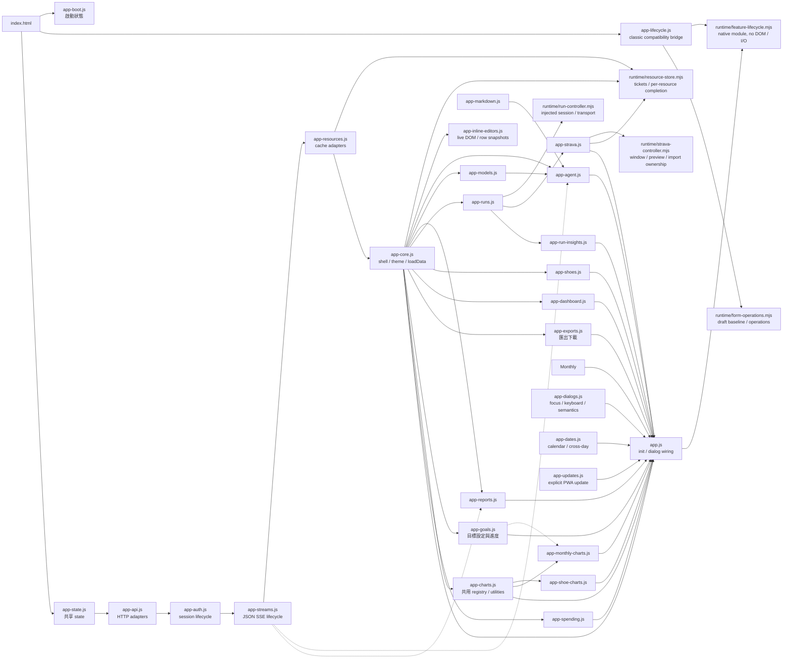

`app-state.js` 只保存共享 state 與常數；`app-api.js` 是 transport adapter；`app-auth.js` 管理 session
transition；`app-core.js` 組合畫面資料但不承擔 feature-specific rendering。跑步 CRUD、Strava 與洞察分別位於
三個 module，降低修改匯入功能時誤動月曆或編輯流程的風險。

### SPEC-017：真正的依賴與狀態邊界

依 [ADR-0003](adr/0003-shared-read-models-and-feature-lifecycles.md)，API、AI tools、月報共同依賴
`read_models`；月報不再 import tools 或解析工具 JSON。工具 facade 只加 tool/schema metadata；
tool definitions、legacy markers parser 與 native statistics 分別維護。名稱歧義回傳 user-scoped 候選，
ID 指定同樣限制使用者且排除已刪除鞋。批次分析只查一次鞋款與一次日誌，不逐鞋讀取。

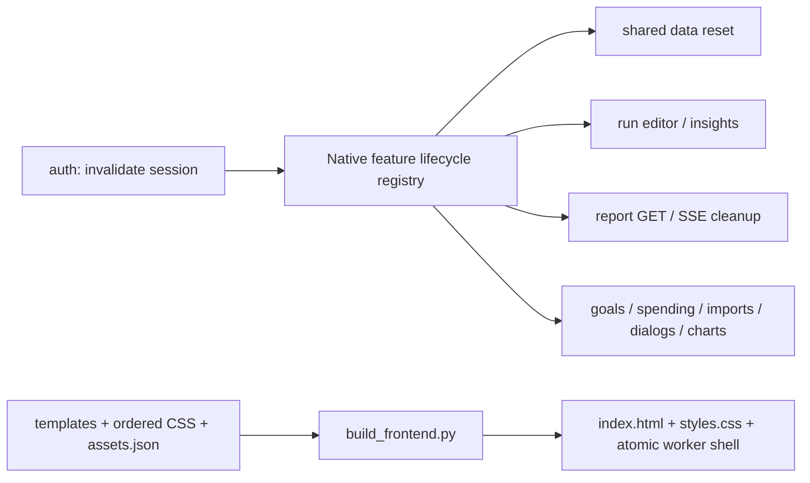

各 feature 在自身 module 呼叫 `registerFeatureReset`；auth 不再知道其他 feature 的 DOM、controller 或 chart。
Registry 繼續清理其他 feature，即使個別 reset 失敗；錯誤只記錄 feature 名稱，不能輸出私密資料。
這是漸進邊界改善，不宣稱所有 classic globals 已轉成 ES modules。新增隔離的純 runtime 應放在 `runtime/`。

`GET /api/runs/summary` 以日期／鞋款 grouping 供完整月曆與卡片；`GET /api/runs` 每頁最多取 201 筆判斷
200 筆明細是否有下一頁，可加 day 篩選。切明細頁不截斷統計，日曆鞋款點選改為篩選當日明細。
`/running-goal/progress` 與首頁／月報使用同一 `goals.goal_progress`，不混入手動歷史調整。
`/running-goal/year` 的 `goals.year_goal_overview` 以同一 `goal_progress` 加上一次月份 group-by，今天應達里程與訓練趨勢共用 `yearly_goal_to_date`。
`/spending/summary` 在後端依日曆年月計算平均，前端只排版；支出非首頁必要請求，失敗局部重試。
`shoe_metrics` 統一 ShoeOut、分析、匯出與工具成本／壽命數值；前端只處理格式與比例單位。
Run list reload 與 aggregate reload 共用 request identity，切月份時不讓晚到明細覆寫目前月份，其他彙總仍可更新。

Dialog manager 使用 role/aria-modal/label、背景 inert、Tab trap 與 Escape；先解除 inert 才返回焦點，
並保存 Safari pointer opener。跨日更新 max 於 pointer/Enter 的 native validation 之前，以及 foreground；
不重設使用者草稿、月份或分頁。登出／換帳號則清除舊草稿與所有 feature 狀態。

[SPEC-013](specs/013-auth-modal-and-module-boundaries.md) 再依責任分離月跑量 CRUD、匯出、目標與兩類圖表；
`app-charts.js` 僅保存共用 registry／label utilities，各 feature 保留既有函式契約。
登入／註冊／更改密碼共用單一 auth operation，具有 AbortController、generation 與物件 identity；
切換表單或 clearAuth 使舊操作失效，回應及 JSON body 後都再次檢查。成功登入後改以新 session
保護後續資料載入，舊 finally 不解鎖或隱藏新操作的 UI。
跑鞋視窗的 create/update/delete/move 共用 context 級鎖與原始 version/session，close/logout 失效 context。
報告 GET／list／SSE completion 以共用 serializer 輸出帶 offset UTC，前端統一轉成本地時間。

Strava route 保留 async upload 與 byte limit，之後一次 `run_in_threadpool` 執行 parse/filter/service。
傳入 scalar user ID；request DB session 的 worker 工作順序執行，不在多個 worker 同時使用同一 session，
資料庫提交、重複檢查與里程同步仍位於現有 service transaction。這不是背景工作佇列；
HTTP 回應仍等到匯入完成，取消 HTTP 也不代表撤銷已提交的交易。

[SPEC-012](specs/012-edit-stream-and-render-safety.md) 將 JSON SSE 的 HTTP 檢查、UTF-8／CRLF 解碼、
取消及 done/error 狀態集中於 `app-streams.js`；AI／月報只處理事件呈現，AI 只在完整成功後提交對話 pair。
編輯 modal 保存 ID/version/session 快照與單一視窗的提交鎖，重新載入不會改變編輯對象，晚到回應也不操作新視窗。
Core 維護 panel revision／theme／date 呈現 key；`render()` 只使分頁失效並繪製 active feature，
切換分頁時重用未變更的圖表；年度日誌只在 monthly 分頁按需讀取，完成後再次確認 active panel。

退役預估由 `backend/forecasting.py` 提供單一規則，shoes router 使用 user-scoped grouped query
批次取得 90 天跑量，透過 ShoeOut 唯讀欄位 `forecast_retirement_date`、`forecast_source`、`forecast_monthly_km`
提供清單與時間軸；單鞋分析使用相同 helper。API path、輸入格式及資料庫 schema 不變。

依 [SPEC-011](specs/011-shoe-purchase-details-in-spending.md)，`app-dashboard.js` 的現役／退役表格
只呈現使用指標與操作；尺寸、買價、原價、折數集中由 `app-spending.js` 顯示。
兩者仍使用同一份 user-scoped shoe state，`app-shoes.js` 的新增／編輯表單保留完整欄位；
此為呈現責任調整，不拆開資料模型，也不改變 API、資料儲存或匯出契約。

帳號生命週期遵循 [SPEC-010](specs/010-session-and-restore-safety.md)：`app-auth.js` 提供
generation/token snapshot，`app-api.js` 的 `authenticatedFetch` 與 `readAuthenticatedBody` 在回應及
body 讀取後驗證 snapshot。過期 session 拋出 `AbortError`，只有目前 session 的 401 可以登出。
圖中的箭頭表示 script 載入順序；上述函式在全部 scripts 載入後才執行。登出統一清除洞察快取、
使 feature request IDs 失效，並中止 AI／月報／Strava 請求。AI 串流每次讀取後也驗證 session 與 request ID，
即使 transport 未遵守取消，舊回應也不得回填 history、retry 或新帳號的 loading 狀態。

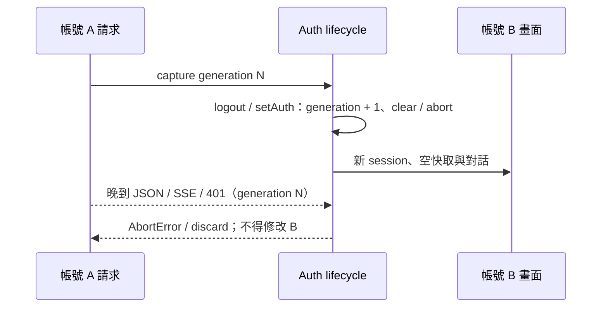

登入後的 UI shell 由 `index.html` 與 `styles.css` 組成：桌面使用左側 sidebar 保存全域導覽與帳號操作，
右側 workspace 只呈現唯一 active feature panel；窄螢幕則轉為單欄精簡頂部列，透過帶 ARIA 展開狀態的按鈕顯示同一組導覽及帳號操作，選取功能後收起。`app-core.js` 只同步 active、
ARIA 與 `agent-mode` 狀態，不以 inline style 決定 shell 幾何，因此功能 rendering 與 responsive layout 維持單向依賴。

[SPEC-015](specs/015-run-log-home.md) 定義跑步日誌為固定首頁：`app.js` 在 init 驗證登入前
呼叫 Auth 既有 `resetAppLayout()`，忽略舊版 activeTab；`switchTab()` 僅更新本文件，不保存分頁。
`pageshow.persisted` 以相同 layout reset 與 Core active-panel renderer 處理快取還原，不重新登入或修改資料；
一般 visibilitychange 不觸發首頁重設，登入 token 與主題偏好仍維持原本儲存方式。

[SPEC-016](specs/016-frontend-alignment.md) 的呈現契約由 `css/` 來源產生單一 `styles.css`：主控制項 44px、桌面緊湊操作 36px，
日期／月份／一般欄位共用行高與尺寸；工具列、彈窗操作分組及 native select 外觀由 CSS 管理。
靜態表頭與動態數字格使用 `numeric` class 共用右側邊界；ShoeModal 只同步次要操作組的 hidden 狀態，
不再以 inline display 指定按鈕版型。雙引擎幾何測試涵蓋 40 組尺寸／主題設定及認證／錯誤／編輯狀態。

## 5. 模組責任與依賴方向

| 模組 | 責任 | 可以依賴 | 不應依賴 |
| --- | --- | --- | --- |
| `backend/main.py` | 最小 ASGI entry point | `app_factory` | routers、database、業務邏輯 |
| `backend/app_factory.py` | app 組裝、密鑰驗證、預設 engine、lifecycle、router/middleware 與 SPA fallback | settings、routers、database | domain 計算 |
| `backend/settings.py` | typed environment configuration | Python stdlib | routers、database、FastAPI |
| `backend/clock.py` | 唯一的應用時區、`local_now()` 與 `local_today()` | Python stdlib | routers、database、FastAPI |
| `backend/dependencies.py`、`routers/errors.py` | app settings／request session（`get_db`）dependency 與 domain error 的 HTTP mapping | FastAPI、settings、service errors | 業務 transaction |
| `backend/seeding.py`、`middleware.py` | 可選 seed 與 request body guard | settings、models／ASGI | `backend.main` |
| `backend/rate_limits.py` | auth／AI 的 SQLite 固定視窗限額，於 app engine 的獨立交易消耗 | settings、SQLAlchemy engine | 請求 session、routers、`backend.main` |
| `backend/routers/` | HTTP 參數、認證 dependency、response | auth、domain/service、models | `backend.main` |
| `backend/services/` | 配額、版本、里程與 application transaction owner | models、schemas、read models、persistence | FastAPI、routers、`backend.main` |
| `backend/read_models/` | user-scoped native statistics／身份消歧義 | models、純 domain、SQLAlchemy | HTTP frameworks、routers、tools |
| `backend/shoe_metrics.py` | 折數、成本、壽命共同算術 | models | HTTP、AI、UI |
| `backend/migrations.py` | ordered/idempotent schema upgrade 與版本 | models、database | routers、frontend |
| `backend/analytics.py`、`goals.py`、`reports.py` | 可重用的唯讀統計與月報提示詞 | models、read models | FastAPI app、frontend |
| `backend/exporting.py`、`strava_import.py` | 輸入／輸出轉換 | models 或純資料 | FastAPI／HTTP exception |
| `backend/tools/` | Agent JSON adapter、tool definitions、legacy parser | read models、受信任 adapter | route 與 UI state |
| `backend/agent.py` | LLM／tool loop runner | planner、tools、protocol、LLM adapter | HTTP response、frontend state |
| `backend/agent_planner.py` | deterministic query plan | Python stdlib | database、FastAPI、LLM network |
| `backend/agent_tools.py` | user-scoped tool dispatch | trusted tools、database session | routers、SSE serialization |
| `backend/agent_protocol.py` | SSE event 與來源摘要 serialization | search result contract | database、FastAPI |
| `backend/database.py`、`models.py` | ORM base、連線 pragma、engine 工廠與 schema；import 無 I/O | SQLAlchemy | router、FastAPI、frontend |

依賴方向由入口往內：`main → app factory → router → domain/service → persistence/adapters`。CI 的
`architecture-check` 會阻止 router 反向 import `backend.main`、service 穿透 HTTP layer，並檢查
API method/path 重複、OpenAPI path contract、`main.py` route 數與最小 entry-point imports。
SPEC-017 同時追蹤 transitive/relative imports，禁止 service/read model 間接穿透 HTTP 或 tool adapters，
檢查 native runtime 不直接存取 DOM／fetch 與 lifecycle ownership 不重複；run controller 的 transport 由 adapter 注入；來源生成漂移由 verify／docs-check 阻擋。

## 6. 關鍵流程：跑鞋匯出

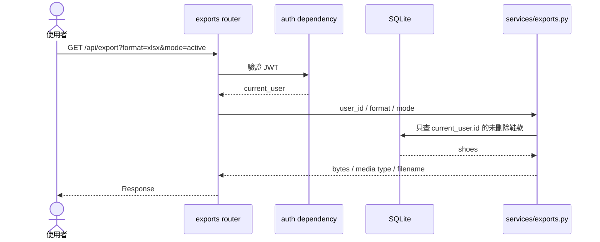

## 7. PWA 與 Fly runtime topology

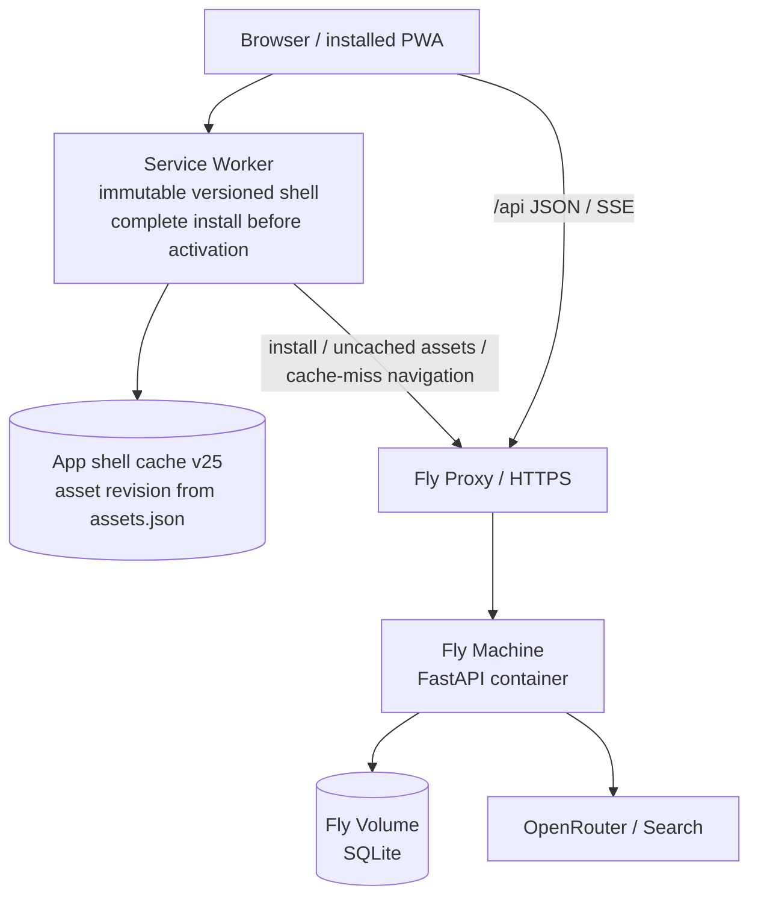

Service Worker 不攔截 `/api/`，因此資料與 SSE 永遠走網路；靜態 module、CSS、vendor assets 與離線頁面
屬於 app shell。[SPEC-014](specs/014-offsite-backup-and-pwa-upgrades.md) 將 navigation 改為本版 immutable HTML，
不再用新版 network HTML 覆寫舊 cache。install 先下載、讀完 response body（避免有限連線池被未讀 body 佔住）、
檢查 MIME 與 HTML revision，再保存完整 shell；成功才 skipWaiting，activate 只清理本 app 前綴的舊 cache。
新版安裝失敗保留既有 shell。首次安裝與 v3.2.2 舊 worker 遷移需要連網；全新離線裝置無法憑空載入 app。
`app-updates.js` 透過 controllerchange/message 比較安裝的 shell revision；只有完整新版啟用後顯示通知，
不強制重載。通知在認證區外，所以登入前也能看到；使用者確認後才 reload，可能丟棄未儲存的草稿。
`.mjs` 與 `.js` 都必須通過 JavaScript MIME 檢查。載入順序、CSS sources 與 worker module list 由同一 manifest 生成。
[SPEC-018](specs/018-pwa-origin-vary.md) 對公開同源 shell cache lookup 忽略 CORS 的 Vary variant，
使預快取與 module 的 Origin 差異不影響離線載入；精確 URL／query、同源限制與 API 排除仍維持。
SQLite 永遠位於掛載 volume，不包含在 app shell 或 container image。

### 7.1 異地備份與 restore drill

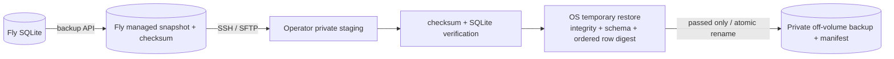

`scripts/offsite_backup.py` 是 operator-only adapter，以參數陣列使用既有 Fly CLI 認證，不新增 SDK、token 設定或 HTTP endpoint。
下載失敗不發布；演練只能還原至工具建立的隨機 OS 暫存目錄，沒有 production destination 參數。
`database_backup.logical_summary` 比較所有資料表的 ordered row digest、schema objects、筆數與 schema version，
manifest 只保存摘要，不包含資料列／密碼 hash。完成的 DB 副本仍含完整帳號資料，必須存於 Git 外 private directory。
不自動刪除本地備份、不自動還原正式 DB；排程與其他異地供應商需另行設定。這台電腦與 Fly 分屬不同故障域，
但不是多份獨立雲端備援，也不是新的一份同步開發 DB。

## 8. 不可破壞的品質屬性

- **帳號隔離**：任何 user-owned table 查詢都必須包含 `user_id`。
- **交易一致性**：跑步日誌與鞋款／月跑量的里程差額在同一交易內完成。
- **向後相容**：外部 API path、payload 與下載格式在純重構時不得改變。
- **資料安全**：帳號備份不得包含密碼 hash、JWT secret、API key 或其他帳號資料。
- **確定性測試**：測試使用暫存／記憶體資料庫，LLM 與搜尋必須 mock。
- **可部署性**：維持單一 container 與 SQLite volume；拆分模組不等於拆分服務。

## 9. 演進順序

1. **已完成**：前端拆出 AI、月報、跑步與跑鞋互動；後端建立 insights／shoes／runs／health routers。
2. **已完成**：共用里程交易整理成 service，startup migration 移到有版本的 migration 模組。
3. **已完成**：抽出 auth／rate-limit 與 agent／reports／goals／monthly routers，main route budget 降為 0。
4. **已完成**：前端再依 core、dashboard、monthly、charts、spending、bootstrap 拆分，加入真實瀏覽器 CRUD E2E。
5. **已完成**：導入 app factory 與 typed settings，注入 lifespan dependencies，移除 `backend.main` route aliases。
6. **已完成**：拆分 frontend boot／state／API／auth 與 run／Strava／insights modules；拆分 backend insights、Strava transaction 與 Agent planner／tools／protocol。

每一階段都先以既有 API regression tests 鎖住行為，再移動程式碼；不在同一個 commit 同時
改變 endpoint contract 與模組邊界。

7. **已完成（SPEC-020）**：寫入服務擁有交易、quota／upload 設定按 app 注入，跑步 native controller 收斂 state，日期區間聚合與文件契約共用。

## 10. SPEC-023：操作身分、部分讀取與帳號服務

[ADR-0006](adr/0006-form-operations-and-account-services.md) 定義這批新增邊界：

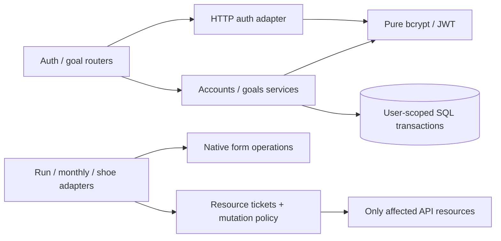

`credentials.py` 不讀 runtime settings、不依賴 FastAPI。`auth.py` 的 token wrapper 保留既有預設設定相容性；
router 注入 app secret／capacity，services 不可直接或間接依賴 HTTP。認證 CAS、註冊 writer reservation 與 token revocation 行為不變。
目標寫入服務保留 SQLite upsert／版本衝突與 rollback。Architecture check 對五個寫入 router 禁止 transaction／mutation 呼叫。

Form operations 的 session／epoch／identity 與 snapshot 不依賴 DOM；classic bridge 管理輸入值，run controller 管理 run state。
Native transitive imports 帶相同 revision，以符合 worker 精確 URL cache。每個資料來源的 ticket 只取消該來源的舊結果；
部分刷新不會丟棄完整讀取中仍有效的其他來源。Mutation policy 與快取範圍詳見 SPEC-023／README。
Schema 3 只新增 nickname；品牌／型號統計分組和里程計算仍由原有 backend 模組擁有。

## 11. SPEC-024：草稿基準與資源所有權

[ADR-0007](adr/0007-draft-rebase-resource-store-and-browser-deadlines.md) 延伸表單與資源邊界：

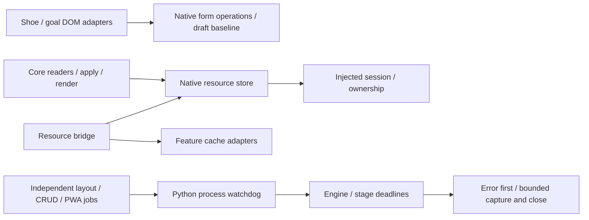

鞋款成功回應更新 snapshot、mode、UI 與 form baseline，再還原操作期間的新修改；後續只提交 dirty fields。
Goal 以 baseline 比較 draft，reconcile 處理背景重繪，acknowledge 處理儲存回應，session reset 清理狀態。
`resource-store.mjs` 管理 resource/key、session/epoch、pending read 合併、成功值與獨立錯誤；失效後拒絕舊回應，接受結果只消費一次。
`app-resources.js` 注入 session 並註冊快取 hooks，core 保留 readers／結果套用與 render；不同來源成功／失敗各自處理。
Native module 不讀 DOM、認證 storage 或 HTTP，architecture-check 同樣限制新 module。

Browser capture 的錯誤文字先保存，截圖／trace 及 teardown 分別限時。Python watchdog 處理 IPC 完全卡住的程序樹，
三個 CI jobs 以 composite setup 共用鎖定依賴，沒有彼此的成功依賴；diagnostics roundtrip 只依賴 PWA job。
細部期限與可保留產物的限制見 README 及測試策略；驗證一律使用暫存 DB／合成 context。

## 12. SPEC-025：匯入生命週期與有界分析

[ADR-0008](adr/0008-strava-ownership-progressive-resources-and-sql-analytics.md) 定義 Strava controller／DOM adapter、歷史 resource ticket 與逐資源完成的依賴方向。取消視窗使 UI operation 失效，但已提交的成功仍更新相同帳號資料。歷史先失效再刷新，拒絕舊 GET，下一次日期預設只讀有效歷史。

`refresh(..., onResult)` 每個來源完成即交付，accept 保證同 ticket 最多套用一次；慢 goal／history 不阻擋 runs。整批 Promise 仍等待全部完成供呼叫者收尾。獨立錯誤在來源恢復前保留。跑步編輯的空白替代鞋款狀態經重繪仍保留；鞋款狀態指令保留原基準上的其他未儲存欄位。

詳細單鞋／批次分析使用 `shoe_statistics.py` 三次 SQL 查詢：全歷史 conditional aggregate、12 個月份 group、每鞋 partition recent 12；摘要只需第一個 aggregate。全部 user-scoped，無 Run entity 全歷史載入；rounding、成本與 forecast 位於既有 backend 政策。Schema 及 API contract 不變。

PWA fixture 對 worker.update 與 candidate 終態設共同 deadline，涵蓋已在 installing 的 candidate。階段／最近 HTTP 請求與 registration timeline 隨失敗文字保存；截斷 body 的未壓縮長度由 installer 驗證，壓縮 wire bytes 不與 decoded bytes 比較。完整雙引擎 failed-upgrade、offline、recovery gates 保留。

PWA CI 後續補充（v3.7.1）：離線 worker script fixture 回 503，並在每次回到在線前驗證 update 在期限內失敗，清楚區分尚未建立 installing candidate 的 script request 卡住與 worker statechange 漏接；細節見 SPEC-025 CI follow-up。正式 shell revision 為 v31，schema 3 不變。

Goal form 初始化（v3.7.2）：switchTab 在 monthly panel 變成 active 前呼叫 prepareGoalForm，同步建立草稿 baseline，避免下一個 animation frame 才第一次 reconcile 時覆蓋已輸入內容。圖表仍使用延後 render；晚到的 goal resource 依既有 baseline 合併。正式 shell revision 為 v32。

## 13. SPEC-026：表格所有權與月報生成服務

[ADR-0009](adr/0009-inline-edit-ownership-and-report-generations.md) 將資源完成的畫面失效限制在依賴分頁；goal 不重建鞋款表格。
`app-inline-editors.js` 以 tbody 擁有 live editor，表格 renderer 在編輯期間不替換 DOM；列快照讓其他按鈕／第二次編輯仍使用顯示中的 id／version，避免背景排序後用錯陣列索引。
明確提交先結束 ownership，再刷新；失敗依原有 CAS 衝突政策處理。取消與 session teardown 撤銷 blur callback，完成後顯示最新資料。
年度／目標／洞察讀取都走 resource store，既有 Map 保留作診斷鏡像，不再作為讀取快取來源。失效同時清除 ticket 與鏡像，session reset 全部清理。
延後 dispatch 先驗證 ticket／session，舊 owner 不得借用新帳號 token 發送請求。

`services/reports.py` 注入統計 builder 及 text stream，產生 token/error/done domain events；`report_llm.py` 僅轉接 prompt／provider error，`report_protocol.py` 序列化 SSE／UTC timestamp。
`services/report_storage.py` 在短 writer reservation 交易中 upsert schema 4 的 `report_generations`。完成時以同一 user/year/month/token 驗證及 upsert，保護整份內容與 stats；DB receipt 適用多連線與多 process。
統計完成後 rollback 讀取交易，LLM 不持有任何 transaction。新請求失敗／取消仍使舊生成過期，之前成功報告保持可讀；reservation 不進歷史 API。
升級只新增表；備份、禁止混跑與 schema marker 回滾程序見 README／SPEC-026。Asset 3.8.0、shell v33。

## 14. SPEC-027：可恢復帳號工作區

[ADR-0010](adr/0010-recoverable-account-workspace.md) 定義草稿、離線佇列、還原及歷史邊界。

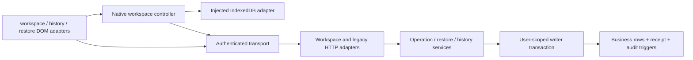

`workspace-controller.mjs` 擁有 account/session ticket、草稿存取、queue lease、錯誤分類與明確重新配對；`app-local-store.js` 擁有 IDB transaction commit，DOM bridge 只負責表單／快照轉換及呈現。操作與消耗相同草稿在同一 IDB transaction；回應成功、帳號切換或重開均不把已接收操作當成新草稿。

`services/operations.py` 是新契約的寫入入口，receipt 在業務交易內；舊 CRUD 帶版本＋key 時可轉交，未帶版本保持相容。`services/transactions.py` 的外層 user reservation 管理 WriteContext、flush／commit／rollback，巢狀 service 不獨立 commit。Schema 5 由 `audit_schema.py` 的白名單 triggers 產生原子事件／revision；不 audit 密碼或 users 表。`identifiers.py` 只配置全域 PK metadata，業務內容查詢仍限本人。

`backup_contract.py` 驗證有界 v1/v2 graph；`services/account_restore.py` 擁有本人預覽、hash/revision、來源 mapping、完整交易與保留現有內容策略；router 不接管 commit。`services/history.py` 擁有可復原事件判斷、原鞋款／版本／配額檢查及里程重算，匯入事件只讀。

resource store 現在直接擁有年度／目標／洞察結果，已移除原本診斷鏡像 Map。Service worker 只快取公開 shell，帳號資源快照由 IDB adapter 管理；新鮮網路結果及已修改欄位不被晚到本機快照覆蓋。v3.9.0 使用 asset 3.9.0、shell v34、schema 5；正式備份／rollback 見 README 與 SPEC-027。

### SPEC-029：帳號資料搬移與顯式更新

v3.10.0 保留上述所有權與 schema 5。`services/account_restore.py` 增加 `merge|update` 策略；預覽把 mode 與 backup 放入 hash 綁定的 envelope，舊預覽相容 merge。HTTP adapter 只解析模式、讀 body 並呼叫 service，apply 沿用 user-bound token／revision／receipt。v2 update 以來源 mapping 更新鞋款／跑步、以年月更新月份調整與月報、更新帳號目標；保留額外資料與跑步 tombstone。服務在同一交易中從該帳號完整日誌彙總鞋款／月份總里程，並撤銷匯入月報對應的舊生成。所有 query／write 沿用 user_id 範圍。

`app-account-restore.js` 擁有檔案／模式／視窗版本，模式改變使舊預覽失效，提交期間鎖定選單。更新模式在確認前呈現來源、接收 origin／帳號、更新範圍；`app-exports.js` 在呼叫它的視窗顯示下載結果並拒絕舊 session。雲端與本機版的伺服器資料庫彼此獨立，瀏覽器 IDB 工作區仍只負責草稿／待送紀錄，兩者不混用。

### SPEC-030：獨立預覽與最小寫入

v3.10.1／schema 6 將預覽主鍵改為 `(user_id, token)`，交易保留舊預覽，不改動業務表。建立新預覽只清理過期項目並檢查本人 8 份／64 MiB 上限，DELETE 只捨棄指定本人 token；hash、資料 revision 與回執保護仍有效。

`account_restore.py` 僅擁有解析、預覽、交易及回執；`account_import_plan.py` 在保留 SQLite writer 後載入本人快照、來源 mapping 與預先確定的 run targets，預覽和套用共用；`account_import.py` 依計畫寫入，不能自行 commit。`services/mileage.py` 擁有帳號日誌對帳，只有數值改變才更新版本。相同欄位不產生 ORM UPDATE，日期比較先統一 UTC 語意，額外紀錄不因 no-op 匯入而失效。

原生 `runtime/account-restore-controller.mjs` 注入 session／transport／key，管理預覽、revision、提交所有權及 token 清理；`app-account-restore.js` 留作 DOM bridge。關窗不捨棄正在提交的 token；舊預覽成功只清理自己的 token，舊 apply 完成可刷新仍相同的帳號，但不能解鎖新提交。工作區清除沿用 form operation session／epoch，逐表單與編輯草稿比對快照，保留 await 期間的新輸入。決策見 [ADR-0011](adr/0011-independent-import-operations.md)。

## SPEC-032：備份契約、實際差異與提交後讀取

`backup_contract.py` 同時擁有匯出／匯入的集合、UTF-8 位元組及結構檢查；export service 在一致快照中以 cap+1 分批讀取並逐筆檢查容量並在產檔前驗證契約。HTTP 僅處理本人 include_history 選項與下載回應，不靜默裁切。

`account_import_plan.py` 保留 user-scoped 來源辨識與配額；query-free `account_import_changes.py` 以快照投影最終跑步、鞋款及月份，產生欄位 patch；preview 由 patch 計數，executor 套用同一 patch，交易／回執仍由 account_restore 擁有。移除 executor 內第二套對帳及欄位比較。

restore controller 擁有 committed／refreshRequired／refreshing 與原操作身分。bridge 將 loadData 的 resource errors 轉為可重試的讀取失敗，不把提交成功誤報成可再次提交；重新載入檢查 session／revision／owner。詳見 [ADR-0012](adr/0012-account-transfer-contract-and-diffs.md)。

## SPEC-033：跨刪除與復原的來源身分

`run_identity.py` 集中 user-scoped 本機 tombstone 辨識與來源別名轉移。匯入計畫只把非 imported 的本機 delete audit 當同來源刪除證據；明確復原在同一業務交易內將全部來源別名轉到新 ID，並記錄原生舊 ID。history 與 import plan 不互相依賴。詳見 [ADR-0013](adr/0013-recovery-identities.md)。

每次 queue claim 使用獨立 lease，舊請求無法解除重新登入後的新租約。`app-resources.js::refreshCoreData` 將核心資源錯誤轉成讀取失敗；匯入、同步及復原 bridge 共用。復原提交成功後保留完成身分，只允許重新讀取；session 變更使回呼失效。

## SPEC-034：可攜來源與同步讀取

[ADR-0014](adr/0014-portable-run-aliases.md) 定義 archive v3 的原生來源別名與跨分頁讀取。`run_identity.py::export_run_aliases` 在一致匯出快照中只讀取本人原生 source_id、仍存在跑步的別名，集合有界；backup_contract 驗證 graph，import plan 共用多別名匹配並拒絕歧義，executor 在原交易記錄全部來源鍵。v1/v2 指紋不含新增欄位，DB schema 6 不變。

`mileage.py` SQL 累加以 round 保持兩位，query-free patch 比較正規化同一精度，無需重寫既有資料。workspace controller 注入 best-effort committed callback；DOM bridge 管理 BroadcastChannel 的帳號 partition 通知，手動／前景／相同帳號通知要求讀取。同步中合併刷新需求，讀取期間的新通知形成 trailing read；session 更換撤銷舊 UI 所有權。

## SPEC-047：有界歷史、單一回執與注入式執行環境

[ADR-0015](adr/0015-bounded-history-and-injected-runtime.md) 取代 SPEC-033 以稽核紀錄推導刪除身分的做法，以及 ADR-0004 的 `run_creation_requests`。

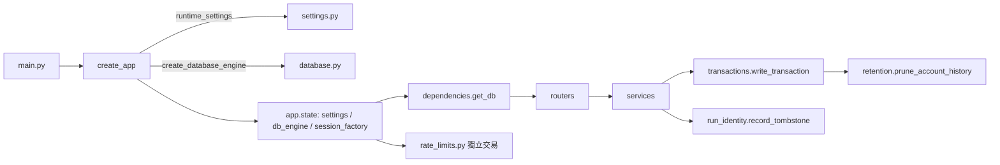

- **組合根**：`create_app()` 唯一驗證密鑰並建立預設 engine。匯入任何 backend 模組都不建立目錄、engine，也不結束程序。測試與 app 透過 `app.state.session_factory` 取得 session，清除 dependency override 後也不會落到預設資料庫。
- **寫入交易**：`write_transaction` commit 前呼叫 `retention`，只清理該帳號超出上限的稽核、回執與墓碑。`run_tombstones` 由 `delete_run` 寫入、匯入計畫讀取；稽核紀錄只負責歷史與復原。
- **限流**：`rate_limits.consume()` 把同一請求的所有視窗放在一個交易，滿了就整筆回滾；限額來自 `app.state.settings`，不再保留記憶體桶。
- **稽核 trigger**：每次啟動依目前欄位重建，避免舊欄位清單使快照不完整或使寫入失敗。
- **Strava**：`strava_import.parse_activity_dates()` 把 UTC 時間戳轉為 `clock.APP_TIMEZONE` 日期。`date_corrections()` 只修正仍停在舊 UTC 日期的既有活動，`services/strava_imports.py` 在匯入交易中移動日期與月跑量。
- **v4.7.2**：router 不再自行查詢資料庫（架構測試把關）：清單查詢在 read model，readiness 探測在 `migrations.ready_schema_version()`。`llm.user_facing_error()` 是模型錯誤進入 HTTP／SSE 前的唯一出口，原始內容只寫 log。
- **前端事件**：markup 只宣告 `data-click`／`data-change`／`data-input`／`data-submit`／`data-dblclick`／`data-keydown`。`frontend/app-actions.js` 在 document 委派，只執行最近的宣告元素；表單送出與 `<a>` 由動作接管預設行為。

