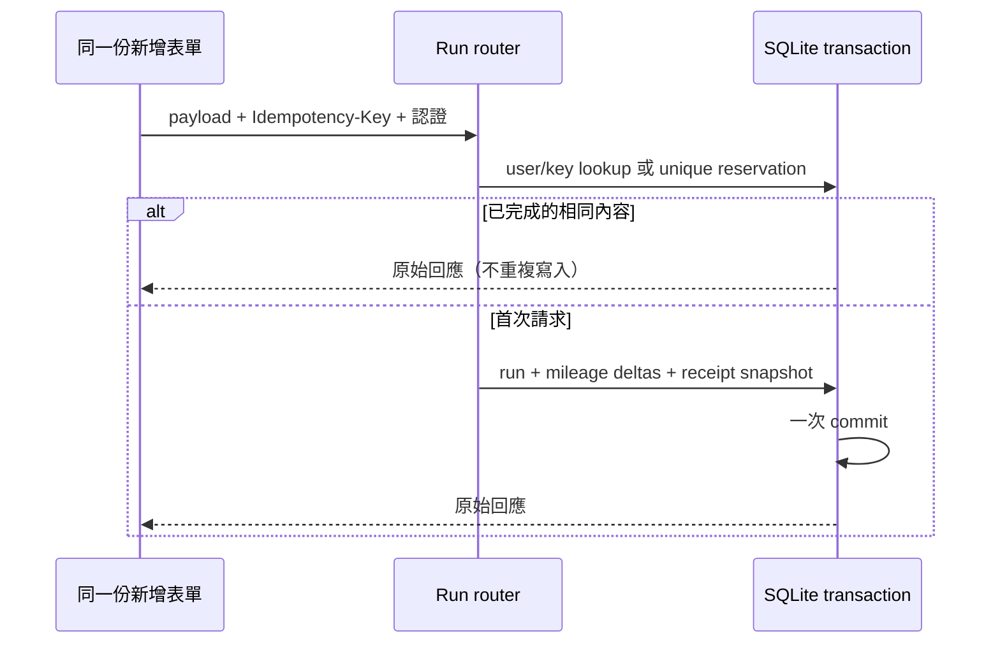
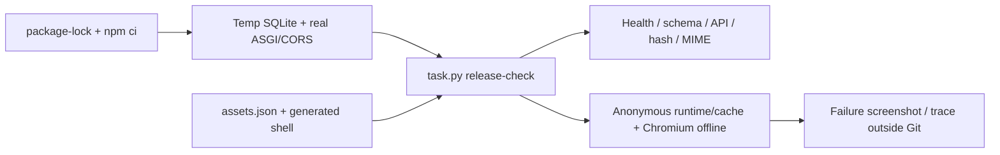
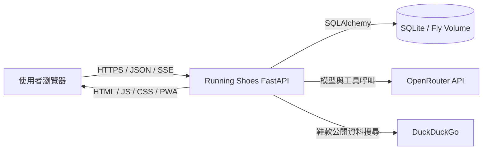
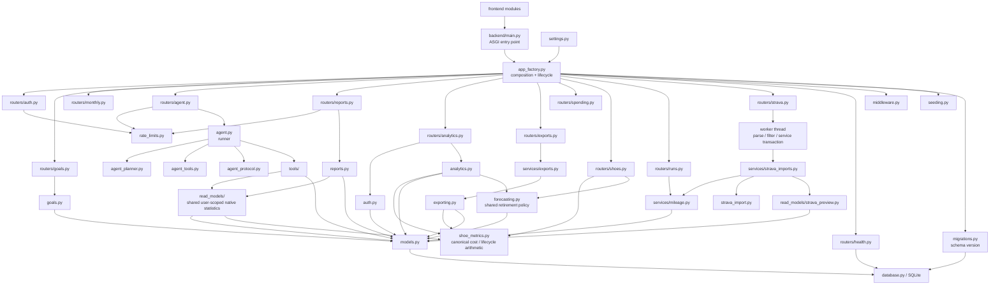
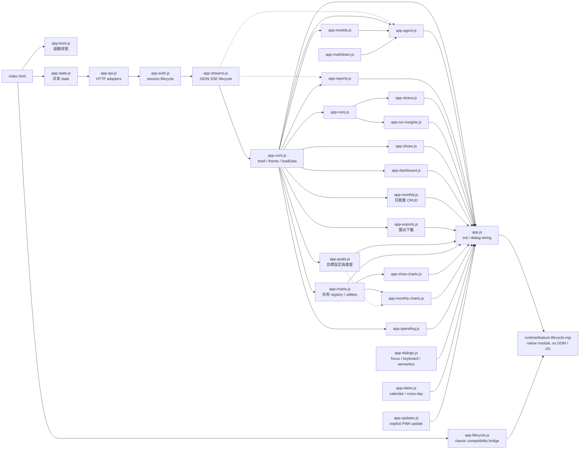
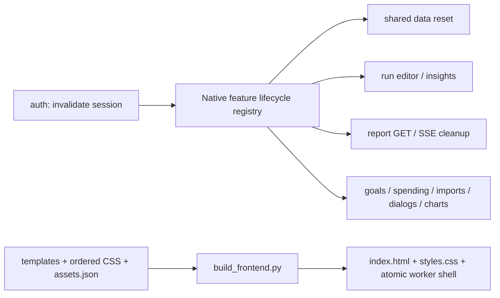
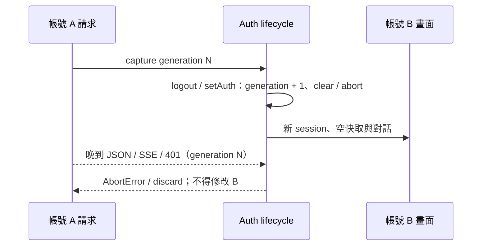
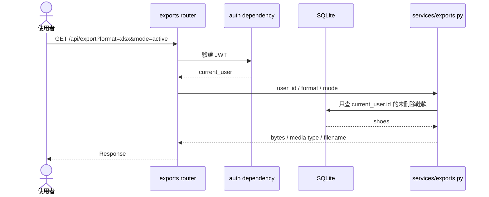
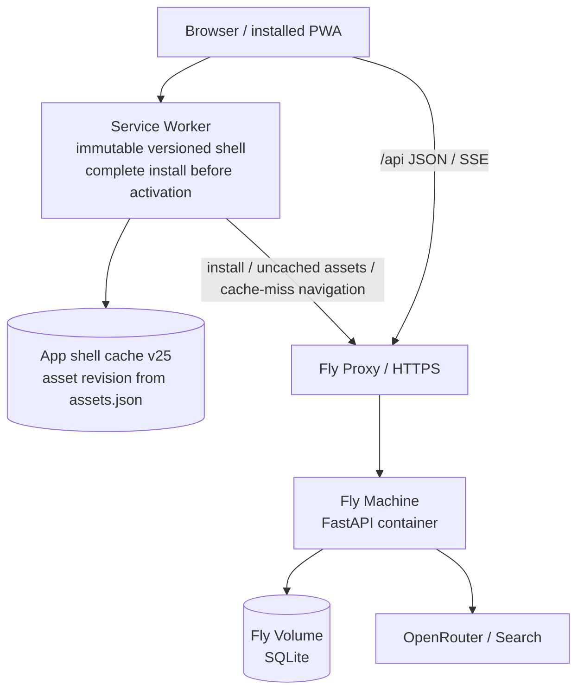
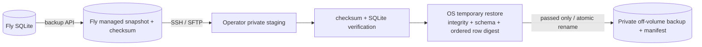

# Software Design Description（SDD）

本文件描述 Running Shoes 的目前架構、模組邊界與下一步拆分方向。它不是理想化的完成圖；
後端採模組化單體，`backend/main.py` 僅作為 ASGI 入口；composition 位於可注入的 app factory，
HTTP endpoint 全部位於 feature router。

## 1. 設計目標

- 維持單一 FastAPI／SQLite 部署，優先符合目前 Fly.io 資源與維運規模。
- 依功能邊界拆成模組化單體（modular monolith），避免為了「看起來有架構」提早引入微服務。
- HTTP router 只處理驗證、參數與 response；計算與資料轉換放在 domain/service 模組。
- 所有資料查詢與修改都必須帶入 `current_user.id`，不可跨帳號存取。
- 外部 LLM 與搜尋是可失敗的 adapter，不可成為跑鞋、跑量和支出計算的資料來源。
- 架構規則、測試與文件可由 CI 重複驗證。

### SPEC-019：請求、資料庫與發布的可靠性邊界

[ADR-0004](adr/0004-request-reliability-and-release-gates.md) 增加持久化回執，而不是靠前端的 disabled 按鈕推論是否寫入成功。
schema 2 只新增 receipt 表；舊 run／shoe／monthly 欄位與總量保持不變。相同 key、不同內容為 409，原始回應重播不代表復活已刪除資料。

`withRequestDeadline` 涵蓋 JSON headers/body，GET 可一次有限重試；`authenticatedFetch` 保留 SSE adapter 語義，串流由 feature controller 管理。
`http-requests` lifecycle owner 在 session teardown 取消普通請求，storage 同步清理其他分頁但不刪除它們剛寫入的新憑證。
月份錯誤使用 `run-load-error`，不與 aggregate error 互相覆蓋。年度圖表使用 `/api/runs/year-summary` 的後端矩陣，不再取得逐筆年度日誌。

此 gate 不含部署權限；正式部署在檢查後依明確授權執行，部署後再次對正式 origin 執行。Rollback 的 schema marker 相容步驟見 README 與 SPEC-019，不能直接切回 schema 1 image。

## 2. 系統脈絡

## 3. 目前後端元件

`backend/main.py` 只輸出由 `create_app()` 建立的 ASGI app，不包含 route 或歷史相容 aliases。
`backend/app_factory.py` 建立 FastAPI、掛載 middleware／router，並從 `app.state` 取得 settings、engine、
session factory 與 frontend path，使測試可完整注入隔離環境。
auth、goals、monthly、agent、reports、analytics、exports、spending、shoes、runs、strava 與 health 都是獨立垂直切片；runs 與 strava 把跨資料表的里程
同步委派給 framework-independent service，exports router 只負責 HTTP response mapping。啟動 migration 位於 `backend/migrations.py` 並寫入
schema version。router 不能反向 import `backend.main`，service 也不能 import FastAPI 或 router。

## 4. 前端 module 與載入順序

前端保留無 bundler 的 classic DOM handlers，漸進引入原生 ES module runtime。`assets.json` 定義載入順序，
`scripts/build_frontend.py` 由 templates／CSS sources 產生完整 `index.html`、單一 `styles.css` 與 worker 清單，
並由產物一致性、前端 regression 與 Service Worker 升級測試鎖定。

`app-state.js` 只保存共享 state 與常數；`app-api.js` 是 transport adapter；`app-auth.js` 管理 session
transition；`app-core.js` 組合畫面資料但不承擔 feature-specific rendering。跑步 CRUD、Strava 與洞察分別位於
三個 module，降低修改匯入功能時誤動月曆或編輯流程的風險。

### SPEC-017：真正的依賴與狀態邊界

依 [ADR-0003](adr/0003-shared-read-models-and-feature-lifecycles.md)，API、AI tools、月報共同依賴
`read_models`；月報不再 import tools 或解析工具 JSON。工具 facade 只加 tool/schema metadata；
tool definitions、legacy markers parser 與 native statistics 分別維護。名稱歧義回傳 user-scoped 候選，
ID 指定同樣限制使用者且排除已刪除鞋。批次分析只查一次鞋款與一次日誌，不逐鞋讀取。

各 feature 在自身 module 呼叫 `registerFeatureReset`；auth 不再知道其他 feature 的 DOM、controller 或 chart。
Registry 繼續清理其他 feature，即使個別 reset 失敗；錯誤只記錄 feature 名稱，不能輸出私密資料。
這是漸進邊界改善，不宣稱所有 classic globals 已轉成 ES modules。新增隔離的純 runtime 應放在 `runtime/`。

`GET /api/runs/summary` 以日期／鞋款 grouping 供完整月曆與卡片；`GET /api/runs` 每頁最多取 201 筆判斷
200 筆明細是否有下一頁，可加 day 篩選。切明細頁不截斷統計，日曆鞋款點選改為篩選當日明細。
`/running-goal/progress` 與首頁／月報使用同一 `goals.goal_progress`，不混入手動歷史調整。
`/spending/summary` 在後端依日曆年月計算平均，前端只排版；支出非首頁必要請求，失敗局部重試。
`shoe_metrics` 統一 ShoeOut、分析、匯出與工具成本／壽命數值；前端只處理格式與比例單位。
Run list reload 與 aggregate reload 共用 request identity，切月份時不讓晚到明細覆寫目前月份，其他彙總仍可更新。

Dialog manager 使用 role/aria-modal/label、背景 inert、Tab trap 與 Escape；先解除 inert 才返回焦點，
並保存 Safari pointer opener。跨日更新 max 於 pointer/Enter 的 native validation 之前，以及 foreground；
不重設使用者草稿、月份或分頁。登出／換帳號則清除舊草稿與所有 feature 狀態。

[SPEC-013](specs/013-auth-modal-and-module-boundaries.md) 再依責任分離月跑量 CRUD、匯出、目標與兩類圖表；
`app-charts.js` 僅保存共用 registry／label utilities，各 feature 保留既有函式契約。
登入／註冊／更改密碼共用單一 auth operation，具有 AbortController、generation 與物件 identity；
切換表單或 clearAuth 使舊操作失效，回應及 JSON body 後都再次檢查。成功登入後改以新 session
保護後續資料載入，舊 finally 不解鎖或隱藏新操作的 UI。
跑鞋視窗的 create/update/delete/move 共用 context 級鎖與原始 version/session，close/logout 失效 context。
報告 GET／list／SSE completion 以共用 serializer 輸出帶 offset UTC，前端統一轉成本地時間。

Strava route 保留 async upload 與 byte limit，之後一次 `run_in_threadpool` 執行 parse/filter/service。
傳入 scalar user ID；request DB session 的 worker 工作順序執行，不在多個 worker 同時使用同一 session，
資料庫提交、重複檢查與里程同步仍位於現有 service transaction。這不是背景工作佇列；
HTTP 回應仍等到匯入完成，取消 HTTP 也不代表撤銷已提交的交易。

[SPEC-012](specs/012-edit-stream-and-render-safety.md) 將 JSON SSE 的 HTTP 檢查、UTF-8／CRLF 解碼、
取消及 done/error 狀態集中於 `app-streams.js`；AI／月報只處理事件呈現，AI 只在完整成功後提交對話 pair。
編輯 modal 保存 ID/version/session 快照與單一視窗的提交鎖，重新載入不會改變編輯對象，晚到回應也不操作新視窗。
Core 維護 panel revision／theme／date 呈現 key；`render()` 只使分頁失效並繪製 active feature，
切換分頁時重用未變更的圖表；年度日誌只在 monthly 分頁按需讀取，完成後再次確認 active panel。

退役預估由 `backend/forecasting.py` 提供單一規則，shoes router 使用 user-scoped grouped query
批次取得 90 天跑量，透過 ShoeOut 唯讀欄位 `forecast_retirement_date`、`forecast_source`、`forecast_monthly_km`
提供清單與時間軸；單鞋分析使用相同 helper。API path、輸入格式及資料庫 schema 不變。

依 [SPEC-011](specs/011-shoe-purchase-details-in-spending.md)，`app-dashboard.js` 的現役／退役表格
只呈現使用指標與操作；尺寸、買價、原價、折數集中由 `app-spending.js` 顯示。
兩者仍使用同一份 user-scoped shoe state，`app-shoes.js` 的新增／編輯表單保留完整欄位；
此為呈現責任調整，不拆開資料模型，也不改變 API、資料儲存或匯出契約。

帳號生命週期遵循 [SPEC-010](specs/010-session-and-restore-safety.md)：`app-auth.js` 提供
generation/token snapshot，`app-api.js` 的 `authenticatedFetch` 與 `readAuthenticatedBody` 在回應及
body 讀取後驗證 snapshot。過期 session 拋出 `AbortError`，只有目前 session 的 401 可以登出。
圖中的箭頭表示 script 載入順序；上述函式在全部 scripts 載入後才執行。登出統一清除洞察快取、
使 feature request IDs 失效，並中止 AI／月報／Strava 請求。AI 串流每次讀取後也驗證 session 與 request ID，
即使 transport 未遵守取消，舊回應也不得回填 history、retry 或新帳號的 loading 狀態。

登入後的 UI shell 由 `index.html` 與 `styles.css` 組成：桌面使用左側 sidebar 保存全域導覽與帳號操作，
右側 workspace 只呈現唯一 active feature panel；窄螢幕則轉為單欄精簡頂部列，透過帶 ARIA 展開狀態的按鈕顯示同一組導覽及帳號操作，選取功能後收起。`app-core.js` 只同步 active、
ARIA 與 `agent-mode` 狀態，不以 inline style 決定 shell 幾何，因此功能 rendering 與 responsive layout 維持單向依賴。

[SPEC-015](specs/015-run-log-home.md) 定義跑步日誌為固定首頁：`app.js` 在 init 驗證登入前
呼叫 Auth 既有 `resetAppLayout()`，忽略舊版 activeTab；`switchTab()` 僅更新本文件，不保存分頁。
`pageshow.persisted` 以相同 layout reset 與 Core active-panel renderer 處理快取還原，不重新登入或修改資料；
一般 visibilitychange 不觸發首頁重設，登入 token 與主題偏好仍維持原本儲存方式。

[SPEC-016](specs/016-frontend-alignment.md) 的呈現契約由 `css/` 來源產生單一 `styles.css`：主控制項 44px、桌面緊湊操作 36px，
日期／月份／一般欄位共用行高與尺寸；工具列、彈窗操作分組及 native select 外觀由 CSS 管理。
靜態表頭與動態數字格使用 `numeric` class 共用右側邊界；ShoeModal 只同步次要操作組的 hidden 狀態，
不再以 inline display 指定按鈕版型。雙引擎幾何測試涵蓋 40 組尺寸／主題設定及認證／錯誤／編輯狀態。

## 5. 模組責任與依賴方向

| 模組 | 責任 | 可以依賴 | 不應依賴 |
| --- | --- | --- | --- |
| `backend/main.py` | 最小 ASGI entry point | `app_factory` | routers、database、業務邏輯 |
| `backend/app_factory.py` | app 組裝、lifecycle、router/middleware 與 SPA fallback | settings、routers、database | domain 計算 |
| `backend/settings.py` | typed environment configuration | Python stdlib | routers、database、FastAPI |
| `backend/seeding.py`、`middleware.py` | 可選 seed 與 request body guard | settings、models／ASGI | `backend.main` |
| `backend/rate_limits.py` | auth／AI 的 process 與 SQLite shared limits | models、database session | routers、`backend.main` |
| `backend/routers/` | HTTP 參數、認證 dependency、response | auth、domain/service、models | `backend.main` |
| `backend/services/` | 跨 route 的交易與 application use case | models、persistence | FastAPI、routers、`backend.main` |
| `backend/read_models/` | user-scoped native statistics／身份消歧義 | models、純 domain、SQLAlchemy | HTTP frameworks、routers、tools |
| `backend/shoe_metrics.py` | 折數、成本、壽命共同算術 | models | HTTP、AI、UI |
| `backend/migrations.py` | ordered/idempotent schema upgrade 與版本 | models、database | routers、frontend |
| `backend/analytics.py`、`goals.py`、`reports.py` | 可重用的業務計算與 use case | models、LLM adapter（僅 AI use case） | FastAPI app、frontend |
| `backend/exporting.py`、`strava_import.py` | 輸入／輸出轉換 | models 或純資料 | FastAPI／HTTP exception |
| `backend/tools/` | Agent JSON adapter、tool definitions、legacy parser | read models、受信任 adapter | route 與 UI state |
| `backend/agent.py` | LLM／tool loop runner | planner、tools、protocol、LLM adapter | HTTP response、frontend state |
| `backend/agent_planner.py` | deterministic query plan | Python stdlib | database、FastAPI、LLM network |
| `backend/agent_tools.py` | user-scoped tool dispatch | trusted tools、database session | routers、SSE serialization |
| `backend/agent_protocol.py` | SSE event 與來源摘要 serialization | search result contract | database、FastAPI |
| `backend/database.py`、`models.py` | persistence 與 schema | SQLAlchemy | router、frontend |

依賴方向由入口往內：`main → app factory → router → domain/service → persistence/adapters`。CI 的
`architecture-check` 會阻止 router 反向 import `backend.main`、service 穿透 HTTP layer，並檢查
API method/path 重複、OpenAPI path contract、`main.py` route 數與最小 entry-point imports。
SPEC-017 同時追蹤 transitive/relative imports，禁止 service/read model 間接穿透 HTTP 或 tool adapters，
檢查 native runtime 無 DOM／I/O 與 lifecycle ownership 不重複；來源生成漂移由 verify／docs-check 阻擋。

## 6. 關鍵流程：跑鞋匯出

## 7. PWA 與 Fly runtime topology

Service Worker 不攔截 `/api/`，因此資料與 SSE 永遠走網路；靜態 module、CSS、vendor assets 與離線頁面
屬於 app shell。[SPEC-014](specs/014-offsite-backup-and-pwa-upgrades.md) 將 navigation 改為本版 immutable HTML，
不再用新版 network HTML 覆寫舊 cache。install 先下載、讀完 response body（避免有限連線池被未讀 body 佔住）、
檢查 MIME 與 HTML revision，再保存完整 shell；成功才 skipWaiting，activate 只清理本 app 前綴的舊 cache。
新版安裝失敗保留既有 shell。首次安裝與 v3.2.2 舊 worker 遷移需要連網；全新離線裝置無法憑空載入 app。
`app-updates.js` 透過 controllerchange/message 比較安裝的 shell revision；只有完整新版啟用後顯示通知，
不強制重載。通知在認證區外，所以登入前也能看到；使用者確認後才 reload，可能丟棄未儲存的草稿。
`.mjs` 與 `.js` 都必須通過 JavaScript MIME 檢查。載入順序、CSS sources 與 worker module list 由同一 manifest 生成。
[SPEC-018](specs/018-pwa-origin-vary.md) 對公開同源 shell cache lookup 忽略 CORS 的 Vary variant，
使預快取與 module 的 Origin 差異不影響離線載入；精確 URL／query、同源限制與 API 排除仍維持。
SQLite 永遠位於掛載 volume，不包含在 app shell 或 container image。

### 7.1 異地備份與 restore drill

`scripts/offsite_backup.py` 是 operator-only adapter，以參數陣列使用既有 Fly CLI 認證，不新增 SDK、token 設定或 HTTP endpoint。
下載失敗不發布；演練只能還原至工具建立的隨機 OS 暫存目錄，沒有 production destination 參數。
`database_backup.logical_summary` 比較所有資料表的 ordered row digest、schema objects、筆數與 schema version，
manifest 只保存摘要，不包含資料列／密碼 hash。完成的 DB 副本仍含完整帳號資料，必須存於 Git 外 private directory。
不自動刪除本地備份、不自動還原正式 DB；排程與其他異地供應商需另行設定。這台電腦與 Fly 分屬不同故障域，
但不是多份獨立雲端備援，也不是新的一份同步開發 DB。

## 8. 不可破壞的品質屬性

- **帳號隔離**：任何 user-owned table 查詢都必須包含 `user_id`。
- **交易一致性**：跑步日誌與鞋款／月跑量的里程差額在同一交易內完成。
- **向後相容**：外部 API path、payload 與下載格式在純重構時不得改變。
- **資料安全**：帳號備份不得包含密碼 hash、JWT secret、API key 或其他帳號資料。
- **確定性測試**：測試使用暫存／記憶體資料庫，LLM 與搜尋必須 mock。
- **可部署性**：維持單一 container 與 SQLite volume；拆分模組不等於拆分服務。

## 9. 演進順序

1. **已完成**：前端拆出 AI、月報、跑步與跑鞋互動；後端建立 insights／shoes／runs／health routers。
2. **已完成**：共用里程交易整理成 service，startup migration 移到有版本的 migration 模組。
3. **已完成**：抽出 auth／rate-limit 與 agent／reports／goals／monthly routers，main route budget 降為 0。
4. **已完成**：前端再依 core、dashboard、monthly、charts、spending、bootstrap 拆分，加入真實瀏覽器 CRUD E2E。
5. **已完成**：導入 app factory 與 typed settings，注入 lifespan dependencies，移除 `backend.main` route aliases。
6. **已完成**：拆分 frontend boot／state／API／auth 與 run／Strava／insights modules；拆分 backend insights、Strava transaction 與 Agent planner／tools／protocol。

每一階段都先以既有 API regression tests 鎖住行為，再移動程式碼；不在同一個 commit 同時
改變 endpoint contract 與模組邊界。
