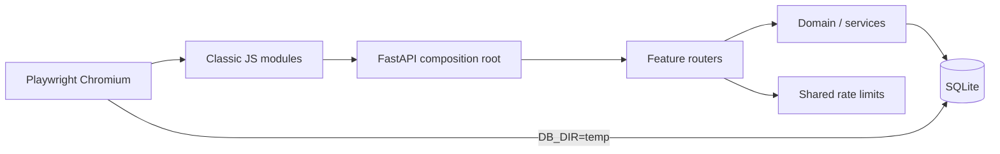

# SPEC-003：模組邊界完成與真實瀏覽器流程

- 狀態：Implemented
- Owner：Running Shoes maintainers
- 關聯 issue／ADR：ADR-0001 Modular Monolith

## Problem

後端 composition root 仍同時承擔 16 個 auth、goal、monthly、agent 與 report routes，以及多 worker
共用的限流邏輯；前端 `app.js` 同時包含登入、資料讀取、表格、月跑量、圖表與支出。既有
Playwright 只驗證 mock 資料的版面，無法證明瀏覽器、FastAPI 與 SQLite 串接後的核心 CRUD 可用。

## Goals

- `backend/main.py` 的 API route 數降為 0，只保留 app 組裝、lifecycle、middleware 與相容入口。
- auth、goals、monthly、agent、reports 與 rate limits 有明確模組邊界，API contract 不變。
- 前端核心狀態、dashboard、月跑量、圖表、支出與 bootstrap 分檔，仍使用無 bundler 的 classic scripts。
- Chromium 真實操作註冊、登入、跑鞋 CRUD、跑步 CRUD 與重新登入後的資料持久性。

## Non-goals

- 不更動 API path、payload、資料表 schema、畫面設計或部署拓撲。
- 不把模組化單體拆成微服務，也不引入前端 bundler／framework。
- 驗證期間不讀寫正式 `shoes.db`、Fly volume 或外部 LLM／搜尋服務。

## Proposed design

`app-boot.js`、`app-state.js`、`app-api.js`、`app-auth.js` 與 `app-core.js` 必須依序載入；feature modules 其後載入，`app.js` 最後執行初始化。
E2E 由 repository task runner 傳入專案 Python，動態取得 loopback port，並以作業系統暫存目錄
作為 `DB_DIR` 啟動 uvicorn；無論成功失敗都終止 server 並移除該暫存目錄。

## Security and data isolation

- routes 延續由 `get_current_user` 取得帳號；所有 user-owned query/mutation 保留 `user_id` 條件。
- 限流的 Fly client IP 信任規則不變，只有在 Fly runtime 才採用 proxy header。
- E2E 使用唯一帳號與暫存 SQLite，不包含正式 secret、備份或任何使用者資料。

## Migration, rollout, and rollback

- Schema／資料 migration：無。
- 上線與 smoke test：先通過 `verify-all`；部署仍沿用現有單一 container。
- 回滾方式與資料相容性：純程式結構重構，可回退 commit；資料與 API contract 不需轉換。

## Acceptance criteria

- [x] Given 既有 API contract，When 執行 architecture check，Then 33 組 method/path 全數保留且 main route budget 為 0。
- [x] Given 既有前端互動，When 執行 Node regressions 與 layout matrix，Then 行為與版面不回歸。
- [x] Given 全新暫存資料庫，When Chromium 完成註冊、登入、跑鞋與跑步 CRUD，Then 重新登入仍讀得到更新後資料，刪除後資料消失。
- [x] Given E2E 結束或失敗，When 執行 cleanup，Then uvicorn 停止且暫存資料庫被移除。

## Test traceability

| Acceptance criterion | Test file / command |
| --- | --- |
| AC-1 | `python3 scripts/task.py architecture-check`、`unit_tests/api_contract.json` |
| AC-2 | `python3 scripts/task.py frontend-test`、`python3 scripts/task.py frontend-layout` |
| AC-3 / AC-4 | `python3 scripts/task.py frontend-e2e`、`unit_tests/frontend_e2e.cjs` |
