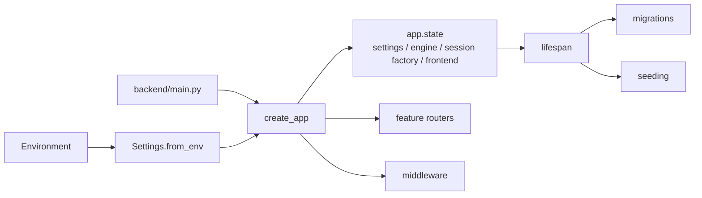

# SPEC-004：App Factory 與集中式 Settings

- 狀態：Implemented
- Owner：Running Shoes maintainers
- 關聯 issue／ADR：ADR-0001 Modular Monolith

## Problem

雖然 API routes 已全部抽離，`backend/main.py` 仍負責 middleware、seed、lifespan、靜態檔案與大量
歷史相容 aliases。環境變數也散落於多個模組，測試必須 monkeypatch `backend.main.engine` 與
`SessionLocal`，使 composition root 難以獨立建立與驗證。

## Goals

- 以 immutable typed settings 集中解析穩定的 runtime configuration。
- 提供 `create_app()`，可注入 settings、engine、session factory 與 frontend path。
- lifespan 從 `app.state` 取得依賴，測試不接觸正式資料庫 globals。
- 將 seed 與 upload middleware 移出 composition root。
- 移除 `backend.main` 的 route／service 相容 aliases，測試直接 import 真正 owner。

## Non-goals

- 不改 API contract、資料表 schema、使用者行為或 Fly topology。
- 不改成 dependency-injection framework；FastAPI app state 已足夠目前規模。
- 外部 provider API keys 仍於呼叫時讀取，避免把可輪替 secret 複製到長生命週期物件。

## Proposed design

## Security and data isolation

- `create_app()` 的測試 instance 使用 in-memory／temporary SQLite；不得回退到 production globals。
- secret 不寫入 log、文件或 app response。
- routes 的 `current_user.id` scopes 與 API contract 保持不變。

## Migration, rollout, and rollback

- Schema／資料 migration：無。
- 上線與 smoke test：`verify-all` 後依既有 Fly 流程部署。
- 回滾方式與資料相容性：純 composition/config 重構，可直接回退 commit。

## Acceptance criteria

- [x] Given 明確注入的 engine/session factory，When app lifespan 啟動，Then migration 與 seed 只使用注入資料庫。
- [x] Given production／test settings，When 建立 app，Then frontend path、auth secret 與 lifecycle flags 來自同一 settings object。
- [x] Given repository imports，When architecture check 執行，Then `backend.main` 只輸出 app factory 入口，無 route 相容 aliases。
- [x] Given 既有 API 與 browser flows，When `verify-all` 執行，Then contract、功能與 layout 全數通過。

## Test traceability

| Acceptance criterion | Test file / command |
| --- | --- |
| AC-1 / AC-2 | `unit_tests/test_app_factory.py`、`unit_tests/test_migrations.py` |
| AC-3 | `python3 scripts/task.py architecture-check` |
| AC-4 | `python3 scripts/task.py verify-all` |
