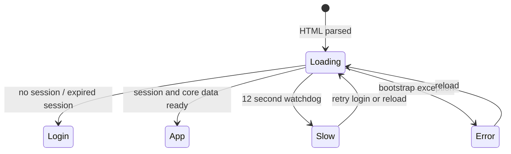

# SPEC-005：PWA 啟動畫面

- 狀態：Implemented
- Owner：Running Shoes
- 關聯 issue／ADR：無

## Problem

應用程式原本會先把整個 `body` 設為透明，而且 Service Worker 會等待網路導覽、外部 CSS 會阻塞首次繪製。
在 PWA 冷啟動、網路較慢、Fly Machine 喚醒或舊快取更新時，使用者只會看到全白或全黑畫面，
無法判斷程式仍在載入、已經失敗，或是否需要重新整理。

此外，登入表單只是隨 Dashboard 隱藏，成功登入後輸入值仍留在 DOM；登出再顯示登入頁時，
可能洩漏上一位使用者輸入的帳號與密碼。

## Goals

- HTML 一開始解析就顯示有品牌識別的載入畫面，不依賴 API 或完整 JavaScript 初始化。
- 已登入的冷啟動與表單登入都在核心資料準備完成後才移除載入畫面。
- 載入超過合理時間或初始化失敗時提供清楚訊息與重新載入操作。
- 亮色、暗色、窄螢幕及減少動態效果偏好都能正常使用。
- 登入成功、登出或工作階段失效後，不保留上一位使用者的認證欄位。

## Non-goals

- 不新增後端 API、資料表或登入流程。
- 不把所有分頁的背景載入都改成全畫面 loading。
- 不取代既有的資料載入失敗提示。

## Proposed design

- `index.html` 在登入頁與 Dashboard 之前提供 `#app-boot`，內嵌最小 critical style，並以非阻塞方式載入完整 CSS。
- Service Worker 對頁面導覽採 cache-first、background refresh，Fly Machine 喚醒時先回傳既有 app shell。
- `app-boot.js` 提供啟動、完成、逾時與失敗狀態控制；`app-core.js` 負責資料準備完成後的 shell orchestration。
- 初始化、登入與註冊後自動登入會等待核心資料載入完成，再淡出啟動畫面。
- 12 秒仍未完成時顯示「載入時間較久」及重新載入按鈕；未捕捉的初始化錯誤顯示失敗狀態。
- HTML 內保留極小的相容監看器，讓舊 Service Worker 快取到的 JavaScript 仍能關閉新版啟動畫面。
- 認證生命週期集中清空登入、註冊與改密碼欄位；登入表單停用自動完成提示。

## Security and data isolation

- 啟動畫面不顯示 token、帳號、API 回應或其他使用者資料。
- 不修改認證、資料查詢與 `user_id` 隔離邏輯。

## Migration, rollout, and rollback

- Schema／資料 migration：無。
- 上線與 smoke test：執行前端回歸與 layout 測試；部署後檢查 PWA 首頁及 health endpoint。
- 回滾方式與資料相容性：回滾靜態前端資源即可，沒有資料相容性問題。

## Acceptance criteria

- [x] AC-1：Given 應用程式尚未初始化，When HTML 已開始呈現，Then 顯示「正在準備」畫面而不是空白頁。
- [x] AC-2：Given 使用者有既有登入狀態或提交登入，When 核心資料仍在載入，Then 啟動畫面保持可見直到載入流程結束。
- [x] AC-3：Given 初始化超過 12 秒或發生未捕捉錯誤，When 啟動畫面仍存在，Then 顯示可重新載入的狀態。
- [x] AC-4：Given 使用者偏好減少動態效果，When 啟動畫面顯示，Then spinner 與淡出動畫不會持續播放。
- [x] AC-5：Given PWA 尚由舊 Service Worker 提供舊版 JavaScript，When 舊程式顯示登入頁或 Dashboard，Then 新版啟動畫面仍會自動關閉。
- [x] AC-6：Given PWA 已有 app-shell 快取，When Fly Machine 尚在喚醒，Then Service Worker 立即回傳快取並在背景更新。
- [x] AC-7：Given 使用者登入後登出或工作階段失效，When 登入頁再次顯示，Then 所有帳號與密碼欄位皆為空白。

## Test traceability

| Acceptance criterion | Test file / command |
| --- | --- |
| AC-1, AC-2, AC-3, AC-4, AC-5, AC-6, AC-7 | `unit_tests/frontend_regressions.cjs`; `python3 scripts/task.py frontend-test` |
| 響應式與亮／暗色版面 | `unit_tests/frontend_layout.cjs`; `python3 scripts/task.py frontend-layout` |
