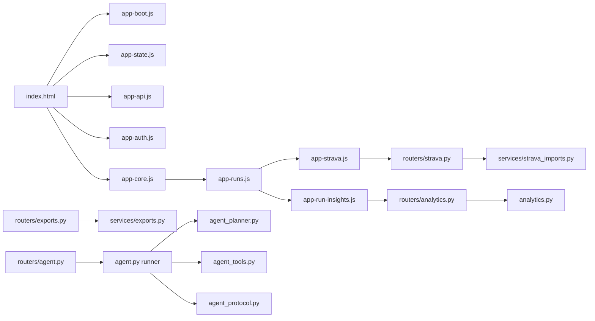

# SPEC-006：Runtime boundary refactor

- 狀態：Implemented
- Owner：Running Shoes maintainers
- 關聯 issue／ADR：`docs/architecture.md` 的 ADR-001 modular monolith

## Problem

前端啟動、認證、API 與全域狀態集中在 `app-core.js`；跑步 CRUD、Strava 匯入與分析 UI 集中在 `app-runs.js`。後端的 analytics、匯出與支出 API 共用單一 router，而 Agent 的查詢規劃、工具執行、SSE protocol 與迴圈也位於同一檔案。這些檔案雖可運作，但變更一個功能時容易碰到不相關的程式碼，測試與責任邊界也不夠清楚。

此外，主要架構文件尚未描繪前端 module 載入順序、Service Worker 與 Fly runtime 的關係；歷史 release note 與集中式 changelog 也不完整。

## Goals

- 將前端 boot、state、API、auth、run insights 與 Strava UI 拆成明確 module。
- 將 Strava HTTP adapter 與匯入 transaction 拆離 run CRUD。
- 將 analytics、exports、spending routers 分離，匯出內容生成放入 framework-independent service。
- 將 Agent planner、tool executor、SSE protocol 與 runner 拆分。
- 保持既有 HTTP path、response shape、瀏覽器全域函式與 SSE event contract 不變。
- 補齊架構圖、release history 與 changelog。

## Non-goals

- 不變更資料庫 schema 或既有資料。
- 不重新設計畫面、登入流程、Agent prompt 或公開 API。
- 不導入前端 bundler 或新的 runtime dependency。

## Proposed design

Frontend 仍採 plain scripts，透過固定載入順序提供共享 global API。Backend routers 僅處理 HTTP dependency／error mapping；services 不 import FastAPI 或 routers。Agent runner 是唯一 orchestration entry point，其餘 module 各自處理 deterministic planning、工具邊界與 SSE serialization。

## Security and data isolation

- 所有 Strava、analytics、exports 與 spending query 都必須使用 authenticated `current_user.id`。
- Strava 鞋款 mapping 必須驗證鞋款屬於目前使用者；匯入 transaction 與里程同步維持同一 database session。
- 匯出 service 不包含密碼 hash、JWT、API key 或其他使用者資料。
- Agent database tools 仍由 runner 傳入 authenticated `user_id`，外部搜尋結果仍視為不可信資料。

## Migration, rollout, and rollback

- Schema／資料 migration：無。
- 上線與 smoke test：執行 `python3 scripts/task.py verify-all`，部署後檢查 `/api/health`、靜態資產與 authenticated dashboard。
- 回滾方式與資料相容性：回滾應用程式 image 即可；沒有資料 migration，也不需還原資料庫。

## Acceptance criteria

- [x] Given 既有帳號與資料，When 載入 dashboard、管理跑步、匯入 Strava、匯出資料或使用 Agent，Then 對外行為與 refactor 前一致。
- [x] Given 未登入或不同使用者，When 存取資料端點，Then 仍受 authentication 與 `user_id` isolation 保護。
- [x] Given CSV/XLSX 匯出與 Agent tool error，When dependency 缺失或工具失敗，Then HTTP／SSE error contract 維持既有格式。
- [x] Given production build，When Service Worker precache 新 module，Then 不會因漏列靜態檔案而離線啟動失敗。
- [x] Given architecture／documentation checks，When 執行 repository task runner，Then 新 module map、圖表與 changelog 可被驗證。

## Test traceability

| Acceptance criterion | Test file / command |
| --- | --- |
| 前端 module 與 global contract | `node --test unit_tests/frontend_regressions.cjs` |
| Strava parser、import、quota、isolation | `unit_tests/test_strava_import.py`, `unit_tests/test_review_regressions.py` |
| Analytics／export／spending endpoints | `unit_tests/test_api_extra.py`, `unit_tests/test_api_isolation.py` |
| Agent planner／tools／SSE | `unit_tests/test_agent.py`, `unit_tests/test_agent_evals.py`, `unit_tests/test_tools.py` |
| Static asset／security contract | `unit_tests/test_security_config.py` |
| Module boundaries and docs | `python3 scripts/task.py architecture-check`, `python3 scripts/task.py docs-check` |
| Full release gate | `python3 scripts/task.py verify-all` |
