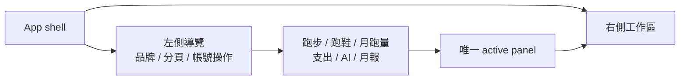

# SPEC-007：側欄工作區版面

- 狀態：Implemented
- Owner：Running Shoes
- 關聯 issue／ADR：`docs/architecture.md` 前端 shell

手機導覽後續調整見 [SPEC-008](008-mobile-navigation.md)；以下保留 v3.0.0 初版設計與驗收紀錄。

## Problem

登入後的六個功能以頁面頂端橫向分頁呈現。寬螢幕沒有充分利用水平空間，使用者在內容較長時也會失去主要導覽；AI 助手另以 JavaScript 直接覆寫整個 app 容器的 display 與高度，讓導覽與功能內容彼此耦合。

## Goals

- 桌面與平板橫向畫面使用固定在左側的功能導覽，右側作為完整工作區。
- 切換功能只替換右側內容，保留使用者、主題與登出操作。
- 手機與窄螢幕改為頂部緊湊導覽，避免側欄壓縮表單、圖表與表格。
- AI 助手高度由 shell 狀態與 CSS 管理，不再以 inline style 改寫整個應用程式。
- 保留所有既有 tab 名稱、localStorage 還原、圖表重繪與 API 行為。

## Non-goals

- 不變更任何後端 API、資料庫 schema 或使用者資料。
- 不重做各功能內部的卡片、表格、圖表與表單視覺。
- 本次不加入可收合 sidebar 或新的前端 framework。

## Proposed design

桌面使用 CSS Grid 建立 `sidebar + workspace`。sidebar 在 viewport 中 sticky，工作區自行捲動頁面內容。小於 800px 時 shell 轉為單欄，導覽以三欄按鈕排列於內容上方。`switchTab` 負責 active 與 ARIA 狀態，以及替工作區切換 `agent-mode` class；實際尺寸完全交由 CSS。

## Security and data isolation

- 本次只有靜態 HTML、CSS 與前端 shell 狀態變更，不新增 query 或 mutation。
- 使用者名稱仍以 `textContent` 寫入，沒有新增 HTML 注入面。
- token、secret、備份及帳號資料處理方式不變。

## Migration, rollout, and rollback

- Schema／資料 migration：不需要。
- 上線與 smoke test：登入後逐一切換六個功能，驗證桌面左右分欄、手機單欄、亮暗主題與 AI 訊息區。
- PWA 資產一致性：HTML 的 application CSS／JavaScript 與 Service Worker 使用相同版本 query；新版 HTML 不得搭配舊版快取資產。
- 回滾方式與資料相容性：可直接回滾前端 commit；不涉及資料格式，無相容性風險。

## Acceptance criteria

- [x] Given viewport 寬度大於 800px，When 使用者登入，Then 導覽位於左側且功能內容位於右側。
- [x] Given 任一分頁，When 使用者點選另一個分頁，Then 只有右側 active panel 改變，sidebar 保持可見並標示目前項目。
- [x] Given viewport 寬度不超過 800px，When 顯示 dashboard，Then 導覽位於內容上方，控制項不溢出或互相覆蓋。
- [x] Given AI 助手分頁，When 視窗尺寸改變，Then 訊息區保持可捲動且 app shell 不被 inline style 改寫。
- [x] Given 重新整理或重新登入，When 還原／重設分頁，Then active 與 `aria-selected` 狀態一致。

## Test traceability

| Acceptance criterion | Test file / command |
| --- | --- |
| AC-1～AC-4 | `python3 scripts/task.py frontend-layout` |
| AC-2、AC-5 | `python3 scripts/task.py frontend-test` |
| 登入後真實互動 | `python3 scripts/task.py frontend-e2e` |
