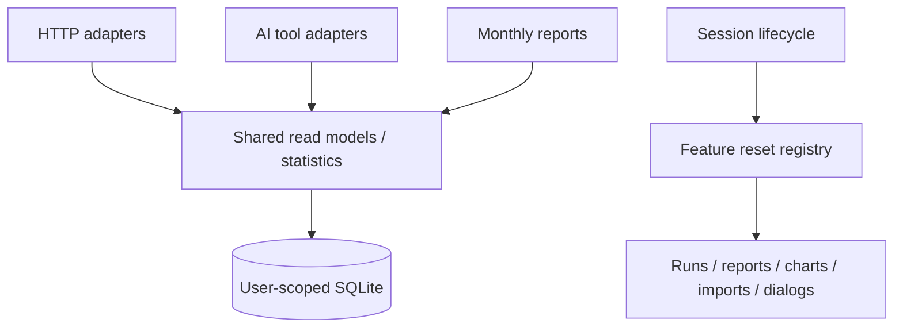

# SPEC-017：統計一致性、資料防呆與功能生命週期

- 狀態：Implemented
- Owner：Running Shoes maintainers
- 關聯 issue／ADR：ADR-0001 modular monolith

## Problem

本次唯讀稽核重現：空白月跑量覆寫成零、目標混入手動調整、跨日日期上限未更新、
刪鞋後堆疊圖漏算、AI 同名鞋任選第一筆，以及負時區購買月份偏移。
此外工具逐鞋分析有 N+1 查詢，月報反向依賴工具 JSON，Strava service 間接依賴 HTTP。
前端功能清理集中於 auth，CSS、工具定義、對話及模板責任混合，需以行為測試保護拆分。

## Goals

- 三批一起完成：六項修正；共用統計與批次查詢；功能生命週期、呈現與工具邊界整理。
- 日誌是目標唯一依據；手動歷史總量仍保留且清楚標示。
- 首頁不因支出載入失敗而失去核心資料；明細分頁與月曆／彙總互不影響。
- 原生 module 的純 runtime 可獨立測試，legacy DOM handlers 保留相容橋接，不引入框架。
- 彈窗鍵盤操作、跨日恢復與 PWA 更新提示不破壞正在編輯的草稿。

## Non-goals

- 不改資料庫 schema、不重寫為 SPA framework、不引入微服務。
- 不執行正式資料遷移；不強制刷新使用者頁面。實作階段不發布，後續發布依使用者明確授權。

## Proposed design

共用 Python read models 提供原生 dict 統計，API、月報與 AI tools 各自包裝。
鞋款查詢以 user scope 及 ID 識別；名稱歧義回傳候選，不猜測。鞋款分析批次讀取日誌。
前端拆出 feature lifecycle registry、日期處理、dialog manager、模型清單及 Markdown；
功能自行註冊 reset，auth 僅推進 session 並通知清理。CSS 由本機分檔來源生成單一資產，
modal markup 由模板生成，harness 檢查產物未漂移，維持 PWA 原子 shell。

## Security and data isolation

- 所有新增讀取皆限制 user_id；ID 消歧義不得回傳他人鞋款。
- 測試使用 in-memory／temporary SQLite，外部 LLM、搜尋與更新傳輸使用 mocks。
- 登出使舊請求、快取及視窗失效；新增資料不得落入其他帳號工作階段。
- 發布稽核的 PYSEC-2026-4320 由 certifi 2026.10.19 修補，重新生成兩份含雜湊鎖檔，必須重新通過 dependency audit 與完整測試才發布。

## Migration, rollout, and rollback

- Schema／資料 migration：無。保留舊 API 與工具名稱；新增統計 API 必須更新 contract。
- 上線與 smoke test：使用者於 2026-10-21 授權發布 v3.3.0。先生成資產、通過 verify-all／eval-agent，再下載並驗證異地備份及隔離還原演練，最後 commit／push／tag／release 與 Fly deploy。
- 部署後核對 machine image、readiness／liveness、HTML／service worker 版本、manifest 資產內容與 native module MIME；不得以正式帳號執行測試寫入。
- 回滾：使用 `fly deploy --app running-shoes --image registry.fly.io/running-shoes:v3.2.5-8845d90` 將程式與靜態 shell 一起回滾；無 schema 變更，不還原或覆蓋正式資料。若需重新發布，使用新的 shell revision，避免已安裝 PWA 的快取混版。

## Acceptance criteria

- [x] AC-1：月跑量空白／無效不送出，明確零可儲存；手動基準不意外遺失。
- [x] AC-2：日誌 50、調整 100、目標 125 時，所有目標頁均為 40%，不是 120%。
- [x] AC-3：跨日恢復、新增及編輯前更新日期限制，不重設使用者草稿／目前分頁。
- [x] AC-4：刪鞋後堆疊合計仍等於日誌合計，顯示歷史鞋款群組。
- [x] AC-5：同名鞋回傳候選且 ID 可選定；不可讀取其他帳號或已刪除鞋款。
- [x] AC-6：購買月份及平均支出不受瀏覽器時區影響，計算由後端統一提供。
- [x] AC-7：批次鞋款分析查詢次數不隨鞋款數增加；月報不 import tools。
- [x] AC-8：Strava 純解析／service 不直接或間接依賴 FastAPI，HTTP 錯誤由 router 映射。
- [x] AC-9：前端功能自行註冊 reset，舊 session 不得寫入新畫面；清理與重設可重複執行。
- [x] AC-10：CSS、HTML 模板、工具 schema／legacy parser、模型與 Markdown 責任拆分，產物可驗證。
- [x] AC-11：明細可分頁但月統計完整，非核心支出失敗不阻擋首頁；請求失敗可重試。
- [x] AC-12：彈窗支援焦點、Tab、Escape、返回焦點；PWA 顯示版本與更新提示且不自動刷新。
- [x] AC-13：行為測試覆蓋統計不變量、時區、跨日、歧義、查詢預算與架構邊界。

## Test traceability

| Acceptance criterion | Test file / command |
| --- | --- |
| AC-1 空白防呆 | `unit_tests/frontend/statistics-lifecycle.test.cjs` + `frontend_consistency.cjs` |
| AC-2 目標一致 | `unit_tests/test_statistics_consistency.py` + Node goal cards + 雙引擎 SPEC-017 |
| AC-3 跨日草稿 | Node date lifecycle + `frontend_consistency.cjs` 的 clock/foreground 流程 |
| AC-4 歷史鞋款合計 | Node deleted-shoe stacked invariant + Python complete summary |
| AC-5 同名及 ID scope | `test_tools_require_disambiguation_and_accept_owned_ids` |
| AC-6 日曆月份 | Python spending read model + Node 禁用 Date parsing + Los Angeles browser context |
| AC-7 共用 read models／批次 | 0／1／12 shoes query budget + `test_reports_depend_on_read_models_not_tool_serialization` |
| AC-8 parser／HTTP 分離 | `test_strava_import.py` + `test_architecture_boundaries.py` direct/transitive/relative imports |
| AC-9 功能清理 | native lifecycle Node + `frontend_sessions.cjs` + SPEC-017 hidden-purchase cleanup |
| AC-10 來源拆分及生成 | `test_generated_frontend_is_exactly_reproducible` + `build_frontend.py --check` + Node asset order |
| AC-11 完整彙總與分頁 | Python 205 rows/day/user scope + Node single-page/card tests + SPEC-017 paging/retry |
| AC-12 彈窗／更新提示 | SPEC-017 Tab/Shift+Tab/Escape/focus + `frontend_pwa.cjs` actual controller messages/module MIME |
| AC-13 Harness | `python3 scripts/task.py verify-all` + `python3 scripts/task.py eval-agent` |

## Verification record

2026-10-20 本機完整驗證通過：396 Python tests、71 Node tests、10 deterministic Agent evals；
backend branch coverage 94.59%（門檻 92%）。40 組 Chromium/WebKit 排版、真實暫存 DB CRUD／session
及兩引擎 SPEC-017／PWA upgrade/offline 均執行，未跳過。Ruff、mypy、architecture、generated assets、
secret scan、dependency audit 與 docs-check 通過。

上述實作驗證階段無 schema migration、無正式資料讀寫、無 Git commit/push、tag/release 或 Fly deploy；後續授權發布流程如上。
瀏覽器引擎測試不等於 iPhone 實機驗證；原生 runtime 為漸進導入，未宣稱 legacy globals 全數消除。
