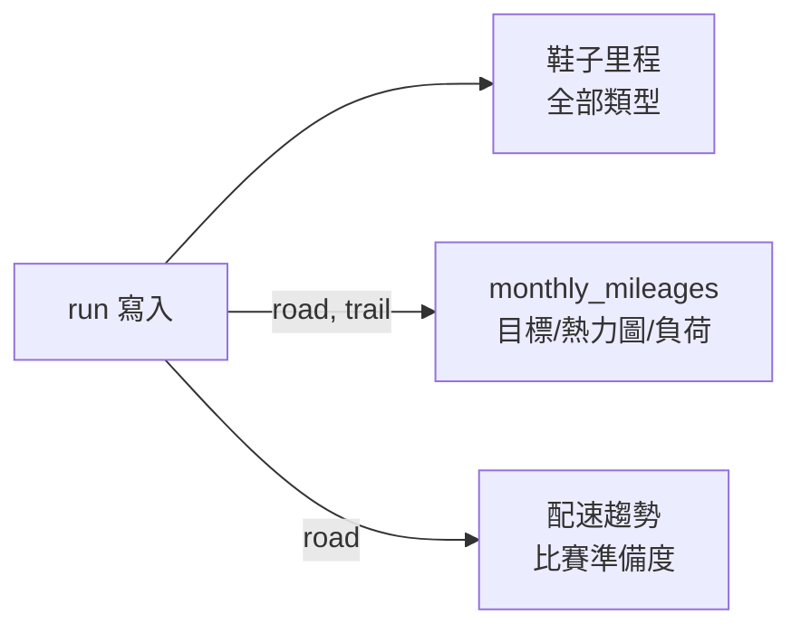

# SPEC-096：運動類型（路跑、越野跑、健行）

- 狀態：Implemented（v4.28.0）
- Owner：Running Shoes maintainers
- 關聯 issue／ADR：[SPEC-060](060-run-duration-and-pace.md)、[SPEC-065](065-race-readiness.md)、[SPEC-067](067-timeline-shoe-mileage.md)

## Problem

- 一雙鞋（尤其越野鞋）會同時用在路跑、越野跑與健行。鞋子的磨耗與壽命提醒需要所有里程，但跑步分析只該看跑步。
- 目前 `runs` 只有日期、公里數、鞋款與選填的移動時間，沒有活動類型：
  - 健行的公里數經 `services/mileage.apply_run_mileage_deltas` 寫進 `monthly_mileages.km`，灌進月跑量、年度目標、熱力圖、連續天數與每週負荷。
  - 健行或越野跑只要填了時間，就會進入配速趨勢（`read_models/pace.py`）與比賽準備度的強度分布、長距離檢查（`read_models/race_readiness.py`），爬升會把配速拉慢、讓強度判斷失準。
- Strava 匯入只接受 `STRAVA_RUN_TYPES`（含 `TrailRun`），`Hike`／`Walk` 會被丟掉，所以 Strava 上的健行反而沒算到鞋子里程。
- 鞋款類別（`Daily`／`Speed`／`Tempo`／`Race`）描述的是鞋款組合的用途；過去的 `Trail`／`Walk` 類別已被移除。同一雙鞋每次的用途不同，類別放在鞋上解決不了紀錄失準。

## Goals

- 每筆紀錄有一個 `activity_type`：`road`（路跑，預設）、`trail`（越野跑）、`hike`（健行）。
- 三種類型都計入鞋子里程、壽命提醒、退役預測、成本／每公里與選鞋建議。
- 路跑：維持現有全部行為。
- 越野跑：計入月跑量、年度目標、熱力圖、連續天數、每週負荷、年度回顧、月報；**不**進入配速趨勢、平均配速與比賽準備度（強度分布、長距離）。
- 健行：只計入鞋子相關統計；不計入月跑量、目標、熱力圖、連續天數、每週負荷、跑步總計、配速與比賽準備度。
- 紀錄頁可以選擇與修改類型，列表標示越野跑與健行；改類型時月里程同步調整。
- Strava 匯入：`Run`／`跑步`／`VirtualRun` → `road`，`TrailRun`／`越野跑` → `trail`，`Hike`／`Walk`／`健行`／`步行` → `hike`。
- 舊資料全部視為 `road`，升級後現有統計數字不變。

## Non-goals

- 不新增鞋款類別，也不依鞋款自動推斷類型（只在表單上把該鞋在已載入紀錄中最近一次的類型當預設值）。
- 不記錄爬升、海拔或坡度修正配速（GAP）。
- 不新增騎車、游泳等其他運動。
- 不提供「越野跑是否計入跑量」的使用者設定；本 SPEC 固定為計入。
- Strava 預覽不逐列顯示類型；類型在匯入後的紀錄列表可見、可修改。
- AI 教練與月報只透過既有 read model 取得已排除後的數字，不另外描述類型細節。

## Proposed design

### 資料模型（schema 13）

- `runs.activity_type VARCHAR NOT NULL DEFAULT 'road'`。合法值由 Pydantic `Literal` 把關（API、備份與 Strava 對照表是唯一的寫入來源），不加 SQLite `CHECK`，讓 `ALTER TABLE ADD COLUMN` 維持單純。
- `migrations._migrate_schema_thirteen` 加欄位；從 schema 12 以下升級時，把仍標為 `hike` 的里程從 `monthly_mileages.km` 扣除。全新的 schema 12 資料庫沒有健行（扣除 0）；回滾後再升級的資料庫則抵銷回滾腳本加回的健行里程。
- `run_tombstones` 不需要類型；復原刪除時沿用稽核快照中的類型，快照沒有則為 `road`。
- 稽核觸發器依模型欄位重建，`activity_type` 自動進入 run 快照。

### 單一判斷來源

- `backend/run_metrics.py`：`ACTIVITY_TYPES = ("road", "trail", "hike")`、`TRAINING_ACTIVITY_TYPES = ("road", "trail")`、`PACE_ACTIVITY_TYPES = ("road",)` 與 `counts_toward_training()`。
- `backend/read_models/run_statistics.py`：共用 SQL 條件 `TRAINING_RUN`、`PACE_RUN`，其他 read model 都從這裡取用。
- 前端 `app-state.js` 鏡射三組常數與中文標籤（路跑／越野跑／健行），Python 測試確認一致。

### 寫入（services）

- `services/mileage.apply_run_mileage_deltas` 的輸入為 `(shoe_id, date, km, activity_type)`：鞋子增量照舊；月增量只累加 `TRAINING_ACTIVITY_TYPES`。
- `services/runs.py` 更新時把「舊值 −1、新值 +1」兩筆增量交給同一函式，所以改類型、日期、公里數與鞋款走同一條路徑。
- `monthly_mileages.km` 的定義改為 `adjustment_km + 該月 training 類型 run 總和`；`adjustment_km` 語意不變。
- 帳號匯入／還原（含合併預覽的投影）、刪除復原與 Strava 匯入（含 UTC 日期修正）共用同一個增量函式與規則。

### 讀取（read models）

- 計入跑量：`run_statistics`（目標與月報的期間距離、每月距離）、`trends` 的每日熱力圖／連續天數／每週負荷、`highlights` 的年度回顧、`insights` 的月份摘要、`report_snapshot`、`runs.year_run_summary` 與 `runs.run_totals`。
- 只計入配速：`pace.py`、`race_readiness.py`、每週負荷的計時里程、月份平均配速與單鞋平均配速。
- 不過濾：`shoe_statistics` 的里程與次數、`forecasting`、選鞋建議、單鞋距離分布。鞋款輪替時間軸的日期看所有活動，`km`／`run_count` 只算跑步，健行併入 `other_km`（記在鞋上但不是跑步的里程）。
- `runs.month_run_summary` 的月曆與鞋款分布列出所有紀錄；`total_km`／`run_count`／`run_days` 只算跑步。單筆健行／越野跑的配速照常顯示，只是不進彙總。

### API 與合約

- `RunBase`／`RunCreate` 新增 `activity_type: Literal["road","trail","hike"] = "road"`；`RunUpdate` 可選（明確的 `null` 回 422）；`RunOut` 回傳。
- 路由不變（`unit_tests/api_contract.json` 不變）；README「API 一覽」更新欄位說明。
- 帳號備份升為 v5：run 加 `activity_type`，月份核對只算跑步。v1–v4 不得帶非路跑類型，匯入時視為 `road`；舊版本的 fingerprint 不含此欄位；以舊備份合併時不覆寫已存在的類型。

### Strava 匯入

- `STRAVA_RUN_TYPES` 換成 `STRAVA_ACTIVITY_TYPES: dict[str, str]`（Strava 類型 → `activity_type`），不在表內的類型仍略過。

### 前端

- 新增／編輯紀錄表單加入「運動類型」下拉選單（路跑／越野跑／健行），下方提示該類型計入哪些統計。
- 新增表單選擇鞋款時，類型改為該鞋在已載入紀錄中最近一次的類型，沒有則為路跑；編輯時不改寫已存的類型。
- 跑步列表在日期旁標示越野跑與健行；月份卡片的配速改稱「路跑平均配速」。
- 離線佇列保存送出的 payload 原樣，`activity_type` 隨之重送；新增表單與編輯視窗的草稿都包含類型。

## Security and data isolation

- `activity_type` 屬於使用者自己的 run；所有新增過濾都疊加在既有 `user_id` 條件上，不改變隔離範圍。
- 值以 Pydantic `Literal` 限制；Strava CSV 的類型字串只用來查表，不寫入資料庫原文。
- 不涉及 secret；備份 v5 仍不含任何憑證。

## Migration, rollout, and rollback

- Schema／資料 migration：schema 12 → 13 只新增欄位與預設值，既有統計不變；部署前依 SPEC-078 流程快照並驗證正式資料庫。
- 上線與 smoke test：`release-check` 確認 schema 13、API 與資源；手動新增一筆健行，確認鞋子里程增加而月跑量不變。
- 回滾方式與資料相容性：`scripts/rollback_schema_thirteen.sql` 把健行里程加回 `monthly_mileages`（必要時建立該月），保留 `activity_type` 欄位並把版本標記改回 12；schema-12 程式不讀這個欄位，新紀錄取得預設值 `road`。再次升級時 migration 扣回健行里程。v5 備份無法匯入回滾後的版本。

## Acceptance criteria

- [x] AC-1：Given schema 12 的資料庫有 run，When 升級到 13，Then 每筆 run 為 `road`，鞋子與月份里程與升級前相同。
- [x] AC-2：Given 一雙鞋，When 新增 10 km 健行，Then 鞋子里程 +10，該月 `monthly_mileages.km`、年度目標進度、熱力圖、連續天數與跑步總計不變，月曆仍列出它。
- [x] AC-3：Given 一筆有時間的越野跑，When 讀取月跑量與配速，Then 月跑量包含它，配速趨勢、月平均配速、單鞋平均配速與比賽準備度的強度分布／長距離不包含它。
- [x] AC-4：Given 一筆路跑，When 依序改成健行、越野跑、路跑，Then 月里程依序減少、恢復，鞋子里程只隨距離變動，版本號遞增；過期版本回 409 且不移動里程。
- [x] AC-5：Given 含 `Run`、`TrailRun`、`Hike`、`Walk`、`健行`、`Ride` 的 Strava CSV，When 預覽與匯入，Then 前五種依對照表取得類型、`Ride` 被略過，月份只增加跑步的里程。
- [x] AC-6：Given v5 備份，When 還原，Then 類型保留；Given v4 備份，When 解析，Then run 為 `road`，帶非路跑類型則拒絕，合併時不覆寫既有類型。
- [x] AC-7：Given 不在三種值內的 `activity_type`（含 `null`），When 建立或更新 run，Then 回應 422，資料不變。
- [x] AC-8：Given 新增表單，When 選擇鞋款，Then 類型預設為該鞋在已載入紀錄中最近一次的類型並更新提示；When 送出，Then payload 帶所選類型。
- [x] AC-9：Given schema 13 資料庫有健行紀錄，When 執行 `rollback_schema_thirteen.sql`，Then 月里程等於 adjustment 加上所有 run 的總和，schema 版本為 12；When 再次升級，Then 月里程回到只含跑步。

## Test traceability

| Acceptance criterion | Named test / command |
| --- | --- |
| AC-1 | `unit_tests/test_migrations.py::test_schema_thirteen_defaults_runs_to_road` |
| AC-2 | `unit_tests/test_runs_api.py::test_hike_counts_toward_shoe_but_not_monthly_mileage` |
| AC-3 | `unit_tests/test_run_pace.py::test_trail_runs_count_toward_volume_but_not_pace` |
| AC-4 | `unit_tests/test_runs_api.py::test_changing_activity_type_moves_monthly_mileage` |
| AC-5 | `unit_tests/test_strava_import.py::test_strava_activity_types_map_to_run_types` |
| AC-6 | `unit_tests/test_account_restore.py::test_backup_v5_round_trips_activity_type` |
| AC-7 | `unit_tests/test_runs_api.py::test_invalid_activity_type_is_rejected` |
| AC-8 | `unit_tests/frontend/run-controller.test.cjs::run form defaults activity type from the selected shoe`、`unit_tests/test_run_pace.py::test_frontend_activity_types_mirror_the_backend` |
| AC-9 | `unit_tests/test_migrations.py::test_rollback_schema_thirteen_restores_hike_mileage` |
