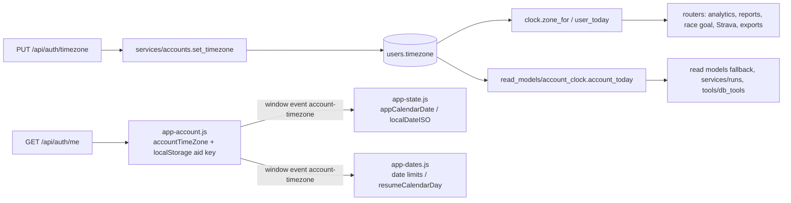

# SPEC-147：帳號時區

- 狀態：Implemented
- Owner：Running Shoes maintainers
- 關聯 issue／ADR：[SPEC-093](093-project-review-hardening.md)、[SPEC-047](047-review-hardening-and-decoupling.md)、[SPEC-134](134-account-keyed-settings-and-decoupling.md)

## Problem

- 服務只有一個固定的應用時區：`backend/clock.py` 的 UTC+8，前端以 `APP_UTC_OFFSET_MINUTES = 480` 鏡像（SPEC-093）。「今天」、跑步日期上限、本週／本月、連續天數、目標進度、退役預估、月報月份與 Strava 日期都照台灣日曆。
- 出國比賽或住在國外的跑者看到錯的「今天」：在檀香山（UTC-10）早上 6:30 時台灣已經是隔天，表單預設日期與上限跳到明天、本月目標提早換月；反過來在東京晚上 11:30 時（台灣 22:30）才記的跑步仍照台灣日期，月底最後一跑可能記到錯的月份。
- 固定偏移也無法表示有夏令時間的地區（例如 America/New_York 一年有 UTC-5 與 UTC-4 兩種偏移）。

## Goals

- 每個帳號有自己的 IANA 時區（例如 `Asia/Tokyo`），預設 `Asia/Taipei`，既有帳號的行為完全不變。
- 後端所有決定「今天」、日曆月份或跨日限制的讀取模型、服務與 AI 工具都用登入帳號的時區；`clock.py` 仍是唯一的時區規則來源，任何模組都不寫死偏移或讀伺服器時區。
- `GET /api/auth/me` 回傳時區，`PUT /api/auth/timezone` 修改時區；只接受 `zoneinfo.available_timezones()` 的名稱。
- 前端以帳號時區計算日期，偏移依每個時間點用 `Intl.DateTimeFormat` 計算（夏令時間正確），並在「資料與同步」提供時區選單。

## Non-goals

- 不移動已記錄的資料：跑步、購鞋與月跑量的日期是日曆日，改時區只改變之後「今天」是哪一天。
- 不依每筆跑步記錄當地時區，也不自動依裝置位置切換帳號時區（只提示「改用這台裝置的時區」）。
- 伺服器時間戳（月報更新時間、異動紀錄）仍以裝置本地時間顯示（SPEC-134 的 `formatLocalTimestamp`）。
- AI 每日額度與全站限流的計數視窗不變，它們是伺服器層級的配額，不是帳號的日曆。
- 帳號備份 JSON 不加入時區，維持 v6（見下方「備份」）。

## Proposed design

- **資料模型**：schema 15 在 `users` 加上 `timezone VARCHAR(64) NOT NULL DEFAULT 'Asia/Taipei'`。舊版 legacy owner migration（以 ORM 讀 `users`）同樣先補欄位。
- **時區規則（`backend/clock.py`）**：`DEFAULT_TIMEZONE`、`timezone_names()`（`available_timezones()` 去掉 `Factory`）、`is_timezone_name()`、`zone(name)`（不認得的名稱用預設時區）、`zone_for(user)`、`local_now(zone)`、`local_today(zone)`、`user_today(user)`、`latest_today()`（UTC+14 的今天）與 `zone_label()`（通知信顯示「台灣時間」或「Asia/Tokyo，UTC+09:00」）。`tzdata` 加入 `requirements.in`，slim 映像與 Windows 不靠系統的時區資料庫。
- **讀取「今天」**：有帳號 row 的路由用 `clock.user_today(current_user)`；只有 user id 的程式（讀取模型的 `today` fallback、`forecasting`、`services/runs.py`、`tools/db_tools.py`）用新的 `read_models/account_clock.account_today()`／`account_zone()`，每個查詢都以 `models.User.id == user_id` 限定。
- **跑步日期上限**：request schema 不知道帳號，`schemas.validate_completed_run_date()` 只擋晚於 `latest_today()` 的日期；`services/runs.reject_future_run_date()` 在新增與改日期時依帳號的今天檢查，回 422（新的 `services.errors.Unprocessable`，`routers/errors.py` 對應 422），離線佇列重送（`Idempotency-Key`）走同一規則。
- **Strava**：路由把 `clock.zone_for(current_user)` 傳給 `strava_import.parse_csv()`，UTC 時間戳換成帳號時區的日期，未來日期檢查也用帳號的今天。SPEC-047 的「舊 UTC 日期修正」只對 `Asia/Taipei` 帳號進行：那些紀錄來自所有帳號都用台灣時間的年代，其他時區無法分辨舊 UTC 日期與當地日期。
- **其他**：CSV／XLSX 與帳號備份的檔名用帳號時區的時間；密碼變更通知信以帳號時區顯示變更時間。
- **API**：`GET /api/auth/me` 多了 `timezone`；`PUT /api/auth/timezone` 接受 `{"timezone": "Asia/Tokyo"}`（`extra="forbid"`，最長 64 字），回傳 `{"timezone", "today"}`。
- **前端**：`app-state.js` 以 `DEFAULT_ACCOUNT_TIMEZONE = 'Asia/Taipei'` 取代固定偏移，`timeZoneOffsetMinutes(zone, instant)` 以 `Intl.DateTimeFormat#formatToParts` 求該時間點的偏移，`appCalendarDate()`／`localDateISO()` 用它；不認得的名稱維持預設時區。`app-account.js` 擁有帳號時區：啟動與 `onAuthView({ appShown })` 先套用這台裝置記住的時區（localStorage `timezone:aid:<aid>`，SPEC-134 的帳號識別碼鍵），`/auth/me` 回來後更新，登出時重設為預設。它以 window 事件 `account-timezone` 通知，`app-state.js` 先套用時區、`app-dates.js` 再更新日期上限，日期改變時重新載入以日期計算的結果，仍停在舊預設值的跑步日期跟著換成新的今天。這樣不新增任何跨 script 名稱（`cross_script_names` 不變）。
- **時區選單**：「資料與同步」新增「時區（決定「今天」是哪一天）」區塊：常用時區在前，接著是瀏覽器 `Intl.supportedValuesOf('timeZone')` 的清單，每個選項標示目前的 UTC 偏移；裝置在別的時區時顯示「改用這台裝置的時區」（只選取，按「儲存時區」才送出）。

### 備份

時區**不**放進帳號備份，v6 格式不變，不新增 v7：

- 備份裡的日期是已經決定好的日曆日，在任何時區都代表同一天；時區只影響之後「今天」怎麼算，不是資料。
- 備份匯入是合併到接收帳號（[SPEC-029](029-account-data-transfer.md)），接收帳號的時區和它的 email、密碼一樣屬於帳號本身；「只新增」模式本來就不改既有設定，讓匯入悄悄改變另一個帳號的「今天」會令人意外。
- 新增 v7 會讓 v5.4 以前的本機版無法讀取新版雲端備份；換到新安裝時在選單設定一次時區即可。

## Security and data isolation

- `users.timezone` 屬於帳號本身。`PUT /api/auth/timezone` 只更新 `current_user.id` 那一列，請求不能帶其他欄位（`extra="forbid"`）；`account_clock` 的查詢以 `models.User.id == user_id` 限定，不存在的 id 回預設時區，不會讀到其他帳號。
- 輸入只接受 IANA 名稱集合中的字串，不能是偏移或任意文字；時區不是 secret，也不寫入 log 或稽核紀錄（`users` 不在稽核範圍）。
- 前端以帳號識別碼（`aid`）為 localStorage 鍵，另一個帳號不會沿用；換帳號或工作階段結束後到達的 `/auth/me` 回應會被丟棄。

## Migration, rollout, and rollback

- Schema／資料 migration：schema 15 以 `ALTER TABLE users ADD COLUMN timezone ... DEFAULT 'Asia/Taipei'` 新增欄位，既有帳號全部是 `Asia/Taipei`，行為與 v5.4 相同。正式環境升級前照常建立並驗證資料庫備份（`verify.yml` 部署前快照）。
- 上線與 smoke test：`release-check` 確認 `/health/ready` 回報 schema 15 與 API contract；登入後在「資料與同步」改一次時區，確認跑步表單的日期上限跟著變。
- 回滾方式與資料相容性：停止寫入並驗證 schema-15 備份後，執行 `scripts/rollback_schema_fifteen.sql`（守衛只在 schema 15 執行），再部署 v5.4 image。`users.timezone` 保留：schema-14 程式不讀它，所有帳號回到台灣日曆；schema-14 程式新建的帳號由欄位預設值得到 `Asia/Taipei`。之後再升級到 schema 15 會沿用每個帳號原本存的時區。映像內含所有回滾腳本（SPEC-134）。

## Acceptance criteria

- [x] AC-1：Given 一個 schema 14 的資料庫，When 啟動升級到 schema 15，Then 每個帳號的時區是 `Asia/Taipei`；回滾腳本把版本改回 14 且保留各帳號存的時區，重複執行會被守衛擋下，再升級時沿用原時區。
- [x] AC-2：Given 同一個時間點（UTC 1 月 31 日 16:30），When 計算「今天」，Then `Asia/Taipei` 帳號是 2 月 1 日、`Pacific/Honolulu` 帳號是 1 月 31 日；沒有時區的資料與不認得的名稱使用預設時區。
- [x] AC-3：Given 有夏令時間的時區，When 計算某個時間點的日期或偏移，Then 後端與前端都依該日期的規則（America/New_York 1 月 UTC-5、7 月 UTC-4），前端沒有任何固定偏移。
- [x] AC-4：Given 已登入的帳號，When 呼叫 `GET /api/auth/me` 與 `PUT /api/auth/timezone`，Then 回傳並保存合法的 IANA 名稱、回應帶該時區的今天；不合法的名稱、偏移字串、`Factory`、多餘欄位回 422，未登入回 401，另一個帳號的時區不變。
- [x] AC-5：Given 1 月 31 日 16:30 UTC，When 檀香山帳號新增、以 `Idempotency-Key` 重送或把跑步改到 2 月 1 日，Then 回 422 並說明帳號時區的今天；同一天台灣帳號可以新增；只改距離不重新檢查日期；晚於 UTC+14 今天的日期由 request schema 擋下。
- [x] AC-6：Given 同一個時間點，When 讀取目標進度、首頁分析、訓練趨勢與產生月報，Then 2 月對台灣帳號是本月、對檀香山帳號是未來月份（月報回「未來月份無法產生報告」），檀香山帳號的 1 月已過 31 天。
- [x] AC-7：Given 台灣已經是 2027 年而檀香山仍是 2026 年 12 月 31 日，When AI 工具沒有指定年份，Then 各帳號用自己時區的年份。
- [x] AC-8：Given Strava 一筆 UTC 16:00 的活動，When 預覽或匯入，Then 台灣帳號記在隔天、檀香山帳號記在當天；舊 UTC 日期修正只對台灣帳號進行。
- [x] AC-9：Given 帳號時區不是台灣，When 寄出密碼變更通知、匯出 CSV／XLSX 或下載帳號備份，Then 時間與檔名用帳號時區（通知信標示時區與偏移）。
- [x] AC-10：Given 前端收到帳號時區，When 時區改變，Then 跑步、編輯與 Strava 日期上限換成新的今天，仍停在舊預設值的跑步日期跟著改，使用者選過的日期不變，日期改變時重新載入首頁分析與目標進度；時區依帳號識別碼記在這台裝置，另一個帳號不沿用，結束的工作階段的回應被丟棄。
- [x] AC-11：Given 「資料與同步」的時區區塊，When 開啟、選擇裝置時區與儲存，Then 常用時區在前並標示偏移，「改用這台裝置的時區」只選取不送出，儲存後套用新時區並顯示該時區的今天，失敗時維持原時區；區塊使用 delegated action，沒有 inline handler。
- [x] AC-12：Given 後端原始碼，When 執行測試，Then 除了 `clock.py` 沒有模組以無參數的 `local_today()`／`local_now()`、`APP_TIMEZONE` 或寫死的時區計算日期。

## Test traceability

| Acceptance criterion | Named test / command |
| --- | --- |
| AC-1 | `unit_tests/test_migrations.py::test_schema_fifteen_starts_accounts_in_taipei_and_rolls_back_keeping_their_zones` |
| AC-1 | `unit_tests/test_edge_cases.py::test_lifespan_repairs_partial_owner_migration_when_users_table_exists` |
| AC-2 | `unit_tests/test_clock.py::test_each_account_counts_today_in_its_own_zone` |
| AC-2 | `unit_tests/test_clock.py::test_unknown_zone_names_fall_back_to_the_default_and_are_not_choosable` |
| AC-2 | `unit_tests/test_user_timezone.py::test_a_stored_zone_that_is_no_longer_known_counts_in_the_default_zone` |
| AC-3 | `unit_tests/test_clock.py::test_daylight_saving_moves_the_day_boundary` |
| AC-3 | `unit_tests/frontend/account-timezone.test.cjs::SPEC-147 today follows the account zone at every instant, daylight saving included` |
| AC-3 | `unit_tests/test_review_hardening.py::test_frontend_calendar_mirrors_the_backend_time_zone` |
| AC-4 | `unit_tests/test_user_timezone.py::test_new_accounts_start_in_taipei_and_each_account_changes_only_its_own_zone` |
| AC-5 | `unit_tests/test_user_timezone.py::test_the_run_date_limit_is_today_on_the_account_calendar` |
| AC-5 | `unit_tests/test_clock.py::test_latest_today_is_the_day_at_utc_plus_fourteen` |
| AC-6 | `unit_tests/test_user_timezone.py::test_months_and_goal_progress_turn_over_at_the_account_midnight` |
| AC-7 | `unit_tests/test_user_timezone.py::test_agent_tools_count_the_year_in_the_account_zone` |
| AC-8 | `unit_tests/test_user_timezone.py::test_strava_activities_are_dated_on_the_account_calendar` |
| AC-8 | `unit_tests/test_user_timezone.py::test_strava_import_upload_uses_the_signed_in_account_zone` |
| AC-9 | `unit_tests/test_user_timezone.py::test_password_notice_shows_the_change_on_the_account_clock` |
| AC-9 | `unit_tests/test_clock.py::test_export_filename_uses_the_application_timezone_not_the_server_zone` |
| AC-9 | `unit_tests/test_clock.py::test_account_backup_filename_uses_the_application_timezone` |
| AC-10 | `unit_tests/frontend/account-timezone.test.cjs::SPEC-147 a new account zone moves the run-date limit and the untouched default run date` |
| AC-10 | `unit_tests/frontend/account-timezone.test.cjs::SPEC-147 the account zone comes from the server and is remembered per account ID` |
| AC-11 | `unit_tests/frontend/account-timezone.test.cjs::SPEC-147 the account panel picks, suggests and saves a zone` |
| AC-11 | `unit_tests/frontend/account-timezone.test.cjs::SPEC-147 the zone section lives in the account panel and uses delegated actions` |
| AC-12 | `unit_tests/test_clock.py::test_only_the_clock_reaches_for_the_default_calendar` |
