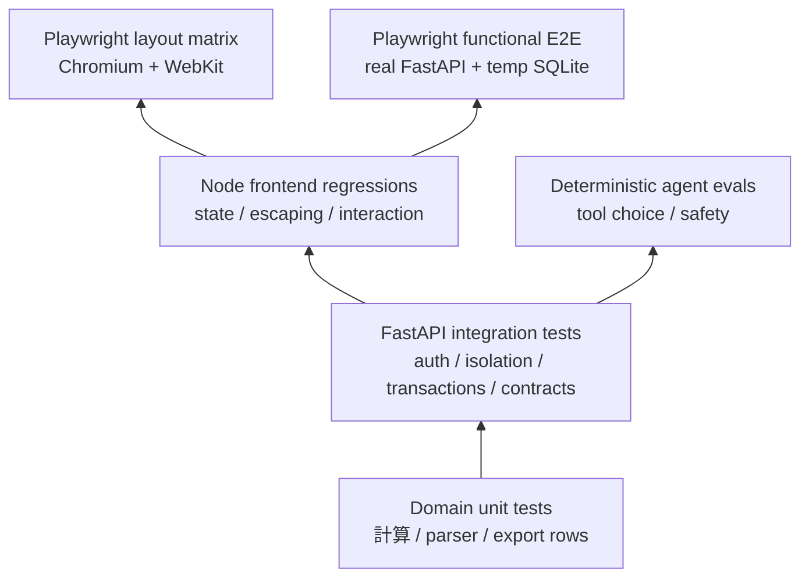
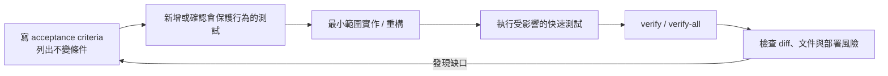

# Test Design Document（TDD）

本文件的 TDD 指 **Test Design Document**。開發流程仍採小步的 test-first／regression-first：
先定義可觀察行為與風險，再實作，最後由 repository harness 與 CI 驗證。

## 1. 測試目標

- 防止帳號隔離、里程交易、備份安全與 API contract 回歸。
- 讓純重構可以證明「程式位置改變，但使用者行為沒有改變」。
- 外部服務不穩定或無網路時，核心測試仍保持確定性。
- 用較少、較快的測試涵蓋多數邏輯，再用 API 與版面測試保護整合邊界。

## 2. 測試層級

下層測試數量較多、速度較快；上層只保留跨模組或瀏覽器才看得到的風險。

## 3. 需求到測試的追蹤矩陣

| 品質需求 | 主要驗證 | 失敗代表 |
| --- | --- | --- |
| 帳號資料隔離 | API tests + security regressions | query 缺少 user scope 或 authorization |
| 帳號切換非同步隔離 | Node transport tests + Chromium/WebKit session E2E | 舊洞察、AI history/retry 或 401 回填／清除新 session |
| 跑步／鞋款／月跑量一致 | transaction 與 edge-case tests | partial commit、差額或 optimistic lock 錯誤 |
| 匯出與備份安全 | export API tests | 格式、欄位、帳號範圍或 secret 洩漏回歸 |
| AI 工具安全與選擇 | agent evals + mocked stream tests | prompt/tool policy 或 fallback 回歸 |
| 前端互動與 XSS 防護 | Node regression tests + 頁面 CSP 雜湊與 browser 違規檢查（SPEC-054） | state、escaping、分頁或錯誤處理回歸；inline script 未被雜湊或出現 inline handler |
| 文件與程式一致 | `docs-check` 清單檢查（SPEC-053）與 API 一覽檢查（SPEC-058） | 新模組、script、環境變數或 API 端點沒有寫進 README／SDD |
| 刪除與匯入身分 | Strava 匯入 API tests + schema 8 升級／回滾 tests（SPEC-055） | 刪除的 Strava 活動被重新匯入、里程重複累加，或回滾失去資料 |
| 統計口徑一致 | read model tests + Node rendering + 前後端門檻比對（SPEC-055／056） | 年度同期比較、退役預估、換鞋門檻或週目標在不同頁面不一致 |
| AI 統計工具 | tool adapter tests + agent evals（SPEC-057） | 工具重算數字、洩漏其他帳號資料、輸出逐日大陣列或意圖未取得對應工具 |
| 固定跑步日誌首頁 | Node startup/lifecycle + Chromium/WebKit SPEC-015 + PWA offline navigation | 舊 activeTab 還原、重開後 agent-mode 殘留、ARIA／手機標籤不同步，或誤清登入與主題 |
| 響應式版面 | Playwright matrix | 特定引擎、尺寸、主題出現重疊／溢出 |
| 元件對齊契約 | 40 組 Chromium/WebKit 排版設定（SPEC-016）+ Node presentation tests | 日期／數字／選單不同高、混用按鈕密度、模型列錯位、圖表起點或數字表頭邊界不齊；覆蓋六個分頁、三個認證表單、全部彈窗、編輯／停用／錯誤／行內輸入 |
| 瀏覽器核心流程 | Playwright E2E + 暫存 SQLite | UI、HTTP 與 persistence 整合回歸 |
| 購鞋欄位歸屬 | Node rendering + Playwright matrix / E2E（SPEC-011） | 跑鞋／支出表頭錯位、尺寸遺失、編輯或退役後購鞋資訊不同步 |
| 編輯快照與衝突 | Node modal tests + 真實 API browser conflict（SPEC-012） | 重新載入後改錯 ID、用新版本提交舊表單，或舊回應關閉新視窗 |
| 共用 SSE 正確性 | Node chunk/UTF-8/CRLF/cancel tests + Chromium/WebKit mock streams | 中斷當成功、錯誤答案進入歷史、重試重複上下文、月報狀態不一致 |
| 退役預估一致性 | `test_forecasting.py` + DOM regression | 清單／分析使用不同公式、預估跨帳號或 N+1 查詢 |
| 按需呈現 | Node render invalidation + browser request/chart counters | 隱藏分頁建立圖表／讀年度日誌、重複繪製或晚到回應重畫隱藏頁 |
| 登入操作與跑鞋視窗競態 | Node + Chromium/WebKit SPEC-013 | 重複登入、舊成功／錯誤覆蓋新 session，或鞋款 mutation 關閉新草稿 |
| 月報時區一致性 | Python UTC serializer / GET / history + browser local formatting | SQLite 無時區值誤作本地時間，讀取與完成時間相差 8 小時 |
| Strava worker 隔離 | `test_strava_worker_keeps_event_loop_responsive` + 原 transaction tests | parse/service 在 event loop 執行、worker 停頓時 loop 也停頓，或交易／隔離回歸 |
| 前端責任拆分 | Node single-responsibility / HTML / SW order + 全分頁 browser matrix | 匯出、目標或圖表函式漏載，或功能重新混合 |
| 模組依賴方向 | `architecture-check` | circular dependency 或重複 API route |
| App composition 隔離 | app factory tests | lifespan 誤用正式 database globals 或設定漂移 |
| API contract | method/path snapshot | endpoint 被意外新增、刪除或改名 |
| Runtime module boundary | architecture check + frontend asset/order regressions | router/service 或 plain-script dependency 再次混合 |
| 備份可恢復性 | backup/restore tests | checksum、integrity、retention、安全快照、殘留 WAL 還原或 busy 鎖失效 |
| 異地備份與隔離演練 | mocked Fly CLI + temporary SQLite（SPEC-014） | 半份備份被發布、checksum 缺失／錯誤、schema／資料遺失、輸出落在 Git 或洩漏遠端內容 |
| 真正 PWA 升級 | `frontend-pwa` local HTTP fixture / Chromium + WebKit | 舊 worker 線上遷移失敗、新版 HTTP／MIME 失敗污染舊 HTML、離線無法載入已安裝 shell、刪除其他 cache 或快取 API |
| Coverage floor | branch coverage ≥ 92% | 測試保護範圍明顯退化 |
| SPEC-017 統計唯一來源 | `test_statistics_consistency.py` + Node + Chromium/WebKit SPEC-017 | 50 日誌＋100 手動變成 120%、清單／分析／匯出成本不一致或支出跨時區偏月 |
| SPEC-017 輸入與完整分頁 | Node + 真實 API 205 筆／browser fixture | 空白清零、只計目前頁、刪鞋後丟失日誌彙總、day 篩選越界或跨帳號 |
| SPEC-017 同名消歧義及效能 | 0／1／12 鞋 query budget + ID scope tests | 任選第一雙、洩漏候選或 N+1 SELECT |
| SPEC-017 跨日與對話框 | Chromium/WebKit `frontend_consistency.cjs` | 日期 max 停在昨日、草稿被重設、Tab 逃出彈窗、inert 未解除導致焦點遺失 |
| SPEC-017 功能生命週期 | native module Node + session E2E | 舊新增回應污染新帳號、遺漏 feature cleanup、隱藏支出仍保留舊帳號內容 |
| SPEC-017 生成與依賴方向 | `build_frontend.py --check` + transitive import tests | CSS／HTML／worker 清單漂移，service 間接依賴 FastAPI 或月報反向解析工具 JSON |
| SPEC-017 PWA 更新 | 實際 worker message／controllerchange + `.mjs` MIME failure | 新版未通知、未確認即重載、錯誤 module MIME 污染離線 shell |
| Secret hygiene | `security-check` | tracked files 包含明確 credential 特徵 |
| 文件與實作一致 | `docs-check` + document contract negative fixtures | 測試數／命令過期、壞連結／anchor、缺 spec sections／Owner、Implemented 未勾選 AC 或測試路徑不存在 |
| SPEC-020 配額與注入 | `unit_tests/test_transactional_features.py` | 不同 app 共用錯誤配額、thread/process 競態突破上限、Strava 與手動上限不一致、upload 設定外洩 |
| SPEC-020 草稿與 state | `unit_tests/frontend/run-controller.test.cjs` + `unit_tests/frontend_reliability.cjs` | 舊成功清除新草稿／月份、controller reset 失效、編輯／重送 key 污染新 session |
| SPEC-020 聚合邊界與效能 | `unit_tests/test_run_statistics.py` | 閏年／跨年／未來／空資料／user scope 錯誤，或月報 YTD 查詢數隨月份增長 |
| SPEC-020 寫入邊界 | architecture constraints + 既有 CRUD／衝突／rollback tests | router 重新擁有 mutation，或 services 穿透 HTTP |
| SPEC-021 認證競態 | `unit_tests/test_auth_concurrency.py` | 舊改密碼請求覆寫新密碼、憑證未撤銷，或獨立程序突破註冊容量／同名回 500 |
| SPEC-021 發布資產數量 | `unit_tests/test_docs_harness.py` + docs-check | README 舊數字或新增 module 未被偵測 |

## 4. 開發流程

PWA fixture 凍結 v3.2.2 worker 進行線上 migration，再測試完整新版 worker 的失敗升級／離線恢復；
Chromium 使用 browser offline emulation，WebKit 使用 fixture transport 斷線（避免 emulation 同時阻止 cache navigation）。
WebKit 的 API probe 另外在 HTTP headers 後截斷 body，讀取完整 JSON 並檢查 server 請求計數，避免 headers 前 TCP 中斷讓 fetch 不結束；沒有降低 API 不可從 worker cache 讀取的要求。
兩者都要求 API network failure、舊 shell 完整、新版恢復及實際 cache key／HTML revision 正確；不連正式站，亦不取代 iPhone 實機驗證。
SPEC-017 增加 native runtime MIME 失敗，以及 worker 完整啟用後提示更新但保留舊 document／草稿的斷言。
Node suites 位於 `unit_tests/frontend/*.test.cjs`，由原有入口載入；共享 source/extraction helpers 不註冊測試。
docs-check 統計所有 suite 的測試數，而非只計入口或以字串命中代替數值情境。

純程式碼搬移若已有足夠 API regression，可先確認測試會經過被搬移的 endpoint，再重構；
新功能或修 bug 則必須新增能在舊版本失敗的測試。

## 5. Harness 指令

所有平台都使用同一份 `scripts/task.py`。Unix 以 `python3 scripts/task.py <task>` 呼叫，
Windows 可用 `py -3 scripts/task.py <task>`；本機、Coding Agent 與 CI 不依賴特定 shell，
runner 會自行尋找 Windows 或 Unix 的專案虛擬環境。

| 變更類型 | 最少執行 |
| --- | --- |
| 後端／router | `python3 scripts/task.py test-fast` |
| Agent／tools | `python3 scripts/task.py eval-agent`，再執行 `test-fast` |
| 前端邏輯 | `python3 scripts/task.py frontend-test` |
| 版面 | `python3 scripts/task.py frontend-layout` |
| 真實瀏覽器 CRUD | `python3 scripts/task.py frontend-e2e` |
| 架構邊界 | `python3 scripts/task.py architecture-check` |
| Secret／credential 風險 | `python3 scripts/task.py security-check` |
| 文件／harness | `python3 scripts/task.py docs-check` |
| 跨模組或 release | `python3 scripts/task.py verify`；大改動使用 `verify-all` |

SPEC-020 的明確 traceability 見 `docs/specs/020-transactional-features-and-document-contracts.md`。
並行 quota 測試同時使用獨立 SQLite connections 的 thread 與 spawn process，不能由 Python lock 假裝通過。
原生 controller 的 Node 測試直接 import production module；DOM adapter 與兩引擎延遲 POST 驗證新草稿保留。
新增文件檢查的負面 fixture 覆蓋壞本地連結／anchor、合法 encoded/reference links、缺 sections、未完成 AC 與不存在測試檔。

## 6. Definition of Done

SPEC-019 的 traceability：`test_request_reliability.py` 驗證 transaction／並行相同與衝突 payload、quota replay、user scope、schema 1→2 與年度單一 grouped query；
`frontend/reliability.test.cjs` 驗證 timeout headers/body、GET 有限重試、401／寫入不重試、人工重送 key 與年度 endpoint。
`frontend_reliability.cjs` 在 Chromium／WebKit 的真實 storage event 下驗證跨分頁登出／換帳號與未完成請求取消，另驗證獨立錯誤恢復。
`test_release_check.py` 負面 fixture 拒絕錯版本／hash／MIME／schema／API／匿名授權與失敗 browser subprocess。
`frontend-e2e` 會對自己的真實 ASGI server 執行 `python3 scripts/task.py release-check --base-url ...`；正式部署後再以相同命令唯讀檢查。
Playwright 使用 `npm ci` 鎖版，CI browser job 使用相符的官方 noble container（SPEC-022），不在 job 內重跑 apt；`test_task_runner.py` 檢查映像版本／完整 gates／診斷上傳。失敗保留 `.artifacts/browser/` 的 screenshot／trace／error，CI 明確允許 hidden files，僅上傳 browser 子目錄並保留 7 天，不包含正式帳號內容。

- Acceptance criteria 與不變條件已寫清楚。
- 新行為或 bug 有 regression test；純重構由既有 contract tests 覆蓋。
- 測試不讀寫正式 `shoes.db`，也不呼叫真實 LLM／搜尋服務。
- Ruff、mypy、architecture-check、security-check、92% branch coverage 與相關測試通過。
- setup、command、API 行為或架構邊界變更時同步 README／SDD／TDD。
- 修改 frontend templates／CSS／assets manifest 後，先 `python3 scripts/build_frontend.py --write`，再驗證產物零漂移。
- diff 不包含 secret、資料庫備份或與需求無關的使用者變更。

## 7. SPEC-023 具名追蹤與診斷 roundtrip

[規格及具名案例](specs/023-feature-operations-and-application-boundaries.md#test-traceability) 覆蓋月跑量新草稿、跨帳號 stale completion、鞋款編輯草稿與版本、nickname escaping／export／migration、服務隔離／rollback 及部分刷新交錯。
新 spec 每個 AC 的 `file::test` 必須由 AST 或 Node literal title 找到；改名／刪除、只引用檔案或越界路徑都有負例，歷史 spec 仍可使用檔案路徑。

`diagnostics-generate` 在不連伺服器的合成 Chromium context 產生刻意 assertion failure，使用與 browser gates 相同的 capture helper 保存 PNG／Playwright trace ZIP／錯誤文字及 SHA-256 manifest。
CI browser job 上傳專用 artifact，`diagnostics-roundtrip` job 下載至 `.artifacts/browser/roundtrip/` 再執行 `diagnostics-verify`；檢查檔案身分、路徑、checksum、PNG magic、ZIP integrity、trace 和錯誤中的合成標記。
這個演練不需要帳號、正式網站或 secrets；真正的 browser regression 失敗仍另傳原本 diagnostics，且仍讓 pipeline 失敗。

## 8. SPEC-024 草稿轉移、資源合併與逾時收尾

[具名追蹤](specs/024-draft-rebase-resource-store-and-browser-deadlines.md#test-traceability) 對應下列風險：

| 風險 | 驗證 |
| --- | --- |
| 退役／現役後再次儲存保留草稿撤銷狀態 | Node 直接執行 ShoeModal，雙向狀態轉移、dirty fields／CAS；`frontend_drafts.cjs` Chromium／WebKit 真實 DOM 延遲退役後儲存暱稱 |
| 目標失焦重繪或晚到成功覆蓋草稿 | Node baseline／acknowledge／reset；雙引擎切主題、延遲儲存期間改值及第二次儲存版本 |
| 同資源重複讀取、舊 session／月份回填 | Native resource store coalescing、mutation invalidation、key／session 失效、只接受一次及成功值快取 |
| 某來源失敗阻擋其他資料或錯誤被隱藏 | Native 及 core adapter tests，獨立成功／錯誤與相關 cache hooks |
| screenshot／trace／close 卡住 | Node 注入永不完成的 promises，以短 deadline 驗證原始文字先落檔及 cleanup 仍繼續 |
| browser 子程序完全停頓 | Python 真實合成 sleep 程序，驗證 timeout 回 124、文字診斷、另開 process group 的 child 也收尾 |
| CI 單一 gate 卡住需全跑 | Workflow contract 驗證三個獨立 jobs、各自 gate／watchdog／取消時產物上傳；PWA artifact 下載驗證內容 |

PWA API probe 10 秒、worker update 外層 20 秒（瀏覽器內 statechange timer 15 秒，與 registration.update 一起等待，避免未處理的 timeout）。
Layout 每引擎 300 秒、PWA 每引擎 120 秒，E2E 真實 CRUD 90 秒／各 feature stage 60 秒，release 每引擎 90 秒。
Trace 啟動 10 秒；失敗 capture 的 screenshot／trace 各 5 秒，context／browser close 各 5 秒。
外層 layout／E2E／PWA／release browser watchdog 分別 660／420／300／240 秒；超時本身屬失敗，不可視為通過。
完全卡死時可能只有 watchdog/error 文字；CI 失敗／取消使用 `always()` 嘗試上傳已有產物，不保證取消的 runner 還能生成 trace。
三個 browser jobs 不互相依賴，僅 `diagnostics-roundtrip` 依賴 `frontend-pwa`。

## 9. SPEC-025 匯入交錯、逐資源交付與 SQL 上界

- Node `strava-resources.test.cjs` 鎖定刪鞋選單的空白 sentinel、Strava 視窗／revision／session、重複匯入、歷史失效與先完成來源的交付；鞋款移動前的暱稱／分類草稿在新版本上再次儲存。
- `frontend_strava_ownership.cjs` 在 Chromium／WebKit 使用合成 API 與可控制的延遲：跨日編輯刪鞋日誌、退役前暱稱草稿、舊匯入成功／失敗遇到替換預覽、同視窗改檔避免重複提交、舊 GET 晚於新歷史，以及慢 goal 不遮住已完成 runs。既有 SPEC-024 等待期間草稿測試保留。
- `test_shoe_analytics_sql_is_bounded_and_user_scoped` 比對每鞋 403 筆合成歷史的完整 totals／distinct days／first-last／30-90 天／12 月／recent12 與單鞋／批次相容性。SQL 固定三次、禁止載入 Run entities；外帳號偽 legacy row、刪鞋及空資料隔離皆檢查。AI 摘要仍維持既有 constant query budget，省略不使用的 detail queries。
- `worker_update.cjs` 用可控制的 EventTarget 測試已在 installing 的 candidate 與 update 卡住的診斷。真實 PWA gate 持有 candidate 資產、先啟動安裝再附加 observer，釋放後驗證啟用；HTTP／MIME／宣告長度截斷／版本不符皆必須拒絕候選安裝並保留舊離線 shell。
- Worker installer Node 測試包含未壓縮截斷拒收、完整回應、無長度及壓縮回應，避免把 wire／decoded 長度混用。失敗 trace、截圖與文字仍先落檔並受限時收尾。
- 具名 AC 對應見 SPEC-025；發布前執行 verify-all，不以重跑或跳過瀏覽器代替通過；正式站 release-check 匿名唯讀。

- v3.7.1 PWA gate 每次 offline→online 前明確呼叫 registration.update，要求 10 秒內失敗。WebKit fixture 的 worker script 回 503，API 回截斷 JSON、其他網路請求仍中斷；測試保留真正的快取離線重載與每種失敗升級，避免一個背景 worker HTTP 重試卡住後續候選。

- v3.7.2 的 goal 首次初始化案例固定持有 switchTab 的第一個 animation frame，在填入 180 並失焦後釋放、切換主題，再驗證儲存。Node 另驗證晚到的 goal resource 不覆寫該草稿；覆蓋首次互動界線，不能只等待初次 render 完成後才測草稿。

## 10. SPEC-026 行內 DOM 與生成順序

- `frontend/resource-editing.test.cjs` 驗證新增表單的刪鞋 sentinel、table DOM 延後替換、原版本提交、session 取消 blur、依資源失效、三種衍生讀取合併／失效，以及 Strava 視窗配對鎖。
- `frontend_resource_editing.cjs` 納入 `frontend-e2e`，在 Chromium／WebKit 以合成 HTTP 與固定時鐘驗證鞋款／月跑量輸入 `1` 時釋放背景 goal、主題及同資源刷新仍無 PUT，完成 `180` 並 Enter 才提交；新增跑步刪鞋、配對成功／失敗，以及 annual pending 在重繪時不重發。
- `test_report_generations.py` 使用獨立 session 與暫存 SQLite，mock text stream；覆蓋兩種完成順序、新生成空內容／model error／未知錯誤／取消、保存失敗、user/month 隔離、並行 writer，以及 schema 3→4 重複升級不改寫既有報告。
- 切換分頁後等待實際 DOM 更新（被刪選項消失），再斷言空選擇；不以 `switchTab` 同步返回推論下一 frame 已完成，也不放寬錯誤鞋款斷言。
- 新版資源 dispatch 在 microtask 前失效時不發 HTTP；session／月份 fixture 等候真正發送後再切換，分別驗證發送前取消及 in-flight 晚到回應。
- `architecture-check` 將月報 router 納入禁止交易／mutation 的檢查；services 不依賴 HTTP／LLM adapter。發布依序要求完整本機驗證、main／tag 全 CI、失敗產物 roundtrip、正式備份隔離還原與部署後匿名 release-check。測試不接觸正式資料或模型。

## 11. SPEC-027 可恢復工作區

| 邊界 | 具名驗證 |
| --- | --- |
| 帳號分區、跨重開草稿、原版本 | `unit_tests/frontend/workspace.test.cjs::SPEC-027 drafts and cached resources stay within their account` |
| 佇列與草稿的原子接收 | `unit_tests/frontend/workspace.test.cjs::SPEC-027 queue acceptance consumes only its draft atomically before a crash` |
| 跨分頁、回應遺失、lease 回收 | `unit_tests/frontend/workspace.test.cjs::SPEC-027 durable queue survives lost responses and competing consumers`、`SPEC-027 leases prevent parallel consumers and recover after a crash` |
| 本機配額失敗、登入過期、刪鞋 | `unit_tests/frontend/workspace.test.cjs` 的 failed persistence／expired auth／missing shoes 案例 |
| 匯出讀取快照、還原原子性、去重、預覽失效、增量來源與 tombstone | `unit_tests/test_account_restore.py`；只使用 `workspace_helpers.py` 暫存 SQLite |
| 里程與復原版本／配額、不可重用主鍵 | `unit_tests/test_history.py` |
| 操作回執、跨連線競態、legacy 相容 | `unit_tests/test_operations.py` |
| 真實離線重開、帳號切換、合併 UI、誤刪復原 | `unit_tests/frontend_workspace.cjs`；`frontend-e2e` 中 Chromium／WebKit 均執行，使用暫存 FastAPI 與合成帳號，真實 IndexedDB／service worker |

`frontend-layout` 自動遍歷全部七個彈窗，資料與同步另填入長訊息／blocked 配對控制項，仍跑 40 組引擎／主題／尺寸設定。`verify-all` 包含完整 PWA 升級／離線 shell 驗證；測試不得連正式站、使用真帳號或寫入工作區 shoes.db。發布仍須另外正式備份、隔離還原、匿名 release-check，通過本機測試不等同已部署。

SPEC-029 更新模式的具名測試見 [資料搬移規格](specs/029-account-data-transfer.md)：覆蓋來源 ID／Strava 辨識、跨鞋款／月份更新、額外資料及跑步 tombstone 保留、配額、模式 hash、舊預覽、交易回滾、月報生成撤銷與 user isolation。雙引擎工作區 E2E 由 UI 實際下載 JSON、匯入至另一合成帳號，修改來源後再以 update 匯入，驗證資料及里程；Node 測試另確認模式／視窗所有權、取消更新與下載失敗回饋。

[SPEC-030](specs/030-import-operation-isolation.md) 增加可重現的亂序預覽、原生 controller 視窗／session 與清理、舊清除不影響新帳號、等待期間的新輸入、相同內容匯入的版本／revision／audit 不變，以及 schema 5→6 與回滾腳本的資料保持測試。E2E 在兩引擎延遲舊預覽至新預覽之後才送達，仍可確認新 token；並延遲清除完成、換帳號輸入後才釋放，驗證新草稿不被清空。

SPEC-032：合成資料驗證歷史筆數上限（v4.7.3 起 10,000／10,001）邊界、UTF-8 位元組及含秘密拒絕、明確省略歷史的 HTTP 下載／匯入契約與帳號隔離。差異預覽對照實際版本變動、額外本機跑步及刪除 tombstone；Node 與 Chromium／WebKit 驗證提交成功後讀取失敗只重試讀取、換帳號／視窗不污染新狀態。SPEC-031 回歸確保月曆不顯示次數且保留日期操作。

## SPEC-033 復原與同步組合流程

[規格與具名案例](specs/033-recovery-and-sync-identity.md) 覆蓋同帳號舊檔保留刪除、多次復原後外部及原生別名、跨帳號隔離、匯入歷史不可偽造本機刪除、commit 失敗原子 rollback，以及重新登入接手租約與已提交操作的讀取重試。雙引擎 workspace E2E 在 origin 注入核心 GET 失敗，驗證離線同步與刪除復原的成功提示及純讀取重試。

## SPEC-034 可攜來源與跨分頁同步

[規格與具名案例](specs/034-portable-recovery-and-sync-refresh.md) 驗證來源及接收者連續復原、省略歷史仍攜帶來源鍵、tombstone、別名衝突／全域容量／格式拒絕、v1/v2 指紋相容，以及小數累積與 legacy Float 尾差的 no-op 版本／audit 不變。Node 覆蓋手動空佇列讀取、通知失敗不重排已確認操作、刷新中的新通知及外帳號忽略；雙引擎 workspace E2E 操作 v3 來源復原檔及真實 BroadcastChannel／IndexedDB 多分頁，確認雲端讀取與表單草稿保留。

## SPEC-047 程式審查修正、有界歷史與模組解耦

[規格與具名案例](specs/047-review-hardening-and-decoupling.md)

- **Strava 日期**：參數化驗證中英文 12 小時制 UTC 時間戳轉成台灣日期。API 案例確認重新匯入只修正仍停在舊 UTC 日期的跑步、保留手動日期、月跑量跨月移動且第二次為 no-op。
- **Migration 與保留**：以檔案型 SQLite 驗證過期 trigger 會被重建、每帳號保留上限只刪自己最舊的資料、稽核清理後墓碑仍保護已刪跑步，以及 schema 7 回填墓碑、移除舊回執表與 7 → 6 回滾腳本可往返。
- **限流**：以注入的 settings 調整限額，驗證超限請求整筆回滾不計數、不 commit 請求 session，以及「來源＋帳號」與「帳號」兩層登入鎖定。
- **import 與密鑰**：子行程確認匯入 backend 模組不建立資料庫目錄；正式環境拒絕缺少或過短的密鑰。
- **前端**：Node 確認 markup 與動態列除了樣式表 `onload` 沒有 inline 事件、每個 `data-*` 動作都有唯一註冊、巢狀元素只執行最近的動作。
- **v4.7.1 修訂**：以小上限重現匯入歷史擠掉本機紀錄（修正前失敗）；啟動清除各帳號過期預覽；年目標在 API、資料庫與匯出都是兩位小數；冷卻設定不超過限流紀錄保留時間；歷史復原四個衝突分支與 readiness 三種 503。
- **v4.7.3 修訂**：以真實匯出列形狀放大到帳號配額（5,000 筆跑步、10,000 筆保留歷史、120 份月報），確認仍在 10 MiB 內且可解析；HTTP 驗證預覽的每帳號與全站限流、忙碌時立即回 429 且不解析、不儲存、不計數；預覽在不建立第二份 Python 副本的情況下存下相同內容並可套用。
- **v4.7.2 修訂**：以凍結時間驗證帳號備份檔名使用台灣日期；參數化七種 OpenAI SDK 錯誤，確認使用者訊息不含原始內容、識別碼與網址，而 log 保有細節；架構測試禁止 router 自行查詢，read model 測試確認本人範圍與排序。
- **測試資源**：`conftest.py` 的 `disposing_engines()` 在每個測試結束時關閉它開啟的 engine，有專門測試確認原始連線已關閉；覆蓋率執行不再出現 ResourceWarning。

## SPEC-046 冷啟動加速、購買日前跑步提醒與瀏覽器偵測

[規格與具名案例](specs/046-cold-start-purchase-date-warnings-and-browser-probe.md) 以子行程驗證匯入 `backend.main` 不載入 `openai`、Dockerfile 預先編譯 backend；Python 驗證 Strava 預覽回傳各群組最早日期；Node 驗證跑步表單與 Strava 配對在早於購買日時提醒、當天不提醒且不阻擋儲存；任務執行器與 Stop hook 以假的啟動探測驗證缺系統函式庫時只探測一次並跳過，release-check 仍拒絕。

## SPEC-045 清除舊空表與已刪除鞋款標籤

[規格與具名案例](specs/045-legacy-tables-and-deleted-shoe-labels.md) 以記憶體資料庫驗證 migration 兩次執行後只刪除空的舊表與其索引、仍有資料的舊表保留、schema version 不變；Node 驗證已刪除鞋款合併為單一「已刪除的鞋款」系列、月合計不變且無內部編號，日曆標籤為「已刪除」。發布前另以正式備份的記憶體副本演練：19 → 17 張表，業務資料雜湊不變。

## SPEC-044 月跑量年度目標總覽

[規格與具名案例](specs/044-annual-goal-overview.md) 以暫存資料庫驗證 12 個月只計本人日誌、今天之後的跑步與手動調整不計入、過去／本月／未來與達標標記、今天應達里程與訓練趨勢目標線相同，以及過去、未來、未啟用年份與 API 帳號隔離；Node 驗證沒有月份選單、12 格狀態與年度文字、設定預設收起、取消還原及草稿自動展開；`frontend-layout` 在 40 組設定檢查 12／6 欄月份格與展開後的設定表單，`frontend-e2e` 在展開的設定中驗證草稿與版本流程。

## SPEC-043 支出併入跑鞋分頁

[規格與具名案例](specs/043-spending-in-shoes-tab.md) 以 Node 驗證沒有支出分頁、支出卡片／圖表／明細位於跑鞋分頁、支出資料晚到時只在跑鞋分頁繪製、跑鞋異動只讓相關面板失效；`frontend-layout` 檢查 4 欄底部分頁列與跑鞋分頁 8 張圖，`frontend-e2e` 在跑鞋分頁驗證支出重試與購買明細。

## SPEC-042 移除跑步摘要卡、距離分布配色與 AI 分頁合併

[規格與具名案例](specs/042-run-log-tiles-distance-colors-and-ai-tab.md) 以暫存資料庫驗證首頁摘要只回傳選鞋建議、距離分段在 20 km 邊界的歸屬；Node 驗證跑步日誌沒有摘要卡與個人紀錄、選鞋建議仍可選入、距離分布五色、AI 分頁只有一個按鈕且月報經面板切換開啟；`frontend-layout` 透過切換開啟月報並檢查 5 欄底部分頁列。

## SPEC-040 年度回顧、首頁摘要與手機導覽

[規格與具名案例](specs/040-highlights-review-and-mobile-navigation.md) 以暫存資料庫驗證累計里程碑級距、選鞋建議排序（未穿過優先、快到退役排最後、排除退役）、本週／連續／本月目標與近 30 天成就、年度回顧（前一年比較、排除刪除鞋花費、進行中與未來年份）、距離分桶與跨使用者隔離。Node 驗證摘要卡、成就與名稱 escape、「選這雙」觸發草稿更新、鞋款顏色不受清單順序影響、年度回顧版面與錯誤資料不快取、唯一年份選單重繪所有年度區塊、距離分布與手機底部分頁列；`frontend-layout` 在 40 組版面檢查底部分頁列固定在底部且無溢出。

## SPEC-039 移除月跑量紀錄表

[規格與具名案例](specs/039-compact-monthly-records.md) 以 Node 驗證訓練分析分頁沒有紀錄表、新增表單與編輯對話框且不載入 `app-monthly.js`，以及舊版本的月份新增／編輯草稿在恢復本機工作區時被捨棄、其他草稿保留、舊草稿鍵不開啟對話框；月份編輯相關的 Node 與瀏覽器案例隨功能移除，SPEC-023 AC-1 改由共用 operation owner 測試覆蓋。

## SPEC-038 訓練趨勢與跑鞋輪替

[規格與具名案例](specs/038-training-trends-and-shoe-rotation.md) 以暫存資料庫驗證同日合計、週一起始與連續天數、前 4 週平均的暴增門檻與最小基數、進行中週次、年度目標線與推估、未來／過去年份邊界、輪替時間軸排序、排除退役與刪除鞋款、閒置，以及跨使用者隔離與 401／422。Node 驗證熱力圖分級與空白格、暴增週次顏色、目標說明、時間軸鞋名與閒置提醒、格式錯誤不快取，以及跑步／跑鞋異動後重新讀取；`frontend-layout` 檢查 40 組版面沒有水平溢出。

## SPEC-037 本機工作區資料庫自動重新連線

[規格與具名案例](specs/037-reconnecting-local-workspace-store.md) 以 Node 模擬 IndexedDB，驗證連線無 `close` 事件靜默關閉與有 `close` 事件兩種情況都會重新開啟並讀寫成功，應用程式驗證錯誤不重試；雙引擎 workspace E2E 以 `waitForAsync` 真正等待離線重新整理後的帳號、跑鞋與佇列恢復。

## SPEC-036 安全強化與跨平台鎖定檔

[規格與具名案例](specs/036-security-hardening-and-portable-locks.md) 以無 `document` 的 Node context 驗證 Markdown 只經 `DOMParser` 解析並移除可執行標記與非 allowlist 屬性；API 測試確認被 IP／帳號上限拒絕的請求不增加全站 bucket、密碼錯誤只鎖定該帳號、未知帳號仍執行 bcrypt；鎖定檔測試確認 `uvloop` 與 `colorama` 的平台條件。

## SPEC-048 push 到 main 自動部署與發版

[規格與具名案例](specs/048-push-to-main-deploy-and-release.md) 以文字解析 workflow：部署只在 main 且全部測試通過後執行、release-check 與發版依序在後；只有部署 job 取得 `FLY_API_TOKEN` 且不執行專案套件，只有發版 job 可寫入；部署前快照的遠端指令、資料庫路徑與成功訊息和 Dockerfile／`database_backup.py` 一致；實際執行發版腳本內嵌的 CHANGELOG 擷取，比對目前版本段落與缺段落的 commit 備援；main 執行序列化不取消；browser 與部署後檢查重跑一次並警告。實際部署由 main 上的 GitHub Actions 驗證。

## SPEC-049 新版部署提示與主動偵測

[規格與具名案例](specs/049-pwa-update-prompt.md) 以 Node 驗證不同版本只顯示提示、不自動重新載入、稍後與再次提示、確認後只重新載入一次；以假時間與事件驗證前景、焦點、連線恢復與 30 分鐘檢查、60 秒合併、隱藏與離線不檢查及失敗不拋錯。`frontend-pwa` 在 Chromium／WebKit 的舊版 worker 遷移與完整升級中，確認提示出現時仍是舊版，按下更新後才載入新 shell。

## SPEC-059 在安全時自動套用新版

[規格與具名案例](specs/059-automatic-updates-at-safe-moments.md) 以 Node 假時間、假可見度與假 service worker 訊息驗證：剛回到前景未操作、在背景、閒置 5 分鐘時自動重新載入一次；AI 回答、月報、請求、行內編輯、彈窗、AI 輸入框與登入表單的文字都會延後，直到下一次檢查；自動重新載入後仍是舊版時改為只顯示提示。AI 對話以假 sessionStorage 驗證只為同一帳號還原、資料格式錯誤或換帳號時捨棄。`frontend-pwa` 在 Chromium／WebKit 的真實 service worker 升級中，確認使用中的頁面只顯示提示，切到背景後自動換成新版 shell。

## SPEC-061 每次推送都跑 CI 與 main 保護

[規格與具名案例](specs/061-ci-on-every-push-and-protected-main.md) 以文字解析 workflow：觸發條件是不限分支的 push、pull request、每週排程與手動執行，沒有 `paths-ignore`；部署條件仍只有 main 的 push／手動執行；main 以外的 ref 由較新的執行取消舊的，main 不取消。ruleset 由 `.github/rulesets/main.json` 描述，Python 測試確認它要求 PR、必要檢查與 workflow 的 5 個測試 job 完全一致、禁止刪除與 force push，且沒有繞過名單。

## SPEC-116 排程 workflow 每天續命

[規格與具名案例](specs/116-keep-scheduled-workflows-enabled.md) 以文字解析 `offsite-backup.yml`：續命 job 不依賴備份 job、只有它有 `actions: write`、只用 `GITHUB_TOKEN` 不用 secret、失敗只發警告，且 repo 裡每個有 `schedule` 的 workflow 都在它的重新啟用清單中。

## SPEC-140 記錄被吞掉的例外與模組私有函式

[規格與具名案例](specs/140-log-swallowed-errors.md) 以 `caplog` 確認月報三個失敗階段各留下一筆含 traceback 的紀錄、月報內文不在紀錄中、`ReportModelError` 不記錄；AI 工具失敗記錄工具名稱與例外類型、不含參數；架構測試以暫存模組確認跨模組匯入或呼叫底線名稱會被回報。

## SPEC-139 讀取模型分層與健行／步行配速上限

[規格與具名案例](specs/139-review-layering-and-hike-pace.md) 以架構測試確認讀取模型不依賴 `backend.services`、工具模組沒有 `.query(...)`（並以暫存檔確認違規會被回報）；Python 測試確認每公里 90:00 的健行可新增與編輯、同樣的路跑與「改成路跑」被拒絕並顯示對應範圍、Strava 慢速健行保留移動時間；前端測試確認配速提示與送出檢查依表單類型採用 60:00 或 120:00，常數由 Python 測試鏡像比對。

## SPEC-138 移除跑鞋「月跑量」欄位

[規格與具名案例](specs/138-drop-shoe-monthly-km.md) 以 Python 測試確認未退役且無近 90 天紀錄的鞋回傳 `forecast_source: "no_runs"` 與 `None` 日期、批次查詢區分 `no_runs`／`idle_90_days`／`recent_90_days`、`list_my_shoes` 不再包含 `assigned_monthly_km`，以及 CSV／XLSX 匯出不包含「月跑量(km)」。前端 Node 與瀏覽器測試確認跑鞋表單與樣板已移除 `#f-monthly`、送出與切換現役／退役不再傳送 `monthly_km`、單鞋分析顯示「—」與「還沒有跑步紀錄，不預估」。

## SPEC-137 前端 review 修正

[規格與具名案例](specs/137-frontend-review-cleanup.md) 以產生的樣式與樣板確認：CSS 用到的 token 都有定義、定義的都有用到；淺色主題的警示、錯誤、Strava 與新手引導文字以 WCAG 公式計算對比至少 4.5:1；死碼與重複的 `[hidden]` 規則不存在；跑鞋表單是 `<form>` 且只經登記處理按鈕與關閉；樣板沒有 inline style，隱私說明與 logo 各一份來源；每個原生模組以與 `import()` 相同的 URL 預先載入。瀏覽器版面測試改以 `hidden` 切換登入與主畫面。

## SPEC-136 個人最佳

[規格與具名案例](specs/136-personal-bests.md) 以不同長度的合成路跑確認較長的跑步以平均配速換算成較短距離、量短 1% 以內仍算、更短的不算、同秒數時日期早的在前且每個距離只留 3 筆；沒有時間、越野、步行、未來日期與另一個帳號的跑步不算。前端確認卡片排版（鞋款名稱跳脫、每一筆都標出日期與跑步距離、沒有紀錄時的提示）、跑步或鞋款重新載入後重讀，以及按鈕只填參考成績、不送出。

## SPEC-135 對話框、更新忙碌判斷與重繪改由功能登記

[規格與具名案例](specs/135-feature-registries.md) 以頁面上的每個 `.modal-overlay` 確認各有一個登記、Escape 與點背景經登記的關閉函式（點背景只關原本的四個）；SPEC-059 的忙碌案例改由各功能登記的判斷驅動；並確認 `refreshPanels()` 更新資料日期、只重繪受影響的目前面板且通知 `refreshed` hook，共用 script 不提任何功能的函式或狀態。

## SPEC-134 帳號識別碼的瀏覽器設定、回滾腳本與前端解耦

[規格與具名案例](specs/134-account-keyed-settings-and-decoupling.md) 確認略過引導、Strava 日期範圍與 AI 對話暫存依帳號識別碼保存、同名新帳號不沿用、舊的略過紀錄接手一次，以及正式映像內含所有回滾腳本且基底以 digest 固定。

## SPEC-133 月報額度、報告清單、支出平均與下載連結

[規格與具名案例](specs/133-report-spending-download-nits.md) 確認被拒絕的月報請求不扣額度、較舊的報告清單回應不覆蓋較新的、日期格式不正確的鞋款只算進總額，以及下載連結不會在點擊後立即釋放。

## SPEC-132 月報、跑鞋匯出與課表模組載入

[規格與具名案例](specs/132-report-export-plan-module-fixes.md) 確認產生月報期間不讀取已儲存的報告、換帳號後才收到的跑鞋匯出不下載，以及課表模組在載入時就開始匯入、失敗時重試。

## SPEC-131 重設密碼次數分組

[規格與具名案例](specs/131-readme-history-and-reset-limits.md) 確認不存在的名稱只忽略 A–Z 大小寫與頭尾空白、email 忽略大小寫。

## SPEC-130 程式碼檢查修正

[規格與具名案例](specs/130-review-findings.md) 以兩個文字呼叫與呼叫後自編文字確認對話紀錄只留第一個呼叫，以重複與分段的串流片段確認工具名稱，以「失敗後沒有結果」確認搜尋狀態且不含原始錯誤，以 `Strasse`／`Straße` 確認管理員比對，並確認自動邀請碼撞到時重抽、Strava 預覽總筆數包含被排除的健行與步行。

## SPEC-129 本機資料依帳號識別碼分區

[規格與具名案例](specs/129-local-data-account-key.md) 以合成 token 確認登入後的名稱是伺服器的寫法、session 帶出帳號識別碼，無法解析的 token 保留輸入的名稱；工作區分區是 `aid:` 且只併入同網站、名稱只差 A–Z 大小寫的舊分區；controller 與 IndexedDB 在同一個交易內併入舊紀錄、新紀錄優先、lease 保留，重複執行不再移動。瀏覽器 E2E 改以帳號識別碼等待分區。

## SPEC-128 目標賽事的異動歷史與誤刪復原

[規格與具名案例](specs/128-race-goal-history.md) 以 API 新增、修改與刪除目標賽事，確認異動歷史的三筆事件與欄位、只有刪除可以復原、復原後內容與版本正確且不能復原兩次；已有新目標時回 409，其他帳號看不到也不能復原；帳號備份不含目標賽事的歷史。前端測試確認歷史顯示「目標賽事」，復原後讓比賽準備重新讀取。

## SPEC-127 訓練課表排版移到 native module

[規格與具名案例](specs/127-race-plan-view-module.md) 直接匯入 `runtime/race-plan-view.mjs`，確認沒有課表時回傳 null、日期等格式由注入的函式決定、模組不使用 DOM 或網路，且過期的請求不寫入畫面；既有 SPEC-119～124 的前端測試改由同一個模組排版，文字完全不變。

## SPEC-126 帳號備份包含目標賽事

[規格與具名案例](specs/126-backup-race-goal.md) 以兩個帳號往返 v6 備份：沒有目標賽事時「只新增」加入，已有時保留，「新增並更新」覆寫且再次匯入顯示內容相同；並確認 v5 檔案不可帶目標賽事、目標賽事沿用 API 驗證、v1／v2 指紋不變；前端測試確認預覽寫出「及跑量目標與目標賽事」。

## SPEC-125 留白的課表週數由後端決定

[規格與具名案例](specs/125-plan-weeks-default-and-docs.md) 以剩下 5 週、半年後、比賽週內與比賽已過的日期確認建議週數和網頁規則相同，並以不帶 `plan_weeks` 的 API 存檔確認存入建議週數，一週後課表的週數與起點不變。

## SPEC-124 課表每週建議強度次數

[規格與具名案例](specs/124-plan-quality-runs.md) 以半馬與 10K 課表確認各階段的建議次數（25 km 門檻、恢復與減量週只排一次、比賽週沒有）；前端測試確認已開始與未開始的週都統一顯示「實際／建議」次數（包含建議為 0 的區間）、達成加粗，以及本週說明的配速範圍。

## SPEC-123 課表依實際執行調整之後的週

[規格與具名案例](specs/123-plan-adapts-to-missed-weeks.md) 以 10K 課表模擬第 2 週沒跑，確認第 3 週從 15 km 重新累積、減量週跟著降低、照新目標跑完後不會再次調降，且已開始的週在之後的日期仍相同；前端測試確認「已調降」標示與說明文字。

## SPEC-122 課表保留長跑並說明怎樣排得到長距離

[規格與具名案例](specs/122-plan-long-run-floor-and-options.md) 以每週 40 km、長跑 20 km 的 10K 課表確認長跑不會降到預設高峰，並以新手全馬、8 週全馬與已開始的課表確認回傳的最短週數與週跑量；前端測試確認提示依兩個欄位組合文字。

## SPEC-121 課表的每週強度次數與減量修正

[規格與具名案例](specs/121-plan-zone-counts-and-taper.md) 以回報的 4 週半馬課表確認減量週低於高峰週，並以各區間一次的計時路跑確認每週強度次數（越野跑與今天之後的紀錄不計）；前端測試確認強度欄略過 0 次、未開始的週顯示「—」。

## SPEC-120 課表週數與 IndexedDB 重試

[規格與具名案例](specs/120-plan-weeks-and-indexeddb-retry.md) 測試自訂週數的課表長度與開始日、API 儲存與驗證、schema 14 升級與回滾保留週數，前端表單的建議週數與提示、本週摘要，以及假的 IndexedDB 在開啟與交易各丟一次 `UnknownError` 時重試成功、寫入只套用一次、連續失敗時回報錯誤。

## SPEC-119 比賽訓練課表

[規格與具名案例](specs/119-race-training-plan.md) 以純函式測試課表的成長、恢復週、減量與比賽週，新手的最低起點與長距離不足提醒，已過週次的達成狀態與起點固定；API 測試確認課表只算自己的路跑與越野跑。前端測試確認課表只排版後端數字，版面測試在每種寬度載入 12 週課表；Agent eval 確認課表問題會呼叫 `race_training_plan`。

## SPEC-118 AI 模型清單的排行榜備援

[規格與具名案例](specs/118-free-model-ranking-fallback.md) 以假的模型目錄與排行榜回應測試：前 50 名有免費工具模型時不啟用備援；沒有時依排行榜用量取前 5 個，且不列入排行榜外的模型；整份排行榜都沒有時回傳空清單。

## SPEC-117 現役與退役跑鞋表格對齊

[規格與具名案例](specs/117-aligned-shoe-tables.md) 的前端測試確認兩張表標題相同、各 11 欄，退役鞋第 9 欄為「已退役」且共用欄寬；瀏覽器 E2E 把鞋移至退役再移回現役，兩邊各自顯示正確。

## SPEC-115 單一使用者的宣告歸位

[規格與具名案例](specs/115-single-consumer-declarations.md) 的架構測試確認基準降為 166 個名稱；支出、鞋款顏色與跑步紀錄的既有測試在搬移後原封不動通過。

## SPEC-114 最後 4 個長函式

[規格與具名案例](specs/114-last-long-functions.md) 的架構測試確認前端沒有函式超過 80 行；輪替時間軸、月報串流、本機儲存與離線佇列的既有測試改為載入拆出的步驟後原封不動通過，瀏覽器 E2E 在 CI 驗證實際頁面。

## SPEC-113 介面動作由功能登記

[規格與具名案例](specs/113-ui-action-registry.md) 的 Node 測試以真實的登記表、每個 script 實際的 `registerUiActions()` 敘述與分派器建立動作表，確認 HTML 與產生的列宣告的每個動作恰好一個處理函式、沒有多餘的登記，分派只執行最近的動作；重複或凍結後的登記會丟錯，分派器不再以名稱呼叫功能函式。

## SPEC-112 測試替身優先

[規格與具名案例](specs/112-test-helper-precedence.md) 確認 `featureContext()` 建立的環境裡，測試傳入的替身優先於共用安裝的真實函式，沒有傳入的仍是真實函式；原本需要事後覆寫的三個測試直接以建立參數提供替身並通過。

## SPEC-111 前端函式長度上限

[規格與具名案例](specs/111-frontend-function-length.md) 的架構測試確認目前的前端沒有未記錄的長函式、兩個拆完的函式都在 80 行以內，並以暫存 script 確認新的長函式、記錄的函式變長、變短或刪除都會被指出；AI 對話與鞋款圖表的既有 Node 測試在拆解後原封不動通過。

## SPEC-110 開發工具與測試的複雜度上限

[規格與具名案例](specs/110-tooling-complexity.md) 的架構測試確認 C901 沒有任何資料夾被排除；任務測試確認任務表恰好涵蓋公開任務；release-check、文件契約、診斷與單鞋分析的既有測試在拆解後原封不動通過。

## SPEC-109 登入身分單一寫入點

[規格與具名案例](specs/109-session-single-writer.md) 的架構測試確認目前的前端只有 `app-session.js` 寫入登入身分，並以暫存 script 確認其他 script 的賦值與遞增逐行被指出，註解、物件 key 與同名區域變數不算；既有的封鎖 storage 與 401 測試確認登入、登出的身分變化不變。

## SPEC-108 登入身分獨立與跑步草稿登記

[規格與具名案例](specs/108-session-module-and-run-drafts.md) 的 transport 測試以真正的 `EventTarget` 當 window，401 經 `auth-session-expired` 事件觸發登出；Node 測試載入整個工作區與跑步、工作區、帳號實際的登記敘述，確認跑步編輯草稿的擷取與繼續編輯、月份快取只套用到目前月份，以及 session 結束、畫面打開與註冊表單打開的 hook 順序；並確認 auth、工作區與 transport 原始碼不再提到彼此的函式。封鎖 storage 的測試另外載入 `app-session.js`。

## SPEC-107 草稿由功能向工作區登記

[規格與具名案例](specs/107-workspace-form-adapters.md) 的 Node 測試載入整個 `app-workspace.js` 與各功能實際的登記敘述：與已儲存目標相同的目標表單不存成草稿、不同時才存；開啟中的鞋款表單存成含分類的 `shoe:<id>` 草稿，繼續編輯時由鞋款登記重新打開並填回草稿值；打開帳號設定會顯示 Email 區塊；工作區原始碼不再提到這些功能的函式。瀏覽器 E2E 在 CI 驗證實際頁面的草稿流程。

## SPEC-106 資料快取重設由功能登記

[規格與具名案例](specs/106-resource-cache-hooks.md) 的 Node 測試以真實的 resource store 接受鞋款與目標資料，確認支出與目標自行登記的重設會清空支出摘要、作廢進行中的讀取並遞增目標進度序號；工作區的資料 hook 只收到仍符合畫面範圍的資料；殼層擁有 `refreshCoreData()`，bridge 不再提到功能狀態。測試 helper 依 script 順序安裝各功能的 `registerResourceCache()`。

## SPEC-105 前端共用工具與比賽準備登記

[規格與具名案例](specs/105-frontend-shared-helpers.md) 的 Node 測試確認月度分頁打開時，比賽準備透過自己的登記在月度圖表之後繪製；比賽準備測試載入整個 `app-pace-charts.js` 與 `app-race-goal.js`，確認表單經 `onRaceGoalShown()` 帶入目標（有目標時顯示刪除與「調整比賽」，沒有時邀請設定）；架構測試確認基準降為 13 對。

## SPEC-104 拆完後端其餘的複雜函式

[規格與具名案例](specs/104-remaining-complexity.md) 是不改行為的重構：既有的備份還原、刪除復原、Strava 匯入、agent 規劃、首頁統計、搜尋快取與上傳大小限制測試原封不動地通過；架構測試確認後端沒有任何 `# noqa: C901`（基準 0）。

## SPEC-103 拆解 AI 對話、遷移與模型呼叫

[規格與具名案例](specs/103-split-agent-migrations-llm.md) 是不改行為的重構：既有的 agent 串流與工具測試、`eval-agent` 行為評估、遷移與回滾測試，以及模型目錄與串流測試原封不動地通過；架構測試確認 `# noqa: C901` 降為基準的 8 個。

## SPEC-102 拆解帳號匯入函式

[規格與具名案例](specs/102-split-account-import.md) 是不改行為的重構：既有的帳號還原測試（合併、更新、墓碑、來源別名、配額、交易回滾與預覽差異）原封不動地通過，證明寫入順序與結果不變；架構測試確認 `# noqa: C901` 的數量降為基準的 12 個。

## SPEC-101 功能自行註冊面板

[規格與具名案例](specs/101-panel-registry.md) 的 Node 測試以 `panelWiring()` 載入殼層的註冊函式與每個 script 實際的 `register*()` 敘述：鞋款、跑步分頁依 script 順序繪製，所選月份改變時重畫，月度分頁打開前建立目標表單基準，資源到達時 dashboard 重畫，整體失效作廢年度讀取，且 `app-core.js` 不以名稱呼叫功能函式；月報分頁只在登入後載入。既有的 `loadData`、面板快取與目標表單測試改走同一套註冊。

## SPEC-100 架構耦合與複雜度只准變少

[規格與具名案例](specs/100-architecture-ratchet.md) 確認目前前端的跨檔名稱數與互相使用的 script 對等於 `scripts/architecture_ratchet.json`；以暫存 script 確認新增的依賴或新的一對會失敗、減少而未更新基準也會失敗，註解中的名稱與自己宣告的同名綁定不算。Python 測試以 `tomllib` 確認 ruff 對後端啟用 C901（上限 10），`# noqa: C901` 的數量等於基準。

## SPEC-099 閒置機器改用 suspend

[規格與具名案例](specs/099-fly-suspend-idle-machine.md) 以 `tomllib` 解析 `fly.toml`：閒置時 `auto_stop_machines = "suspend"`、有請求時自動啟動、最少執行台數為 0，且機器記憶體不超過 2 GB、沒有 swap 與 schedule，符合 Fly suspend 的條件。

## SPEC-098 健行與步行不出現在跑步畫面

[規格與具名案例](specs/098-shoe-only-activities-off-run-views.md) 確認月份摘要的月曆、鞋款分布與總數只有路跑與越野跑，紀錄列表仍列出健行；距離分布不含健行與步行，單鞋最近使用列出所有活動並帶類型。Node 測試確認摘要尚未載入時，月曆、卡片與鞋款分布只算跑步，列表仍標示健行與步行。

## SPEC-097 步行類型與 Strava 健行／步行選擇匯入

[規格與具名案例](specs/097-strava-walk-hike-opt-in.md) 以 API 上傳同一份含跑步、健行與步行的 CSV：不勾選時只匯入跑步、回報健行／步行的筆數與略過數、鞋子里程不重複增加；勾選後健行與步行分別記為 `hike`／`walk`，只增加鞋子里程，不合法的勾選值回 422。另確認步行只計入鞋子、回滾腳本與再次升級同樣移動步行里程，以及前端勾選框的提醒文字與預覽鍵。

## SPEC-096 運動類型

[規格與具名案例](specs/096-activity-types.md) 以暫存 SQLite 驗證 schema 12 → 13 升級後紀錄為路跑、總數不變，以及回滾腳本把健行里程加回月份、再次升級又扣回。API 測試確認健行只增加鞋子里程、不改月跑量、目標、熱力圖與連續天數；改類型時月份移動、鞋子不動、版本遞增，過期版本與不合法的類型都不改資料。Read model 測試確認越野跑計入跑量但不進配速趨勢、比賽準備度與單鞋平均配速。Strava 測試確認類型對照與略過騎車；備份測試確認 v5 保留類型、v4 一律為路跑且合併不覆寫。前端 Node 測試確認新增表單依鞋款最近一次的類型預設、提示文字與送出的 `activity_type`，Python 測試確認前後端類型常數一致。

## SPEC-095 核心資料搬進 native store

[規格與具名案例](specs/095-core-data-store.md) 以 Node import store，確認 view 的欄位不能指定、陣列不能 `push` 或排序、未知初始欄位被拒絕、套用其他資源時保留原陣列、呼叫端的回應不會被凍結、`reset()` 回到預設值；再於 VM 實際載入 `app-lifecycle.js`、`app-state.js`、`app-resources.js`，確認舊的 7 個全域名稱不存在、bridge 只更新該資源的欄位、登出重設。架構測試以暫存檔確認替換 view、寫入欄位、就地排序、重新宣告舊名稱與讀取已移除的全域變數會被指出，區域變數、參數與物件 key 不會。其餘前端回歸測試以 `seedCoreData()` 把 fixture 放進真正的 store。

## SPEC-094 前端核心資料只有一個寫入點

[規格與具名案例](specs/094-core-data-single-writer.md) 以 Node 直接 import `runtime/core-data.mjs`，確認鞋款排序成新陣列、月跑量年份的保留與挑選、每種資源只傳回自己的欄位且格式錯誤被拒絕；再於 VM 實際載入 `app-lifecycle.js`、`app-state.js`、`app-resources.js`，確認初始值等於模組預設、bridge 只寫入傳回的欄位、登出重設回到預設。架構測試確認目前的前端沒有其他寫入點，並以暫存檔確認指定、解構、屬性寫入與就地排序會被逐行指出，讀取、比較、物件屬性、註解與區域宣告不會。其餘前端回歸測試透過共用 context 使用真正的 bridge 與規則。

## SPEC-093 整體審查修正

[規格與具名案例](specs/093-project-review-hardening.md) 以 Python 比對前端的時區偏移與 `clock.py`，並掃描前端不以裝置時區取年月日；Node VM 以 `Date.UTC` 固定的時刻確認東京午夜後的今天與預設月份仍是台灣日期。服務層測試確認只改距離造成不合理配速時回錯且資料不變；API 測試以真實的限流函式建立各種帳號視窗後刪除帳號、輪流以名稱與 email 申請重設密碼、在 open 模式註冊管理員名稱、註冊並登入「Ärger」，以及沒有 `aid` 的 token 回 401。另確認驗證碼雜湊用衍生金鑰、工具呼叫與串流開始前 session 不在交易中、`round_metric` 四捨五入且 read model 不再直接呼叫 `round(x, n)`、`create_app` 注入 LLM 設定且 `repr` 不含密鑰。

## SPEC-092 程式碼審查修正

[規格與具名案例](specs/092-review-fixes.md) 以只出現在衝突活動的裝備建立 CSV，確認預覽有它的配對群組、兩筆連到同一筆手動紀錄回 400、配對後選擇匯入會真的匯入；註冊名額已滿回 `capacity`。前端 VM 測試確認重複連結時停用匯入並說明、狀態列顯示已選擇的筆數，以及「登出所有裝置」進行中再按不會送出第二個請求。

## SPEC-091 Strava 與手動紀錄衝突時讓使用者選擇

[規格與具名案例](specs/091-strava-conflict-choices.md) 以純函式測試確認候選紀錄扣除本次自動連結的、略過／匯入／連結照選擇套用、只有距離接近時補時間，以及不屬於衝突、不是候選、重複選擇、布林與浮點數等格式都被拒絕。API 測試以兩個帳號建立同日手動紀錄，確認預覽只列出本帳號的候選、格式錯誤回 400、選別人的紀錄回 409 且資料不變，一筆連結一筆匯入後里程只增加匯入的距離，重新預覽沒有衝突。前端 VM 測試確認選項內容、名稱跳脫、全部略過時不能匯入，以及送出的選擇格式。

## SPEC-090 模組解耦

[規格與具名案例](specs/090-module-decoupling.md) 以架構測試確認目前沒有 route module 互相 import，並在暫存目錄建立「route module import 另一個 route module」與「import 共用 helper」兩種情況，只有前者被找出；移入 `read_models/` 的模組由既有的 read models 依賴規則與月報快照規則檢查。前端的目標賽事 VM 測試同時載入 `app-pace-charts.js` 與 `app-race-goal.js`，其餘回歸測試以函式名稱擷取，不受檔案拆分影響。

## SPEC-089 內建前端函式庫納入稽核與跑鞋索引

[規格與具名案例](specs/089-vendored-audit-and-shoe-index.md) 從內建檔案的標頭讀出版本，確認與 `package.json`、鎖定檔一致且來源是 registry.npmjs.org；已 `npm ci` 時再逐字比對內建檔案與 npm 套件發布的檔案（沒安裝時跳過）。task runner 測試確認 `verify` 包含 pip 與 npm 兩個稽核。migration 測試先刪掉索引再啟動，以 `EXPLAIN QUERY PLAN` 確認以擁有者查詢跑鞋時使用 `idx_shoes_user_id`，並重複執行一次。

## SPEC-088 登出所有裝置與註冊不洩漏帳號名稱

[規格與具名案例](specs/088-logout-everywhere.md) 以 API 讓同一帳號登入兩次，其中一個登出所有裝置後兩個 token 都回 401、原密碼可以重新登入；以無效邀請碼註冊已存在與不存在的名稱都得到 `Invalid invite code`，有效邀請碼註冊已存在的名稱不會用掉邀請碼。前端 VM 測試確認取消時不送請求、失敗時保留登入、成功後才登出並說明。

## SPEC-087 登入綁定帳號、Actions 釘選與瀏覽器儲存

[規格與具名案例](specs/087-session-binding-and-hardening.md) 以 API 刪除帳號後用同一名稱重新註冊，先確認新帳號拿到相同的 id 與 `token_version`，再確認舊 token 回 401、新登入可用；解開登入 token 確認 `aid` 等於 `backup_id`，沒有 `aid` 的舊格式 token 仍可用，`aid` 不符的回 401。一般帳號呼叫管理員 API 時 `error` 為 `forbidden`。workflow 測試掃描 `.github` 下所有 YAML，確認每個外部 action 都釘選到 40 位 SHA 並標註版本。前端在 VM 裡讓 `localStorage` 的每次存取都丟出例外，實際載入 `app-lifecycle.js`、`app-state.js`、`app-auth.js`，確認不中斷、登入與登出只改記憶體，並檢查所有 script 的 `localStorage` 存取都在 try 裡。

## SPEC-086 AI 對話即時顯示思考過程

[規格與具名案例](specs/086-live-agent-reasoning.md) 以假的串流片段與本機 SSE server 搭配真正的 OpenAI SDK，確認 `reasoning`／`reasoning_details` 只在要求時以 `ReasoningText` 產出、同一個 delta 不重複、加密內容略過、回答 `content` 不含思考；Agent 測試確認 SSE 依序為 `thinking`、工具事件、`thinking`、`token`，且第二輪 prompt 不含思考內容。前端在 VM 中以假 DOM 執行完整的 `sendAgentMessage` 串流：思考區塊即時展開、回答時收合為「已思考 N 秒」、內容只以純文字顯示且不寫入歷史；多輪工具時區塊依序排列，空泡泡顯示等待秒數，思考區塊的秒數從這一輪開始算（等 31 秒後才一口氣送來的思考內容仍顯示「已思考 31 秒」），串流結束後計時器停止。

## SPEC-085 寄信憑證、管理員名稱與驗證碼次數

[規格與具名案例](specs/085-auth-hardening.md) 以假的 SMTP 類別確認 STARTTLS 收到要求憑證、檢查主機名稱的 context；以 API 確認邀請制下註冊管理員名稱得到與名稱已被使用相同的回應且邀請碼未消耗、open 模式可以註冊，管理員刪帳號被拒且不登出；攔截 `hmac.compare_digest` 確認每次比對時次數已寫入、用完 5 次不再比對；重寄驗證碼與換用 email 後第 11 次嘗試回 429，不存在的帳號同樣如此。前端 VM 測試確認管理員看到中文原因且不被登出。

## SPEC-084 新帳號引導

[規格與具名案例](specs/084-new-account-onboarding.md) 在 VM 中執行 `app-onboarding.js`：鞋子、月跑量與目標都載入後才顯示，三步依序打勾、第 2 步在有鞋子前停用，全部完成或登出後隱藏；既有帳號看不到，略過旗標依帳號分開；各步驟按鈕開啟對應表單。

## SPEC-083 密碼變更通知信

[規格與具名案例](specs/083-password-change-notice.md) 以假的寄信函式確認登入後更改密碼、用 email 驗證碼重設、管理員產生臨時密碼各寄一封通知，內容含帳號、台灣時間與方式；沒有 email 的帳號不寄，寄信失敗時更改仍成功，密碼錯誤不寄。

## SPEC-082 淺色／深色／跟隨系統

[規格與具名案例](specs/082-theme-choice.md) 以 Node vm 執行 `resolveTheme`、`applyTheme` 與 `setThemePreference`：裝置為淺色時跟隨系統顯示淺色、`theme-color` 與按鈕狀態正確、偏好被記住，換成深色時重畫一次、重選不重畫，無效值視為跟隨系統；並檢查啟動 script 的判斷與三個選項。版面測試仍以 `applyTheme('light'|'dark')` 檢查兩種主題。

## SPEC-081 公開 repo 的個人資料清理

[規格與具名案例](specs/081-public-repo-privacy-scrub.md) 以 seed 測試確認虛構範例資料的鞋款與月份數量；捨去規則與工具統計的測試改用虛構數字，驗證的性質不變（四捨五入會多 0.1 的例子、成本與月跑量合計）。

## SPEC-080 移除登入頁的更改密碼

[規格與具名案例](specs/080-account-cleanup.md) 以 Node 測試確認登入頁沒有更改密碼表單、「資料與同步」有更改密碼區塊，打錯目前密碼不登出、成功後清空欄位並登出；版面測試的認證表單改為登入、註冊與忘記密碼。

## SPEC-079 Email 驗證碼找回密碼

[規格與具名案例](specs/079-email-recovery.md) 一律以假的寄信函式取代 `app.state.mailer`，不寄真信；SMTP adapter 以假的 `smtplib.SMTP` 確認 STARTTLS、登入與失敗訊息不含憑證。API 測試確認綁定只在輸入正確驗證碼後生效、驗證碼只存 HMAC、錯 5 次與過期失效、email 不能重複綁定；以帳號或 email 重設密碼後舊 token 失效、驗證碼只能用一次；不存在的帳號、沒有 email 的帳號與寄信失敗都回同樣結果；沒有 SMTP 時回 503、寄送過於頻繁回 429；刪除帳號一併刪除驗證碼。Migration 測試確認 schema 12 與回滾腳本。Node 測試確認登入頁與 Email 區塊依 `mail_enabled` 顯示、重設流程的中性訊息與密碼檢查。

## SPEC-078 每日加密異地備份

[規格與具名案例](specs/078-daily-encrypted-offsite-backup.md) 以文字解析 `offsite-backup.yml`：每天排程且可手動觸發、只有讀取權限、第一步缺少密碼就失敗、快照放在 checkout 之外、加密後刪除明文並在上傳前解密驗證、只上傳 `.tar.gz.enc` 且保留 30 天，步驟中沒有會把資料印到 log 的指令。

## SPEC-077 側邊欄的邀請碼管理入口

[規格與具名案例](specs/077-admin-entry.md) 以 Node 測試確認一般帳號的側邊欄入口保持隱藏、管理員顯示入口並可開啟視窗載入清單，關閉視窗時清除邀請碼與臨時密碼；版面測試的 mock 回應 `/api/auth/me`。

## SPEC-076 自訂邀請碼

[規格與具名案例](specs/076-custom-invite-code.md) 以 API 測試確認自訂碼正規化為大寫、不分大小寫與空白都能註冊、達到使用次數後拒絕，重複、太短、太長或非英數字的自訂碼被拒絕；Node 測試確認註冊表單沒有像真的邀請碼的提示，管理員面板送出修剪過的自訂碼並在成功後清空。

## SPEC-075 邀請制註冊與帳號管理

[規格與具名案例](specs/075-invites-and-account-controls.md) 以 API 測試確認邀請碼只顯示一次、資料庫只存雜湊、失敗的註冊不扣用、單次邀請碼不能重複使用、停用與過期的邀請碼被拒絕、closed／open 模式；非管理員打不到任何管理員路由；臨時密碼讓舊 token 失效；帳號名稱註冊、登入與鎖定都不分大小寫；刪除帳號後所有含 `user_id` 的資料表都沒有該帳號的資料，其他帳號不受影響。Migration 測試確認 schema 11、回滾腳本的守衛與重新升級，以及舊資料有大小寫重複時仍能啟動。Node 測試確認註冊表單依模式顯示邀請碼欄位、送出 `invite_code`、管理員面板只對管理員顯示且備註有跳脫、刪除帳號打錯密碼不登出。

## SPEC-074 登入耗用的 CPU 與 Strava 上傳記憶體

[規格與具名案例](specs/074-auth-cpu-and-upload-memory.md) 以事件迴圈測試在第一個上傳解析中再呼叫一次路由，確認立即回 429 且不消耗帳號額度；API 測試確認帳號每分鐘上限；設定測試確認登入預設上限與全站額度的 bcrypt 時間低於一分鐘。

## SPEC-073 被大量請求灌爆時的防護

[規格與具名案例](specs/073-api-flood-guard.md) 以 API 測試確認同一位址超過上限後，即使帶有效 token 也回 429，回應仍有安全標頭，其他位址與健康檢查不受影響；單元測試確認記憶體限流器每 60 秒重新計算、`Retry-After` 倒數、追蹤位址有上限；設定測試確認 `fly.toml` 有以請求計算的同時上限。共用 app 的限流器在 `conftest` 每個測試重設。

## SPEC-072 過去年份的圖表看得到全年

[規格與具名案例](specs/072-year-over-year-zero-months.md) 以 Node vm 執行 `yearOverYearSeries`，確認過去年份沒有資料的月份為 0、今年未到的月份與未來年份留白；年份選單測試確認實際圖表資料套用同一規則，且換年份時重設每週視窗。read model 測試確認 `weeks_end` 視窗只計自己的跑步、限制在年份內、最早一頁從含 1/1 那週開始；API 測試確認參數格式錯誤回 422。Node 測試確認按「較早」以 `weeks_end` 重新讀取、按鈕啟用狀態、區間日期文字，以及過去年份不出現「本週」。

## SPEC-071 公開站台的 AI 每日額度與防護補強

[規格與具名案例](specs/071-public-site-hardening.md) 以 API 測試確認每帳號每日額度用完後回 429 且不呼叫模型，全站每日額度用完時回超過一小時的 `Retry-After`；設定測試確認每日視窗不超過限流桶保留時間、模型刷新冷卻上限仍是 3600 秒；app factory 測試確認正式環境的 `/docs`、`/redoc` 回 JSON 404 而 `/openapi.json` 仍列出路由，開發環境照常開啟；安全標頭測試涵蓋新的 HSTS。

## SPEC-070 跑步里程與跑鞋里程分開顯示

[規格與具名案例](specs/070-run-total-card.md) 以 API 測試確認跑步總計包含已刪除鞋款上的跑步、只算自己的帳號、未登入回 401；Node vm 驗證六張摘要卡的順序、跑鞋里程的說明文字，以及跑步里程照 Strava 無條件捨去並顯示筆數。

## SPEC-069 近 90 天沒穿的鞋不預估退役日

[規格與具名案例](specs/069-idle-shoe-forecast.md) 以 Python 測試涵蓋純函式（穿過但近 90 天沒穿 → 不預估；新鞋 → 計畫月跑量）與批次查詢（未來日期的紀錄不算穿過、單鞋分析一致），Node vm 驗證單鞋分析顯示「—」與清單提示文字。

## SPEC-068 跑鞋里程與 Strava 相同的捨去規則

[規格與具名案例](specs/068-strava-mileage-truncation.md) 以 Node vm 驗證捨去而非四捨五入（512.352 → 512.3、0.29 → 0.2）、二進位浮點數不會多捨一位（401.7、4.35、1.1），並掃描三個前端檔案，確認里程顯示不再直接 `toFixed`。

## SPEC-067 輪替時間軸顯示鞋子里程

[規格與具名案例](specs/067-timeline-shoe-mileage.md) 以 Python 測試確認時間軸回傳鞋子里程與跑步以外的里程（含沒有基準里程時為負數），Node vm 驗證提示框只在差距為正時顯示步行與暖身，以及跑鞋里程一律顯示到小數點第一位。

## SPEC-066 手機數字鍵盤輸入時間

[規格與具名案例](specs/066-duration-digit-entry.md) 以 Node vm 逐字模擬輸入 `15959`，確認每次按鍵後的分組、刪除數字後重新分組、貼上的時間與過長數字不變、分組後的值能被解析，以及新增跑步、目標時間與參考成績三個欄位都接上同一個輸入處理。

## SPEC-065 比賽準備

[規格與具名案例](specs/065-race-readiness.md) 以兩個帳號驗證比賽目標的儲存、版本衝突、輸入驗證與刪除；以固定資料驗證 Riegel 預估（10 km 52:00 → 半馬 1:54:44）、強度分區邊界、近 8 週時間占比（排除沒有時間與未來的跑步）、長距離門檻、次數、最長一次、每週最長一次與最後期限；暫存 SQLite 驗證 10 → 9 回滾腳本的守衛、保留資料與再升級。Node 以 vm 驗證摘要卡、長距離與強度圖、依強度上色的配速趨勢、賽前兩週改為減量的建議、沒有目標時只畫配速趨勢，以及表單驗證與送出內容。

## SPEC-064 配速分析

[規格與具名案例](specs/064-pace-analytics.md) 以兩個帳號與未來日期的資料驗證時間加權平均、跑量包含沒有時間的跑步、近 30 天平均線、月份、距離區間與分布；以 12 週合成資料驗證前 4 週平均週跑量、相關係數、趨勢線、各組中位數與比較，以及沒有時間時的空結構。星期幾的平均配速以時間加權並排除另一個帳號。Node 以 vm 驗證 5 張圖與星期幾配速折線使用後端數字、配速軸反向與沒有時間時的提示，並掃描所有傳統 script，確保沒有重複的頂層宣告（共用全域範圍時會讓後載入的 script 整個失效）。

## SPEC-063 Strava 繁中匯出的時段用語

[規格與具名案例](specs/063-strava-chinese-part-of-day.md) 以參數化案例涵蓋實際匯出出現的每個時段用語（含跨日的「晚上」、中午 12 點與 1 點）與 24 小時制時間，確認台灣日期與 UTC 日期。

## SPEC-062 Strava 匯入辨識手動輸入的跑步

[規格與具名案例](specs/062-strava-import-matches-manual-runs.md) 以純函式測試涵蓋四捨五入的距離、已有時間、配速不合理的時間、同天多筆一對一與無法一對一、距離差太多、當天沒有手動紀錄、已知活動與 CSV 重複列。API 測試以兩個帳號的資料驗證預覽與匯入的筆數一致、只新增沒手動輸入的日子、連結的紀錄補上時間但不覆寫既有時間、跑鞋與月跑量只增加新匯入的距離、另一個帳號的同日紀錄不參與配對，以及再次匯入或刪除後不再新增。Node 以 vm 驗證預覽說明與只有連結時仍可匯入。

## SPEC-060 跑步時間與配速

[規格與具名案例](specs/060-run-duration-and-pace.md) 以 API 測試新增、只更新、清除與拒絕不合理的跑步時間，確認回應的配速；以兩個帳號的資料驗證月份摘要與單雙鞋分析的時間加權平均配速。Strava 測試使用真實繁中匯出的欄位排列（重複的「經過時間」「距離」），驗證移動時間、經過時間備援與時間不可用時照常匯入；重新匯入只補缺少且合理的時間、不覆寫既有時間，也不動另一個帳號的同一活動。備份測試涵蓋 v4 往返、v3 帶時間被拒、合併不清除時間與刪除復原；暫存 SQLite 驗證 9 → 8 回滾腳本的守衛、保留資料與再升級。Node 以 vm 驗證時間輸入格式、即時配速提示、新增／編輯送出的 `duration_seconds`、列表與卡片的配速，以及只補時間的 Strava 匯入仍可執行；Python 測試確保前後端的配速上下限一致。

## SPEC-055 資料正確性修正與 Strava 刪除記憶

[規格與具名案例](specs/055-correctness-fixes-and-strava-deletions.md)：
- API 測試匯入、刪除再匯入同一份 CSV，確認預覽與結果計入刪除筆數、不建立跑步也不加里程，另一個帳號不受影響。
- 以暫存 SQLite 把 tombstone 的活動 ID 清空、marker 改回 7 後重新啟動，確認從稽核紀錄回填；8 → 7 回滾腳本有守衛、保留資料並可再升級。
- read model 測試涵蓋年度同期比較（含 2/29）、已退役鞋的預估，以及 95%／85%／79.9% 在提醒、壽命狀態與前端常數的一致門檻。
- Node 測試以 vm 執行提醒、跑步日誌卡片、單鞋分析與 Strava 預覽文字，並檢查登入欄位的 `autocomplete` 值。

## SPEC-056 週目標、每週最長一次與星期幾分析

[規格與具名案例](specs/056-weekly-goal-long-run-and-weekday-analysis.md) 以 pytest 驗證週目標斜率、同日多跑的最長一次、達標判斷與只計當年的星期分布；Node 以假 Chart 驗證週目標虛線與說明、兩張新圖的資料與文字，以及未來年份不建立圖表。版面矩陣把訓練分析分頁的圖表數改為 8，檢查新圖不溢出、不被擠壓。v4.14.1 修訂另驗證進行中的週不畫平均點與 0 km 長跑點、近期平均只用已結束的週、週目標說明的計算依據，以及以跑步次數計算的平均每次距離。

## SPEC-057 AI 助手使用現有統計

[規格與具名案例](specs/057-ai-tools-for-native-statistics.md) 以兩個帳號的資料呼叫 4 個新工具，比對 read model 數字、鞋名與輸出裁剪，確認另一個帳號的資料不出現；`year` 參數的各種不合法值都退回今年。Agent eval 新增目標、暴增、回顧與支出 4 個意圖案例。

## SPEC-058 README API 一覽與版本說明分離

[規格與具名案例](specs/058-readme-api-reference-and-release-notes.md) 以暫存 repo 驗證 `api_reference_errors()` 只接受完整的 `` `METHOD /path` ``（較長路徑不能代替），目前的 README 必須列出 contract 的每個端點；`docs/release-notes.md` 的連結由文件契約一併檢查。

## SPEC-053 文件清單一致性與程式整理

[規格與具名案例](specs/053-documentation-inventory-and-hygiene.md)：
- 以暫存 repo 驗證 `inventory_errors()` 會指出 README 目錄樹漏列的模組、列了但不存在的路徑、SDD 沒提到的應用模組，以及 README 沒寫的 `settings.py` 環境變數；目前的 repo 必須全部通過。
- 方框樹解析器以縮排還原巢狀路徑，並忽略註解。
- 回歸案例確認合併後的 legacy tool-call 掃描、共用 `Password` 型別（三個端點、新舊密碼）與只用注入密鑰的認證，行為都不變。
- 前端 helper 以 LF 讀取來源，Windows 的 CRLF checkout 也能通過。

## SPEC-054 安全標頭與頁面 CSP

[規格與具名案例](specs/054-security-headers-and-page-csp.md)：
- Node 測試解析產生的 `index.html`，用 `node:crypto` 重新計算每段 inline script 的 SHA-256，必須與 CSP 完全相同。
- 確認政策位於第一個 script 之前、沒有 `'unsafe-inline'` 或外部來源，模板、產生的列與離線頁也沒有 inline 事件屬性。
- 以 vm 執行樣式表載入器，驗證 preload 在 script 之前或之後完成時都只套用一次。
- pytest 對 JSON、頁面、SPA fallback、script、401、404、422、413 回應檢查安全標頭，確認跨來源請求沒有 CORS 標頭、`.mjs` 在 `nosniff` 下仍是 `text/javascript`。
- `frontend-e2e`、`frontend-layout` 與部署後 `release-check` 以 `trackCspViolations()` 收集真實 Chromium／WebKit 的 CSP 違規，有任何違規即失敗。

## SPEC-052 主畫面與分頁圖示改版

[規格與具名案例](specs/052-app-icon-refresh.md) 以 Node 讀取 PNG 標頭，確認 manifest 宣告的 192／512 圖示與 180px `apple-touch-icon` 的實際尺寸、manifest 圖示可 maskable；比對向量來源 `app-icon.svg` 與 `favicon.svg` 的標誌路徑和介面品牌標誌完全相同，並計算進度環外緣落在半徑 40% 的 maskable 安全區內。模板測試確認 SVG 分頁圖示優先、PNG 備援，且所有圖示都在 service worker 預先快取清單中；`frontend-pwa` 驗證新 shell 版本的升級流程。

## SPEC-051 運動科技風視覺改版

[規格與具名案例](specs/051-sports-tech-visual-refresh.md) 以 Node 解析產生的 `styles.css`，確認圖表程式讀取的每個 `getThemeColor()` token 在暗色與亮色主題都有定義、舊的靛藍／綠色不再寫死；以 token 名稱 stub 驗證磨耗色階門檻、每週跑量與輪替時間軸的配色，以及月曆輸出 `has-run` 與 `--day-load` 而非 inline 顏色。模板測試確認分頁使用線條 SVG 且標籤仍為最後一個 span、英文小標與描邊字以 `content: … / ""` 排除在無障礙名稱外，手機標題列不使用會改變 fixed 定位的 filter／transform。`frontend-layout` 的 40 組版面確認幾何不變。

## SPEC-050 近 90 天月均里程佔比

[規格與具名案例](specs/050-recent-shoe-share.md) 以 API 測試確認跑鞋清單的 `actual_monthly_km_90_days` 與單鞋分析、批次預估一致，且只計 user-scoped 的近 90 天紀錄；以 Node 執行真實的 `renderCharts()`，確認圓餅圖使用近 90 天月均而非計畫月跑量、中間顯示合計、缺值的鞋沒有扇形；表格測試確認現役表格移除「月跑量」欄與行內編輯，數值欄對齊。`frontend-layout` 與 `frontend-e2e` 驗證 40 組版面與 CRUD 流程的欄數。跑鞋頁在讀取途中收到跑步紀錄／目標資料或離開分頁時的重畫，由 `trends.test.cjs` 以真實 resource store 與 cache hook 驗證。
