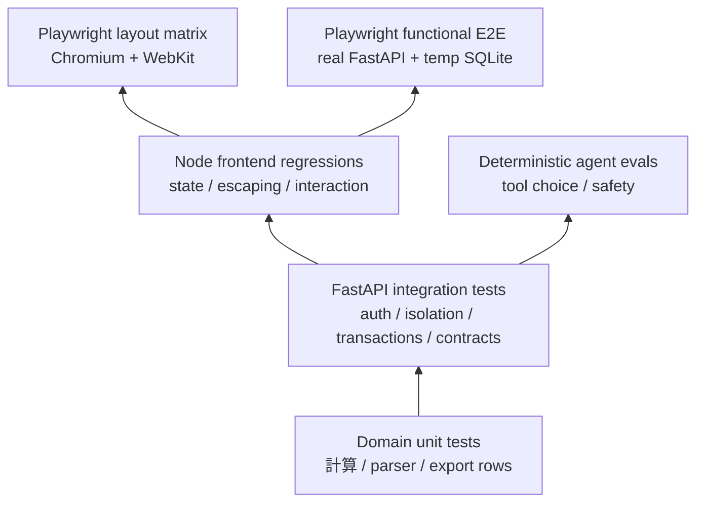
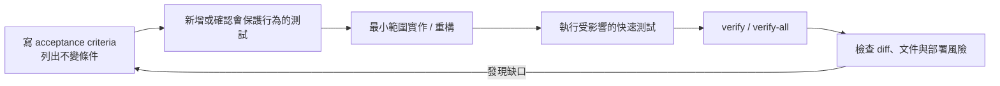

# Test Design Document（TDD）

本文件的 TDD 指 **Test Design Document**。開發流程仍採小步的 test-first／regression-first：
先定義可觀察行為與風險，再實作，最後由 repository harness 與 CI 驗證。

## 1. 測試目標

- 防止帳號隔離、里程交易、備份安全與 API contract 回歸。
- 讓純重構可以證明「程式位置改變，但使用者行為沒有改變」。
- 外部服務不穩定或無網路時，核心測試仍保持確定性。
- 用較少、較快的測試涵蓋多數邏輯，再用 API 與版面測試保護整合邊界。

## 2. 測試層級

下層測試數量較多、速度較快；上層只保留跨模組或瀏覽器才看得到的風險。

## 3. 需求到測試的追蹤矩陣

| 品質需求 | 主要驗證 | 失敗代表 |
| --- | --- | --- |
| 帳號資料隔離 | API tests + security regressions | query 缺少 user scope 或 authorization |
| 帳號切換非同步隔離 | Node transport tests + Chromium/WebKit session E2E | 舊洞察、AI history/retry 或 401 回填／清除新 session |
| 跑步／鞋款／月跑量一致 | transaction 與 edge-case tests | partial commit、差額或 optimistic lock 錯誤 |
| 匯出與備份安全 | export API tests | 格式、欄位、帳號範圍或 secret 洩漏回歸 |
| AI 工具安全與選擇 | agent evals + mocked stream tests | prompt/tool policy 或 fallback 回歸 |
| 前端互動與 XSS 防護 | Node regression tests | state、escaping、分頁或錯誤處理回歸 |
| 固定跑步日誌首頁 | Node startup/lifecycle + Chromium/WebKit SPEC-015 + PWA offline navigation | 舊 activeTab 還原、重開後 agent-mode 殘留、ARIA／手機標籤不同步，或誤清登入與主題 |
| 響應式版面 | Playwright matrix | 特定引擎、尺寸、主題出現重疊／溢出 |
| 元件對齊契約 | 40 組 Chromium/WebKit 排版設定（SPEC-016）+ Node presentation tests | 日期／數字／選單不同高、混用按鈕密度、模型列錯位、圖表起點或數字表頭邊界不齊；覆蓋六個分頁、三個認證表單、全部彈窗、編輯／停用／錯誤／行內輸入 |
| 瀏覽器核心流程 | Playwright E2E + 暫存 SQLite | UI、HTTP 與 persistence 整合回歸 |
| 購鞋欄位歸屬 | Node rendering + Playwright matrix / E2E（SPEC-011） | 跑鞋／支出表頭錯位、尺寸遺失、編輯或退役後購鞋資訊不同步 |
| 編輯快照與衝突 | Node modal tests + 真實 API browser conflict（SPEC-012） | 重新載入後改錯 ID、用新版本提交舊表單，或舊回應關閉新視窗 |
| 共用 SSE 正確性 | Node chunk/UTF-8/CRLF/cancel tests + Chromium/WebKit mock streams | 中斷當成功、錯誤答案進入歷史、重試重複上下文、月報狀態不一致 |
| 退役預估一致性 | `test_forecasting.py` + DOM regression | 清單／分析使用不同公式、預估跨帳號或 N+1 查詢 |
| 按需呈現 | Node render invalidation + browser request/chart counters | 隱藏分頁建立圖表／讀年度日誌、重複繪製或晚到回應重畫隱藏頁 |
| 登入操作與跑鞋視窗競態 | Node + Chromium/WebKit SPEC-013 | 重複登入、舊成功／錯誤覆蓋新 session，或鞋款 mutation 關閉新草稿 |
| 月報時區一致性 | Python UTC serializer / GET / history + browser local formatting | SQLite 無時區值誤作本地時間，讀取與完成時間相差 8 小時 |
| Strava worker 隔離 | `test_strava_worker_keeps_event_loop_responsive` + 原 transaction tests | parse/service 在 event loop 執行、worker 停頓時 loop 也停頓，或交易／隔離回歸 |
| 前端責任拆分 | Node single-responsibility / HTML / SW order + 全分頁 browser matrix | 匯出、目標或圖表函式漏載，或功能重新混合 |
| 模組依賴方向 | `architecture-check` | circular dependency 或重複 API route |
| App composition 隔離 | app factory tests | lifespan 誤用正式 database globals 或設定漂移 |
| API contract | method/path snapshot | endpoint 被意外新增、刪除或改名 |
| Runtime module boundary | architecture check + frontend asset/order regressions | router/service 或 plain-script dependency 再次混合 |
| 備份可恢復性 | backup/restore tests | checksum、integrity、retention、安全快照、殘留 WAL 還原或 busy 鎖失效 |
| 異地備份與隔離演練 | mocked Fly CLI + temporary SQLite（SPEC-014） | 半份備份被發布、checksum 缺失／錯誤、schema／資料遺失、輸出落在 Git 或洩漏遠端內容 |
| 真正 PWA 升級 | `frontend-pwa` local HTTP fixture / Chromium + WebKit | 舊 worker 線上遷移失敗、新版 HTTP／MIME 失敗污染舊 HTML、離線無法載入已安裝 shell、刪除其他 cache 或快取 API |
| Coverage floor | branch coverage ≥ 92% | 測試保護範圍明顯退化 |
| SPEC-017 統計唯一來源 | `test_statistics_consistency.py` + Node + Chromium/WebKit SPEC-017 | 50 日誌＋100 手動變成 120%、清單／分析／匯出成本不一致或支出跨時區偏月 |
| SPEC-017 輸入與完整分頁 | Node + 真實 API 205 筆／browser fixture | 空白清零、只計目前頁、刪鞋後丟失日誌彙總、day 篩選越界或跨帳號 |
| SPEC-017 同名消歧義及效能 | 0／1／12 鞋 query budget + ID scope tests | 任選第一雙、洩漏候選或 N+1 SELECT |
| SPEC-017 跨日與對話框 | Chromium/WebKit `frontend_consistency.cjs` | 日期 max 停在昨日、草稿被重設、Tab 逃出彈窗、inert 未解除導致焦點遺失 |
| SPEC-017 功能生命週期 | native module Node + session E2E | 舊新增回應污染新帳號、遺漏 feature cleanup、隱藏支出仍保留舊帳號內容 |
| SPEC-017 生成與依賴方向 | `build_frontend.py --check` + transitive import tests | CSS／HTML／worker 清單漂移，service 間接依賴 FastAPI 或月報反向解析工具 JSON |
| SPEC-017 PWA 更新 | 實際 worker message／controllerchange + `.mjs` MIME failure | 新版未通知、未確認即重載、錯誤 module MIME 污染離線 shell |
| Secret hygiene | `security-check` | tracked files 包含明確 credential 特徵 |
| 文件與實作一致 | `docs-check` + document contract negative fixtures | 測試數／命令過期、壞連結／anchor、缺 spec sections／Owner、Implemented 未勾選 AC 或測試路徑不存在 |
| SPEC-020 配額與注入 | `unit_tests/test_transactional_features.py` | 不同 app 共用錯誤配額、thread/process 競態突破上限、Strava 與手動上限不一致、upload 設定外洩 |
| SPEC-020 草稿與 state | `unit_tests/frontend/run-controller.test.cjs` + `unit_tests/frontend_reliability.cjs` | 舊成功清除新草稿／月份、controller reset 失效、編輯／重送 key 污染新 session |
| SPEC-020 聚合邊界與效能 | `unit_tests/test_run_statistics.py` | 閏年／跨年／未來／空資料／user scope 錯誤，或月報 YTD 查詢數隨月份增長 |
| SPEC-020 寫入邊界 | architecture constraints + 既有 CRUD／衝突／rollback tests | router 重新擁有 mutation，或 services 穿透 HTTP |
| SPEC-021 認證競態 | `unit_tests/test_auth_concurrency.py` | 舊改密碼請求覆寫新密碼、憑證未撤銷，或獨立程序突破註冊容量／同名回 500 |
| SPEC-021 發布資產數量 | `unit_tests/test_docs_harness.py` + docs-check | README 舊數字或新增 module 未被偵測 |

## 4. 開發流程

PWA fixture 凍結 v3.2.2 worker 進行線上 migration，再測試完整新版 worker 的失敗升級／離線恢復；
Chromium 使用 browser offline emulation，WebKit 使用 fixture transport 斷線（避免 emulation 同時阻止 cache navigation）。
WebKit 的 API probe 另外在 HTTP headers 後截斷 body，讀取完整 JSON 並檢查 server 請求計數，避免 headers 前 TCP 中斷讓 fetch 不結束；沒有降低 API 不可從 worker cache 讀取的要求。
兩者都要求 API network failure、舊 shell 完整、新版恢復及實際 cache key／HTML revision 正確；不連正式站，亦不取代 iPhone 實機驗證。
SPEC-017 增加 native runtime MIME 失敗，以及 worker 完整啟用後提示更新但保留舊 document／草稿的斷言。
Node suites 位於 `unit_tests/frontend/*.test.cjs`，由原有入口載入；共享 source/extraction helpers 不註冊測試。
docs-check 統計所有 suite 的測試數，而非只計入口或以字串命中代替數值情境。

純程式碼搬移若已有足夠 API regression，可先確認測試會經過被搬移的 endpoint，再重構；
新功能或修 bug 則必須新增能在舊版本失敗的測試。

## 5. Harness 指令

所有平台都使用同一份 `scripts/task.py`。Unix 以 `python3 scripts/task.py <task>` 呼叫，
Windows 可用 `py -3 scripts/task.py <task>`；本機、Coding Agent 與 CI 不依賴特定 shell，
runner 會自行尋找 Windows 或 Unix 的專案虛擬環境。

| 變更類型 | 最少執行 |
| --- | --- |
| 後端／router | `python3 scripts/task.py test-fast` |
| Agent／tools | `python3 scripts/task.py eval-agent`，再執行 `test-fast` |
| 前端邏輯 | `python3 scripts/task.py frontend-test` |
| 版面 | `python3 scripts/task.py frontend-layout` |
| 真實瀏覽器 CRUD | `python3 scripts/task.py frontend-e2e` |
| 架構邊界 | `python3 scripts/task.py architecture-check` |
| Secret／credential 風險 | `python3 scripts/task.py security-check` |
| 文件／harness | `python3 scripts/task.py docs-check` |
| 跨模組或 release | `python3 scripts/task.py verify`；大改動使用 `verify-all` |

SPEC-020 的明確 traceability 見 `docs/specs/020-transactional-features-and-document-contracts.md`。
並行 quota 測試同時使用獨立 SQLite connections 的 thread 與 spawn process，不能由 Python lock 假裝通過。
原生 controller 的 Node 測試直接 import production module；DOM adapter 與兩引擎延遲 POST 驗證新草稿保留。
新增文件檢查的負面 fixture 覆蓋壞本地連結／anchor、合法 encoded/reference links、缺 sections、未完成 AC 與不存在測試檔。

## 6. Definition of Done

SPEC-019 的 traceability：`test_request_reliability.py` 驗證 transaction／並行相同與衝突 payload、quota replay、user scope、schema 1→2 與年度單一 grouped query；
`frontend/reliability.test.cjs` 驗證 timeout headers/body、GET 有限重試、401／寫入不重試、人工重送 key 與年度 endpoint。
`frontend_reliability.cjs` 在 Chromium／WebKit 的真實 storage event 下驗證跨分頁登出／換帳號與未完成請求取消，另驗證獨立錯誤恢復。
`test_release_check.py` 負面 fixture 拒絕錯版本／hash／MIME／schema／API／匿名授權與失敗 browser subprocess。
`frontend-e2e` 會對自己的真實 ASGI／CORS server 執行 `python3 scripts/task.py release-check --base-url ...`；正式部署後再以相同命令唯讀檢查。
Playwright 使用 `npm ci` 鎖版，CI browser job 使用相符的官方 noble container（SPEC-022），不在 job 內重跑 apt；`test_task_runner.py` 檢查映像版本／完整 gates／診斷上傳。失敗保留 `.artifacts/browser/` 的 screenshot／trace／error，CI 明確允許 hidden files，僅上傳 browser 子目錄並保留 7 天，不包含正式帳號內容。

- Acceptance criteria 與不變條件已寫清楚。
- 新行為或 bug 有 regression test；純重構由既有 contract tests 覆蓋。
- 測試不讀寫正式 `shoes.db`，也不呼叫真實 LLM／搜尋服務。
- Ruff、mypy、architecture-check、security-check、92% branch coverage 與相關測試通過。
- setup、command、API 行為或架構邊界變更時同步 README／SDD／TDD。
- 修改 frontend templates／CSS／assets manifest 後，先 `python3 scripts/build_frontend.py --write`，再驗證產物零漂移。
- diff 不包含 secret、資料庫備份或與需求無關的使用者變更。

## 7. SPEC-023 具名追蹤與診斷 roundtrip

[規格及具名案例](specs/023-feature-operations-and-application-boundaries.md#test-traceability) 覆蓋月跑量新草稿、跨帳號 stale completion、鞋款編輯草稿與版本、nickname escaping／export／migration、服務隔離／rollback 及部分刷新交錯。
新 spec 每個 AC 的 `file::test` 必須由 AST 或 Node literal title 找到；改名／刪除、只引用檔案或越界路徑都有負例，歷史 spec 仍可使用檔案路徑。

`diagnostics-generate` 在不連伺服器的合成 Chromium context 產生刻意 assertion failure，使用與 browser gates 相同的 capture helper 保存 PNG／Playwright trace ZIP／錯誤文字及 SHA-256 manifest。
CI browser job 上傳專用 artifact，`diagnostics-roundtrip` job 下載至 `.artifacts/browser/roundtrip/` 再執行 `diagnostics-verify`；檢查檔案身分、路徑、checksum、PNG magic、ZIP integrity、trace 和錯誤中的合成標記。
這個演練不需要帳號、正式網站或 secrets；真正的 browser regression 失敗仍另傳原本 diagnostics，且仍讓 pipeline 失敗。

## 8. SPEC-024 草稿轉移、資源合併與逾時收尾

[具名追蹤](specs/024-draft-rebase-resource-store-and-browser-deadlines.md#test-traceability) 對應下列風險：

| 風險 | 驗證 |
| --- | --- |
| 退役／現役後再次儲存保留草稿撤銷狀態 | Node 直接執行 ShoeModal，雙向狀態轉移、dirty fields／CAS；`frontend_drafts.cjs` Chromium／WebKit 真實 DOM 延遲退役後儲存暱稱 |
| 目標失焦重繪或晚到成功覆蓋草稿 | Node baseline／acknowledge／reset；雙引擎切主題、延遲儲存期間改值及第二次儲存版本 |
| 同資源重複讀取、舊 session／月份回填 | Native resource store coalescing、mutation invalidation、key／session 失效、只接受一次及成功值快取 |
| 某來源失敗阻擋其他資料或錯誤被隱藏 | Native 及 core adapter tests，獨立成功／錯誤與相關 cache hooks |
| screenshot／trace／close 卡住 | Node 注入永不完成的 promises，以短 deadline 驗證原始文字先落檔及 cleanup 仍繼續 |
| browser 子程序完全停頓 | Python 真實合成 sleep 程序，驗證 timeout 回 124、文字診斷、另開 process group 的 child 也收尾 |
| CI 單一 gate 卡住需全跑 | Workflow contract 驗證三個獨立 jobs、各自 gate／watchdog／取消時產物上傳；PWA artifact 下載驗證內容 |

PWA API probe 10 秒、worker update 外層 20 秒（瀏覽器內 statechange timer 15 秒，與 registration.update 一起等待，避免未處理的 timeout）。
Layout 每引擎 300 秒、PWA 每引擎 120 秒，E2E 真實 CRUD 90 秒／各 feature stage 60 秒，release 每引擎 90 秒。
Trace 啟動 10 秒；失敗 capture 的 screenshot／trace 各 5 秒，context／browser close 各 5 秒。
外層 layout／E2E／PWA／release browser watchdog 分別 660／420／300／240 秒；超時本身屬失敗，不可視為通過。
完全卡死時可能只有 watchdog/error 文字；CI 失敗／取消使用 `always()` 嘗試上傳已有產物，不保證取消的 runner 還能生成 trace。
三個 browser jobs 不互相依賴，僅 `diagnostics-roundtrip` 依賴 `frontend-pwa`。

## 9. SPEC-025 匯入交錯、逐資源交付與 SQL 上界

- Node `strava-resources.test.cjs` 鎖定刪鞋選單的空白 sentinel、Strava 視窗／revision／session、重複匯入、歷史失效與先完成來源的交付；鞋款移動前的暱稱／分類草稿在新版本上再次儲存。
- `frontend_strava_ownership.cjs` 在 Chromium／WebKit 使用合成 API 與可控制的延遲：跨日編輯刪鞋日誌、退役前暱稱草稿、舊匯入成功／失敗遇到替換預覽、同視窗改檔避免重複提交、舊 GET 晚於新歷史，以及慢 goal 不遮住已完成 runs。既有 SPEC-024 等待期間草稿測試保留。
- `test_shoe_analytics_sql_is_bounded_and_user_scoped` 比對每鞋 403 筆合成歷史的完整 totals／distinct days／first-last／30-90 天／12 月／recent12 與單鞋／批次相容性。SQL 固定三次、禁止載入 Run entities；外帳號偽 legacy row、刪鞋及空資料隔離皆檢查。AI 摘要仍維持既有 constant query budget，省略不使用的 detail queries。
- `worker_update.cjs` 用可控制的 EventTarget 測試已在 installing 的 candidate 與 update 卡住的診斷。真實 PWA gate 持有 candidate 資產、先啟動安裝再附加 observer，釋放後驗證啟用；HTTP／MIME／宣告長度截斷／版本不符皆必須拒絕候選安裝並保留舊離線 shell。
- Worker installer Node 測試包含未壓縮截斷拒收、完整回應、無長度及壓縮回應，避免把 wire／decoded 長度混用。失敗 trace、截圖與文字仍先落檔並受限時收尾。
- 具名 AC 對應見 SPEC-025；發布前執行 verify-all，不以重跑或跳過瀏覽器代替通過；正式站 release-check 匿名唯讀。

- v3.7.1 PWA gate 每次 offline→online 前明確呼叫 registration.update，要求 10 秒內失敗。WebKit fixture 的 worker script 回 503，API 回截斷 JSON、其他網路請求仍中斷；測試保留真正的快取離線重載與每種失敗升級，避免一個背景 worker HTTP 重試卡住後續候選。

- v3.7.2 的 goal 首次初始化案例固定持有 switchTab 的第一個 animation frame，在填入 180 並失焦後釋放、切換主題，再驗證儲存。Node 另驗證晚到的 goal resource 不覆寫該草稿；覆蓋首次互動界線，不能只等待初次 render 完成後才測草稿。

## 10. SPEC-026 行內 DOM 與生成順序

- `frontend/resource-editing.test.cjs` 驗證新增表單的刪鞋 sentinel、table DOM 延後替換、原版本提交、session 取消 blur、依資源失效、三種衍生讀取合併／失效，以及 Strava 視窗配對鎖。
- `frontend_resource_editing.cjs` 納入 `frontend-e2e`，在 Chromium／WebKit 以合成 HTTP 與固定時鐘驗證鞋款／月跑量輸入 `1` 時釋放背景 goal、主題及同資源刷新仍無 PUT，完成 `180` 並 Enter 才提交；新增跑步刪鞋、配對成功／失敗，以及 annual pending 在重繪時不重發。
- `test_report_generations.py` 使用獨立 session 與暫存 SQLite，mock text stream；覆蓋兩種完成順序、新生成空內容／model error／未知錯誤／取消、保存失敗、user/month 隔離、並行 writer，以及 schema 3→4 重複升級不改寫既有報告。
- 切換分頁後等待實際 DOM 更新（被刪選項消失），再斷言空選擇；不以 `switchTab` 同步返回推論下一 frame 已完成，也不放寬錯誤鞋款斷言。
- 新版資源 dispatch 在 microtask 前失效時不發 HTTP；session／月份 fixture 等候真正發送後再切換，分別驗證發送前取消及 in-flight 晚到回應。
- `architecture-check` 將月報 router 納入禁止交易／mutation 的檢查；services 不依賴 HTTP／LLM adapter。發布依序要求完整本機驗證、main／tag 全 CI、失敗產物 roundtrip、正式備份隔離還原與部署後匿名 release-check。測試不接觸正式資料或模型。

## 11. SPEC-027 可恢復工作區

| 邊界 | 具名驗證 |
| --- | --- |
| 帳號分區、跨重開草稿、原版本 | `unit_tests/frontend/workspace.test.cjs::SPEC-027 drafts and cached resources stay within their account` |
| 佇列與草稿的原子接收 | `unit_tests/frontend/workspace.test.cjs::SPEC-027 queue acceptance consumes only its draft atomically before a crash` |
| 跨分頁、回應遺失、lease 回收 | `unit_tests/frontend/workspace.test.cjs::SPEC-027 durable queue survives lost responses and competing consumers`、`SPEC-027 leases prevent parallel consumers and recover after a crash` |
| 本機配額失敗、登入過期、刪鞋 | `unit_tests/frontend/workspace.test.cjs` 的 failed persistence／expired auth／missing shoes 案例 |
| 匯出讀取快照、還原原子性、去重、預覽失效、增量來源與 tombstone | `unit_tests/test_account_restore.py`；只使用 `workspace_helpers.py` 暫存 SQLite |
| 里程與復原版本／配額、不可重用主鍵 | `unit_tests/test_history.py` |
| 操作回執、跨連線競態、legacy 相容 | `unit_tests/test_operations.py` |
| 真實離線重開、帳號切換、合併 UI、誤刪復原 | `unit_tests/frontend_workspace.cjs`；`frontend-e2e` 中 Chromium／WebKit 均執行，使用暫存 FastAPI 與合成帳號，真實 IndexedDB／service worker |

`frontend-layout` 自動遍歷全部七個彈窗，資料與同步另填入長訊息／blocked 配對控制項，仍跑 40 組引擎／主題／尺寸設定。`verify-all` 包含完整 PWA 升級／離線 shell 驗證；測試不得連正式站、使用真帳號或寫入工作區 shoes.db。發布仍須另外正式備份、隔離還原、匿名 release-check，通過本機測試不等同已部署。

SPEC-029 更新模式的具名測試見 [資料搬移規格](specs/029-account-data-transfer.md)：覆蓋來源 ID／Strava 辨識、跨鞋款／月份更新、額外資料及跑步 tombstone 保留、配額、模式 hash、舊預覽、交易回滾、月報生成撤銷與 user isolation。雙引擎工作區 E2E 由 UI 實際下載 JSON、匯入至另一合成帳號，修改來源後再以 update 匯入，驗證資料及里程；Node 測試另確認模式／視窗所有權、取消更新與下載失敗回饋。
