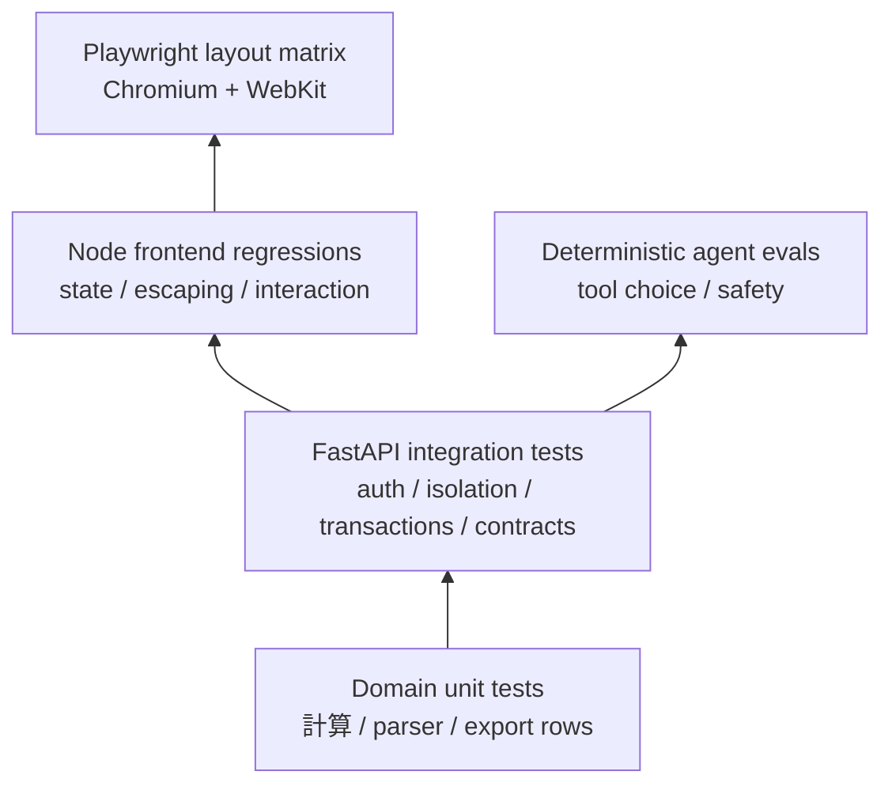
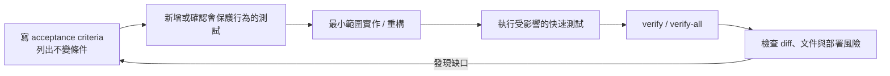

# Test Design Document（TDD）

本文件的 TDD 指 **Test Design Document**。開發流程仍採小步的 test-first／regression-first：
先定義可觀察行為與風險，再實作，最後由 repository harness 與 CI 驗證。

## 1. 測試目標

- 防止帳號隔離、里程交易、備份安全與 API contract 回歸。
- 讓純重構可以證明「程式位置改變，但使用者行為沒有改變」。
- 外部服務不穩定或無網路時，核心測試仍保持確定性。
- 用較少、較快的測試涵蓋多數邏輯，再用 API 與版面測試保護整合邊界。

## 2. 測試層級

下層測試數量較多、速度較快；上層只保留跨模組或瀏覽器才看得到的風險。

## 3. 需求到測試的追蹤矩陣

| 品質需求 | 主要驗證 | 失敗代表 |
| --- | --- | --- |
| 帳號資料隔離 | API tests + security regressions | query 缺少 user scope 或 authorization |
| 跑步／鞋款／月跑量一致 | transaction 與 edge-case tests | partial commit、差額或 optimistic lock 錯誤 |
| 匯出與備份安全 | export API tests | 格式、欄位、帳號範圍或 secret 洩漏回歸 |
| AI 工具安全與選擇 | agent evals + mocked stream tests | prompt/tool policy 或 fallback 回歸 |
| 前端互動與 XSS 防護 | Node regression tests | state、escaping、分頁或錯誤處理回歸 |
| 響應式版面 | Playwright matrix | 特定引擎、尺寸、主題出現重疊／溢出 |
| 模組依賴方向 | `architecture-check` | circular dependency 或重複 API route |
| API contract | method/path snapshot | endpoint 被意外新增、刪除或改名 |
| 備份可恢復性 | backup/restore tests | checksum、integrity、retention 或安全快照失效 |
| Coverage floor | branch coverage ≥ 92% | 測試保護範圍明顯退化 |
| Secret hygiene | `security-check` | tracked files 包含明確 credential 特徵 |
| 文件與實作一致 | `docs-check` | 測試數、命令、檔案或工具數過期 |

## 4. 開發流程

純程式碼搬移若已有足夠 API regression，可先確認測試會經過被搬移的 endpoint，再重構；
新功能或修 bug 則必須新增能在舊版本失敗的測試。

## 5. Harness 指令

所有平台都使用同一份 `scripts/task.py`。Unix 以 `python3 scripts/task.py <task>` 呼叫，
Windows 可用 `py -3 scripts/task.py <task>`；本機、Coding Agent 與 CI 不依賴特定 shell，
runner 會自行尋找 Windows 或 Unix 的專案虛擬環境。

| 變更類型 | 最少執行 |
| --- | --- |
| 後端／router | `python3 scripts/task.py test-fast` |
| Agent／tools | `python3 scripts/task.py eval-agent`，再執行 `test-fast` |
| 前端邏輯 | `python3 scripts/task.py frontend-test` |
| 版面 | `python3 scripts/task.py frontend-layout` |
| 架構邊界 | `python3 scripts/task.py architecture-check` |
| Secret／credential 風險 | `python3 scripts/task.py security-check` |
| 文件／harness | `python3 scripts/task.py docs-check` |
| 跨模組或 release | `python3 scripts/task.py verify`；大改動使用 `verify-all` |

## 6. Definition of Done

- Acceptance criteria 與不變條件已寫清楚。
- 新行為或 bug 有 regression test；純重構由既有 contract tests 覆蓋。
- 測試不讀寫正式 `shoes.db`，也不呼叫真實 LLM／搜尋服務。
- Ruff、mypy、architecture-check、security-check、92% branch coverage 與相關測試通過。
- setup、command、API 行為或架構邊界變更時同步 README／SDD／TDD。
- diff 不包含 secret、資料庫備份或與需求無關的使用者變更。
