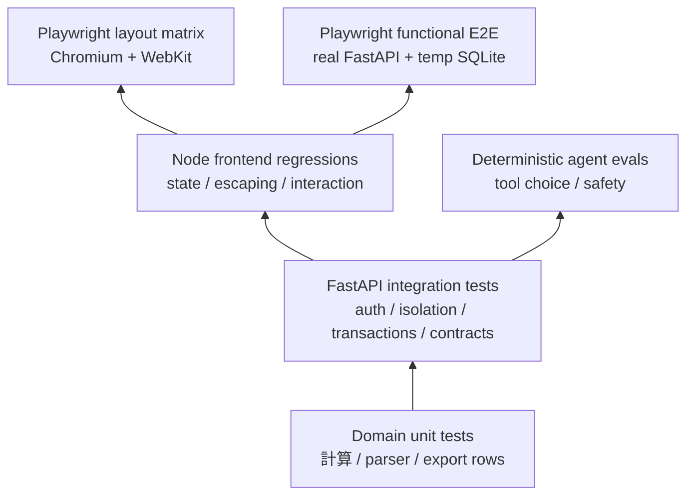
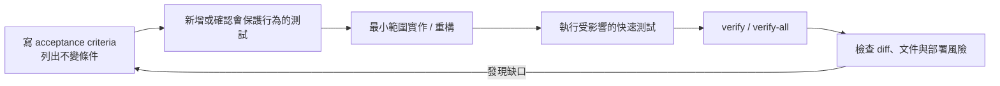

# Test Design Document（TDD）

本文件的 TDD 指 **Test Design Document**。開發流程仍採小步的 test-first／regression-first：
先定義可觀察行為與風險，再實作，最後由 repository harness 與 CI 驗證。

## 1. 測試目標

- 防止帳號隔離、里程交易、備份安全與 API contract 回歸。
- 讓純重構可以證明「程式位置改變，但使用者行為沒有改變」。
- 外部服務不穩定或無網路時，核心測試仍保持確定性。
- 用較少、較快的測試涵蓋多數邏輯，再用 API 與版面測試保護整合邊界。

## 2. 測試層級

下層測試數量較多、速度較快；上層只保留跨模組或瀏覽器才看得到的風險。

## 3. 需求到測試的追蹤矩陣

| 品質需求 | 主要驗證 | 失敗代表 |
| --- | --- | --- |
| 帳號資料隔離 | API tests + security regressions | query 缺少 user scope 或 authorization |
| 帳號切換非同步隔離 | Node transport tests + Chromium/WebKit session E2E | 舊洞察、AI history/retry 或 401 回填／清除新 session |
| 跑步／鞋款／月跑量一致 | transaction 與 edge-case tests | partial commit、差額或 optimistic lock 錯誤 |
| 匯出與備份安全 | export API tests | 格式、欄位、帳號範圍或 secret 洩漏回歸 |
| AI 工具安全與選擇 | agent evals + mocked stream tests | prompt/tool policy 或 fallback 回歸 |
| 前端互動與 XSS 防護 | Node regression tests | state、escaping、分頁或錯誤處理回歸 |
| 固定跑步日誌首頁 | Node startup/lifecycle + Chromium/WebKit SPEC-015 + PWA offline navigation | 舊 activeTab 還原、重開後 agent-mode 殘留、ARIA／手機標籤不同步，或誤清登入與主題 |
| 響應式版面 | Playwright matrix | 特定引擎、尺寸、主題出現重疊／溢出 |
| 元件對齊契約 | 40 組 Chromium/WebKit 排版設定（SPEC-016）+ Node presentation tests | 日期／數字／選單不同高、混用按鈕密度、模型列錯位、圖表起點或數字表頭邊界不齊；覆蓋六個分頁、三個認證表單、全部彈窗、編輯／停用／錯誤／行內輸入 |
| 瀏覽器核心流程 | Playwright E2E + 暫存 SQLite | UI、HTTP 與 persistence 整合回歸 |
| 購鞋欄位歸屬 | Node rendering + Playwright matrix / E2E（SPEC-011） | 跑鞋／支出表頭錯位、尺寸遺失、編輯或退役後購鞋資訊不同步 |
| 編輯快照與衝突 | Node modal tests + 真實 API browser conflict（SPEC-012） | 重新載入後改錯 ID、用新版本提交舊表單，或舊回應關閉新視窗 |
| 共用 SSE 正確性 | Node chunk/UTF-8/CRLF/cancel tests + Chromium/WebKit mock streams | 中斷當成功、錯誤答案進入歷史、重試重複上下文、月報狀態不一致 |
| 退役預估一致性 | `test_forecasting.py` + DOM regression | 清單／分析使用不同公式、預估跨帳號或 N+1 查詢 |
| 按需呈現 | Node render invalidation + browser request/chart counters | 隱藏分頁建立圖表／讀年度日誌、重複繪製或晚到回應重畫隱藏頁 |
| 登入操作與跑鞋視窗競態 | Node + Chromium/WebKit SPEC-013 | 重複登入、舊成功／錯誤覆蓋新 session，或鞋款 mutation 關閉新草稿 |
| 月報時區一致性 | Python UTC serializer / GET / history + browser local formatting | SQLite 無時區值誤作本地時間，讀取與完成時間相差 8 小時 |
| Strava worker 隔離 | `test_strava_worker_keeps_event_loop_responsive` + 原 transaction tests | parse/service 在 event loop 執行、worker 停頓時 loop 也停頓，或交易／隔離回歸 |
| 前端責任拆分 | Node single-responsibility / HTML / SW order + 全分頁 browser matrix | 匯出、目標或圖表函式漏載，或功能重新混合 |
| 模組依賴方向 | `architecture-check` | circular dependency 或重複 API route |
| App composition 隔離 | app factory tests | lifespan 誤用正式 database globals 或設定漂移 |
| API contract | method/path snapshot | endpoint 被意外新增、刪除或改名 |
| Runtime module boundary | architecture check + frontend asset/order regressions | router/service 或 plain-script dependency 再次混合 |
| 備份可恢復性 | backup/restore tests | checksum、integrity、retention、安全快照、殘留 WAL 還原或 busy 鎖失效 |
| 異地備份與隔離演練 | mocked Fly CLI + temporary SQLite（SPEC-014） | 半份備份被發布、checksum 缺失／錯誤、schema／資料遺失、輸出落在 Git 或洩漏遠端內容 |
| 真正 PWA 升級 | `frontend-pwa` local HTTP fixture / Chromium + WebKit | 舊 worker 線上遷移失敗、新版 HTTP／MIME 失敗污染舊 HTML、離線無法載入已安裝 shell、刪除其他 cache 或快取 API |
| Coverage floor | branch coverage ≥ 92% | 測試保護範圍明顯退化 |
| SPEC-017 統計唯一來源 | `test_statistics_consistency.py` + Node + Chromium/WebKit SPEC-017 | 50 日誌＋100 手動變成 120%、清單／分析／匯出成本不一致或支出跨時區偏月 |
| SPEC-017 輸入與完整分頁 | Node + 真實 API 205 筆／browser fixture | 空白清零、只計目前頁、刪鞋後丟失日誌彙總、day 篩選越界或跨帳號 |
| SPEC-017 同名消歧義及效能 | 0／1／12 鞋 query budget + ID scope tests | 任選第一雙、洩漏候選或 N+1 SELECT |
| SPEC-017 跨日與對話框 | Chromium/WebKit `frontend_consistency.cjs` | 日期 max 停在昨日、草稿被重設、Tab 逃出彈窗、inert 未解除導致焦點遺失 |
| SPEC-017 功能生命週期 | native module Node + session E2E | 舊新增回應污染新帳號、遺漏 feature cleanup、隱藏支出仍保留舊帳號內容 |
| SPEC-017 生成與依賴方向 | `build_frontend.py --check` + transitive import tests | CSS／HTML／worker 清單漂移，service 間接依賴 FastAPI 或月報反向解析工具 JSON |
| SPEC-017 PWA 更新 | 實際 worker message／controllerchange + `.mjs` MIME failure | 新版未通知、未確認即重載、錯誤 module MIME 污染離線 shell |
| Secret hygiene | `security-check` | tracked files 包含明確 credential 特徵 |
| 文件與實作一致 | `docs-check` | 測試數、命令、檔案或工具數過期 |

## 4. 開發流程

PWA fixture 凍結 v3.2.2 worker 進行線上 migration，再測試完整新版 worker 的失敗升級／離線恢復；
Chromium 使用 browser offline emulation，WebKit 使用 fixture transport 斷線（避免 emulation 同時阻止 cache navigation）。
兩者都要求 API network failure、舊 shell 完整、新版恢復及實際 cache key／HTML revision 正確；不連正式站，亦不取代 iPhone 實機驗證。
SPEC-017 增加 native runtime MIME 失敗，以及 worker 完整啟用後提示更新但保留舊 document／草稿的斷言。
Node suites 位於 `unit_tests/frontend/*.test.cjs`，由原有入口載入；共享 source/extraction helpers 不註冊測試。
docs-check 統計所有 suite 的測試數，而非只計入口或以字串命中代替數值情境。

純程式碼搬移若已有足夠 API regression，可先確認測試會經過被搬移的 endpoint，再重構；
新功能或修 bug 則必須新增能在舊版本失敗的測試。

## 5. Harness 指令

所有平台都使用同一份 `scripts/task.py`。Unix 以 `python3 scripts/task.py <task>` 呼叫，
Windows 可用 `py -3 scripts/task.py <task>`；本機、Coding Agent 與 CI 不依賴特定 shell，
runner 會自行尋找 Windows 或 Unix 的專案虛擬環境。

| 變更類型 | 最少執行 |
| --- | --- |
| 後端／router | `python3 scripts/task.py test-fast` |
| Agent／tools | `python3 scripts/task.py eval-agent`，再執行 `test-fast` |
| 前端邏輯 | `python3 scripts/task.py frontend-test` |
| 版面 | `python3 scripts/task.py frontend-layout` |
| 真實瀏覽器 CRUD | `python3 scripts/task.py frontend-e2e` |
| 架構邊界 | `python3 scripts/task.py architecture-check` |
| Secret／credential 風險 | `python3 scripts/task.py security-check` |
| 文件／harness | `python3 scripts/task.py docs-check` |
| 跨模組或 release | `python3 scripts/task.py verify`；大改動使用 `verify-all` |

## 6. Definition of Done

SPEC-019 的 traceability：`test_request_reliability.py` 驗證 transaction／並行相同與衝突 payload、quota replay、user scope、schema 1→2 與年度單一 grouped query；
`frontend/reliability.test.cjs` 驗證 timeout headers/body、GET 有限重試、401／寫入不重試、人工重送 key 與年度 endpoint。
`frontend_reliability.cjs` 在 Chromium／WebKit 的真實 storage event 下驗證跨分頁登出／換帳號與未完成請求取消，另驗證獨立錯誤恢復。
`test_release_check.py` 負面 fixture 拒絕錯版本／hash／MIME／schema／API／匿名授權與失敗 browser subprocess。
`frontend-e2e` 會對自己的真實 ASGI／CORS server 執行 `python3 scripts/task.py release-check --base-url ...`；正式部署後再以相同命令唯讀檢查。
Playwright 使用 `npm ci` 鎖版；失敗保留 `.artifacts/browser/` 的 screenshot／trace／error，CI 上傳 7 天，不包含正式帳號內容。

- Acceptance criteria 與不變條件已寫清楚。
- 新行為或 bug 有 regression test；純重構由既有 contract tests 覆蓋。
- 測試不讀寫正式 `shoes.db`，也不呼叫真實 LLM／搜尋服務。
- Ruff、mypy、architecture-check、security-check、92% branch coverage 與相關測試通過。
- setup、command、API 行為或架構邊界變更時同步 README／SDD／TDD。
- 修改 frontend templates／CSS／assets manifest 後，先 `python3 scripts/build_frontend.py --write`，再驗證產物零漂移。
- diff 不包含 secret、資料庫備份或與需求無關的使用者變更。
